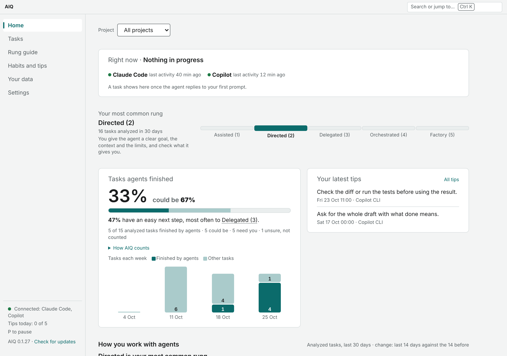
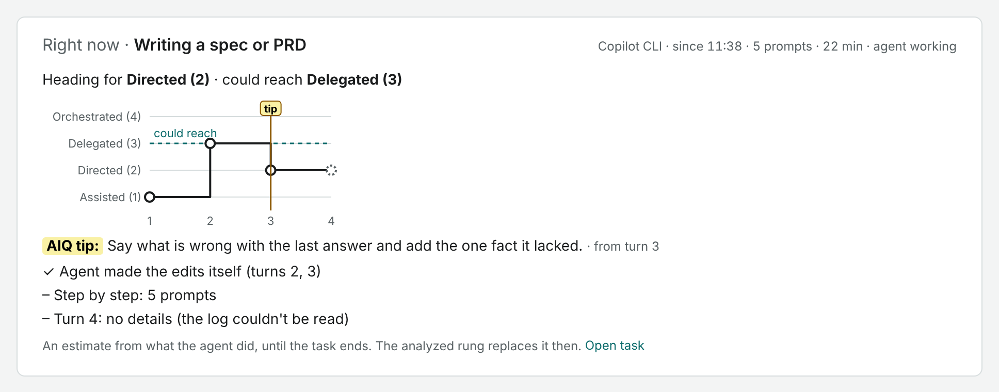
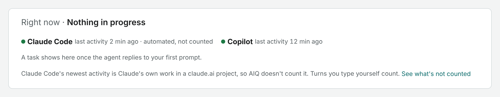
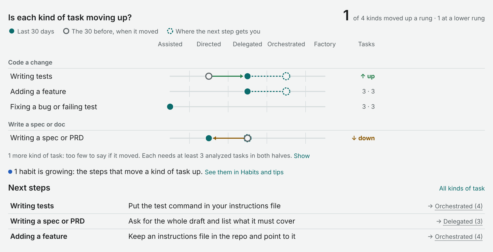
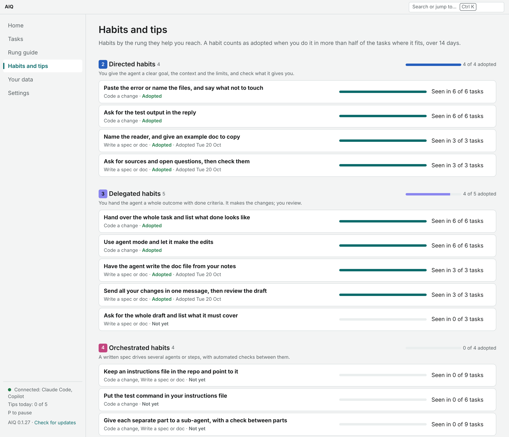
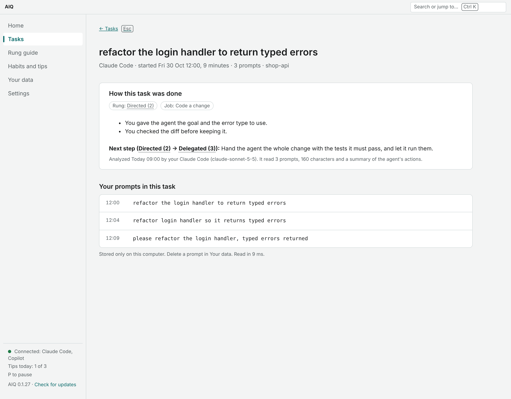
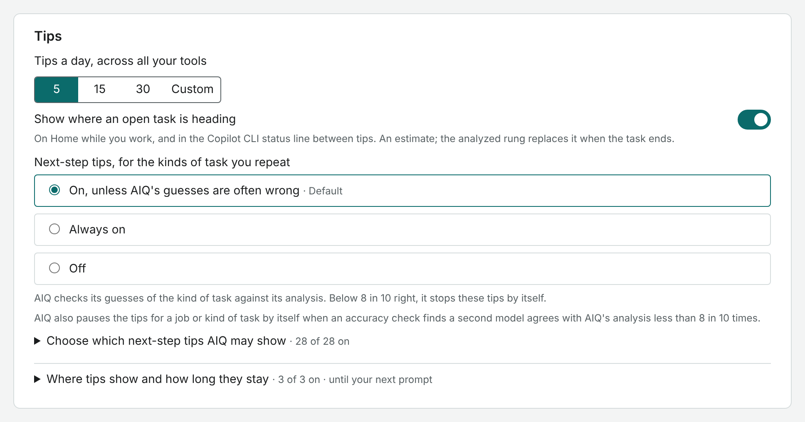
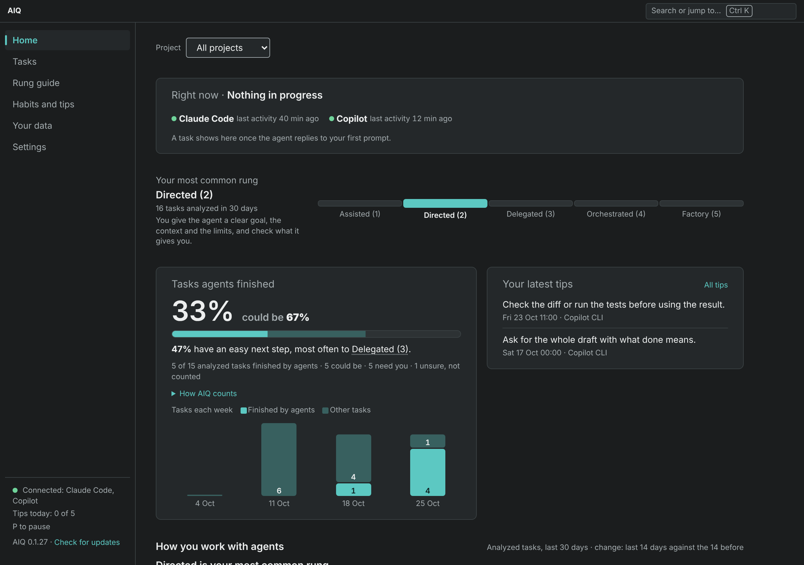

# AIQ

A private coach for how you work with AI agents. AIQ learns from how you work in Claude Code, GitHub
Copilot CLI and VS Code, on your own computer. It shows where each kind of task sits on a five-rung ladder,
which habits would move it up, and, at a natural pause, one short tip. Your prompts stay on your computer.
What does go out (analysis calls through your own Copilot or Claude Code, and a daily update check) is in
[AIQ privacy and terms](docs/privacy-and-terms.md).

Windows, private alpha. Download the latest release from
[Releases](https://github.com/imransargusingh/AIQ/releases/latest).



*All screenshots use made-up example data.*

## The ladder

AIQ places each task on one of five rungs, from how you and the agent worked together:

| Rung | What it looks like |
|---|---|
| **Assisted (1)** | You ask AI for answers or pieces, and you do the work. |
| **Directed (2)** | You give the agent a clear goal, the context and the limits, and check what it gives you. |
| **Delegated (3)** | You hand the agent a whole outcome with done criteria. It makes the changes; you review. |
| **Orchestrated (4)** | A written spec drives several agents or steps, with automated checks between them. |
| **Factory (5)** | A saved, versioned workflow runs the work, for you and for others. |

Tasks are grouped into kinds (writing tests, fixing a bug, writing a spec, and so on) under four jobs:
Code a change, Write a spec or doc, Ask or research, and Run or ship it. AIQ coaches a kind of task once it
has seen at least three of them in 30 days. Success is a kind of task you repeat moving up a rung.

## What you see

### AIQ home

The desktop app. It reads your own store on this computer and nothing else.

**Right now.** While you work, the card shows the open task, the rung it is heading for, and where a tip
landed. It is an estimate from what the agent did; the analyzed rung replaces it when the task ends.



When nothing is open, the card stays and lists each connected tool with its last activity. Work an agent did
on its own (for example Claude working in a claude.ai project) shows as **automated, not counted**, so you
can tell "nothing in progress" from "AIQ has heard nothing". Turns you type yourself always count, on any
device.



**Is each kind of task moving up?** The last 30 days against the 30 before, per kind of task, with a check
that a move is more than chance. A line underneath says which habits are growing and which you use less
often lately, and links to them. **Next steps** names the one habit that would move each kind up.



**Habits and tips.** Habits grouped by the rung they help you reach. A habit counts as adopted when you do it
in more than half of the tasks where it fits, over 14 days.



**Tasks.** Every task, its rung, why, and the next step, with your prompts kept only on this computer. You can
delete any prompt in **Your data**.



**Settings.** Tips a day across all your tools (5, 15, 30 or your own number; default 5), where tips show and
how long they stay, which next-step tips AIQ may show, background analysis, updates and connected tools.



Home also has a one-minute tour on example data (Ctrl K, then "Take the tour"), and light, dark and
high-contrast themes.



### Tips in your tools

At most one tip at a natural pause, never more than your daily number, with 30 quiet minutes between tips and
no repeat of the same tip within 72 hours. Tips start with a yellow **AIQ tip:** label.

- **Copilot CLI**: a status line under the prompt. Between tips it shows where the open task is heading:

  ```
  AIQ: heading for Directed (2) so far · could reach Delegated (3) · turn 4
  AIQ tip: this request went round 3 times. The agent may need one new detail · aiq show
  ```

- **Claude Code**: a short card under Claude's reply:

  ```
  AIQ tip: this looks like fixing a bug. The goal and limits up front help the agent.
  Try this: paste the exact error or failing test, name the files it touches, and say what must not change.
  Details: aiq show  ·  Turn off tips for now: aiq pause
  ```

- **VS Code**: a notification after a Copilot agent-mode turn, only while the window has focus, with
  **Try this**, **Helpful**, **Not helpful**, **Snooze 7 days** and **Don't show again**.

**Team tips (optional).** A team can keep a `team-tips.toml` file that names a tool to try for a habit. When
a habit tip shows, a **Tool to try** line rides with it on Copilot CLI, VS Code and Home (not Claude Code).
Add it with `aiq team-tips add <folder>`; `aiq team-tips check` lists which habits it covers.

## Install (Windows)

1. Download `aiq-<version>-windows-x64.zip` from [Releases](https://github.com/imransargusingh/AIQ/releases/latest)
   and unzip it.
2. Double-click `install.cmd`, or run `powershell -ExecutionPolicy Bypass -File .\install.ps1` in a normal
   (not administrator) window.

The installer copies AIQ to `%USERPROFILE%\.aiq\bin`, adds it to your user PATH, adds an AIQ Start menu
shortcut, connects every AI tool it finds (Claude Code, Copilot CLI, VS Code) and lists each file it changed.
Then it adds your past sessions and opens AIQ home. The status bar shows what is connected, for example
**Connected: Claude Code, Copilot**.

**Updates.** AIQ checks for a new release once a day (and Home every 15 minutes while open). By default it
installs a waiting update by itself while AIQ is idle, then starts again. Change this with
`aiq config set update <auto|ask|off>` or in Settings.

**Undo.** `aiq uninstall --all` disconnects AIQ from every tool and keeps your data; `aiq forget --all`
deletes everything AIQ stored.

## Use

```
aiq status                  # what AIQ is doing, tips today, store size, hook times
aiq show [card-id]          # a tip, why it showed, and the prompts it counted (no id: the latest)
aiq progress                # each kind of task's typical rung now against before
aiq tips                    # each next-step tip, whether it is on, and how often it would show
aiq pause | aiq resume
aiq config set daily-cap 5  # most tips a day, all tools together (0-50)
aiq include <folder>        # count a folder again that AIQ marked automated, not counted
aiq import --dry-run        # count your past Claude Code / Copilot CLI sessions; aiq import adds them
aiq export [<folder>]       # copy everything AIQ stored to plain JSON files
aiq forget --imported       # delete only what aiq import added
aiq forget --all            # delete everything AIQ stored on this machine
aiq install | aiq uninstall --all
aiq help                    # every command
```

**Where data lives:** `%USERPROFILE%\.aiq` on Windows; `~/.local/share/aiq` on Linux and macOS. Files are
readable only by you. Prompts are stored unencrypted for now (see
`docs/notes/note-20261031-encryption-deferred.md`). Logs never contain prompt text.

## Build

Rust 1.89 or later. No other tools are needed for the core (the store is plain SQLite, compiled in).

```
cargo build -p aiq --release      # target/release/aiq (aiq.exe on Windows)
cargo test --workspace            # unit, store, spool-replay property and end-to-end tests
```

**AIQ home** (Tauri + React, `apps/home`) needs Node 22 as well:

```
cd apps/home && npm ci
npm test && npm run build && npm run e2e   # unit, then UI end-to-end, keyboard and axe checks
npm run readme-shots                       # refresh the screenshots in this README (example data only)
npx tauri build --no-bundle                # src-tauri/target/release/aiq-home(.exe)
```

CI builds and tests on Linux and Windows (`.github/workflows/rust.yml`, `home.yml`). A version tag builds the
Windows zip and `SHA256SUMS` into a draft release (`release.yml`); nothing is public until someone presses
Publish.

`overrides` in `apps/home/package.json` holds build-tool packages one release back, because some npm mirrors
lag public npm and `npm ci` fails if the lockfile names a version the mirror lacks. Remove an override once
the mirror has the newer version.

## Layout

| Path | What |
|---|---|
| `crates/aiq-contracts` | Event, card and local-API formats, pack schema, error codes |
| `crates/aiq-domain` | Pure logic: tasks, rungs, habits, tip triggers, card text (no I/O) |
| `crates/aiq-store` | SQLite store: dimensions plus append-only facts, migrations |
| `crates/aiq-core` | The background core: hooks in, tips out, analysis, updates, team tips, bundled pack |
| `crates/aiq-home` | Read model: one snapshot of the store (read-only) for the desktop app |
| `crates/aiq-statusline` | The small Copilot CLI status-line program |
| `crates/aiq` | The `aiq` binary: hook client, core, CLI |
| `apps/home` | AIQ home: React UI (`src`), Tauri shell (`src-tauri`), UI tests (`tests`) |
| `extensions/vscode` | The VS Code extension that shows tips after a Copilot agent turn |
| `packaging/windows` | `install.ps1`, `install.cmd`, `upgrade.ps1` |
| `site/` | The public landing page |
| `docs/` | Specs, architecture, ADRs, designs, privacy and terms |
