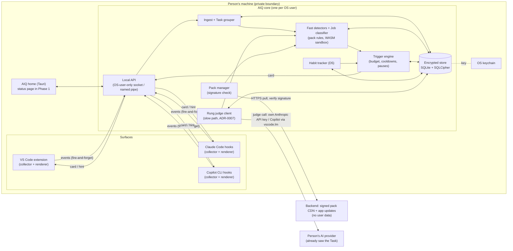

# Architecture: AIQ

Produced with AI-Forward `/define-architecture` (v2026.10.19.4), run with Imran.
Answers to: [coaching-loop spec](specs/coaching-loop.md) (D1–D7, US-1–US-7, NFRs) and the AIQ brief
and Design > Implementation tab (https://claude.ai/artifact/6PhqpuQvWMcU6xBD7rBbRw).

## Context & constraints
Requirements this architecture must meet (quoted from the spec and brief):
- **Privacy (D4, US-6):** only the person can see their data; nothing leaves the device in normal
  operation except pack and update checks; AIQ never writes to shared systems.
- **Never in the way (NFR Reliability, Performance):** collectors add ≤ 50 ms p95 to any hook and fail
  open if the core is down; core idle CPU < 1%, RSS < 150 MB.
- **In the moment (US-1):** show/hold/drop decision ≤ 2 s p95 from the triggering event.
- **One budget per person (Surface parity, US-2):** interruption budget and cooldowns are shared
  across all surfaces and survive a core restart.
- **Job, not title (D7):** each Task is classified by Job; packs are per Job; roles are presets.
- **Tunable without a release (NFR Maintainability, D5):** detectors, tips, thresholds and caps are
  pack data.

Out of the boundary: org/manager views (never), browser and closed-app collectors (Beta), sync relay,
aggregates service and helper directory (Platform phase), AIQ home views beyond a status page.

## System sketch (stocks, flows, loops, delays)
- **Stocks:** the event log (append-only), Tasks, Signals, cards shown, feedback, Habit tracks,
  per-person budget counters, installed packs.
- **Flows:** hook/extension events → core → Signals → card decision → renderer → feedback → ranking
  and Habit tracks.
- **Feedback loops:** feedback tunes ranking and suppression (balancing: fewer unwanted tips);
  adoption feeds milestones (reinforcing); the interruption budget caps the loop (balancing).
- **Delays:** fast path seconds; slow path (rung model) minutes; adoption 14 days (D5).

Candidate shapes considered:
1. **Local core + thin collectors (chosen).** One process owns state; collectors are dumb pipes.
2. **Smart collectors, no core.** Each extension/hook keeps its own state. Rejected: the budget and
   Habit tracks must be shared across surfaces (parity rule); duplicated logic in TS, hook scripts
   and Kotlin.
3. **Cloud service with per-user encryption.** Rejected: the server would see data in use; breaks
   D4 and the "nothing leaves the device" criterion.

**Leverage point:** the collector contract (ADR-0005). If collectors can block or leak, nothing else
fixes it; if they are fail-open, fire-and-forget pipes, everything else can evolve behind them.

## Archetype & rationale
- **Primary: LOA F — Copilot Aside Hot Path.** The person's IDE and agents are the hot path; AIQ
  must add no latency and never mutate it. AIQ is a parallel advisory channel.
- **Composed with G — Continuous Sentinel** (ongoing observation against habit rules, carrying state
  across sessions) and **A — Cascade Pipeline** inside it (T0 rules first, T2 model only for the
  slow path).
- **Rejected:** H Long-Horizon Agent (AIQ takes no actions), C Tool-Mediated Constructor (no
  artifacts built), D Grounded Synthesizer (no corpus synthesis in Phase 1), B Adversarial Ensemble
  (cost too high for advisory tips).

## Capability-tier allocation
| Work | Tier | Why |
|---|---|---|
| Event normalisation, Task grouping, fast detectors (Opportunities 1–3, 5), budget, cooldowns, D5 adoption rule | **T0** deterministic | Must decide in ≤ 2 s and be explainable (P1, P2) |
| Job classification (D7) | **T0 rules first; T3 judge as fallback** below confidence 0.7 | Phase 0 spike (PR #2, synthetic): model 93–98% with a 300-char excerpt vs 77–80% signals-only. Inferred until the real-data week |
| Rung and potential-rung judgement, slow-path Opportunities 4 and 6 | **T3 places the rung, T0 floors and guardrails**: frontier model through the **person's own account** (ADR-0007) places it; log/repo-verifiable facts set a floor for Orchestrated and Factory; guardrails lower it, low priority, ≤ 60 s p95 after a Task closes | Owned by the rung-model spec; never on the fast path; queues (never reroutes) when offline or signed out |

## Component map & boundaries

Trust boundaries (detail in the [threat model](security/threat-model.md); data in the [privacy review](security/privacy-review.md)): B1 surface → core API;
B2 pack content → core; B3 core → backend; B4 store at rest; B5 core → the person's AI provider (judge calls).

## Contracts at the seams
| Seam | Contract | Source | Confidence |
|---|---|---|---|
| Claude Code → collector | Command hooks on SessionStart, UserPromptSubmit, PreToolUse, PostToolUse, Stop; JSON on stdin; `systemMessage` is shown to the user; `additionalContext` goes to the model (AIQ must **not** use it: coaching is for the person, not the agent); `"async": true` runs a hook in the background; default command timeout 600 s, so the collector enforces its own 50 ms budget | https://code.claude.com/docs/en/hooks; Phase 0 hook probe | **Verified by running** (2.1.316, headless): async hooks never block; Stop `systemMessage` renders to the person; payloads sufficient for Task grouping. TUI rendering not yet checked |
| Copilot CLI → collector | Hooks in `.github/hooks/*.json` (repo) or `~/.copilot/hooks/` (user): sessionStart, userPromptSubmitted, preToolUse, postToolUse, agentStop, sessionEnd and others; command hooks can print `{"type":"progress","message":…}` lines to the CLI timeline, `"temporary": true` for a transient line; default timeout 30 s | https://docs.github.com/en/copilot/reference/copilot-cli-reference/cli-hooks-reference | Verified by reading docs; **not run** (Phase 0 spike) |
| VS Code → extension | Extension API: notifications, status bar, webview views; agent/chat events where exposed | VS Code extension API docs | Flagged: which chat/agent events are observable must be spiked |
| Collector → core | Versioned JSON Schema event (`aiq.event.v1`), at-least-once, idempotent by `event_id` (UUIDv7) | ADR-0005 | Decided |
| Core → renderer | Coaching card schema (`aiq.card.v1`): noticed, why, try_this, evidence_ref, card_id | ADR-0005 | Decided |
| Pack → core | Signed pack (detectors as data, optional WASM), thresholds, caps, tips | ADR-0006 | Decided |
| Local git (read-only) | Diffs to compare agent edits with what landed (F2); repo metadata as counts: workflow file versioned, distinct author count, CI/others' run counts (F9). Local `git` only, never hosting APIs; counts stored, not names | rung-model spec PR #3 | Decided; command set to design in /design-slice |
| Session stores (read-only) | `~/.claude/projects/*.jsonl`, `~/.copilot/session-store.db`, as AI-Forward `session-profile.py` reads them | AI-Forward repo | Inferred; undocumented formats, owned by the Phase 0 spike thread |

## Cross-cutting concerns
- **Identity:** one core per OS user; the local API accepts only that user (socket file mode 0600 /
  named-pipe ACL), and every request carries a per-boot token read from a user-only file. No AIQ
  account (P11: no ambient credential; AIQ holds no credentials to any shared system).
- **Idempotency (P8):** every event has `event_id`; ingest is upsert-by-id, so hook retries and
  replay from the spool never double-count. Cards have `card_id`; feedback is keyed by it.
- **Ordering:** events are ordered by (surface session, monotonic seq) not wall clock; Tasks tolerate
  out-of-order arrival within 5 s.
- **Failure modes:** core down → collectors drop to a bounded local spool (≤ 1 MB, user-only file)
  and the tools carry on; renderer failure → card held; corrupt pack → previous pack kept.
- **Observability:** local only. Health page, capture log the person can read, per-component
  counters. **No remote telemetry** (US-6).
- **Judgments are versioned facts:** each rung judgment is stamped with rubric and judge versions and
  appended; re-judging writes a new version. The person's corrections and per-job calibration stay
  local and are never synced.
- **Audit (P10):** every card decision records which rule fired, inputs (by reference), pack version
  and tier; every model call records model, version and tier. Local, viewable, deletable.
- **Privacy controls:** opt-in per surface, pause on every surface, quiet hours, export, delete-all.

## Load-bearing decisions → ADRs
| ADR | Decision | Status |
|---|---|---|
| [0001](adr/0001-local-first-core.md) | Local-first: one core per OS user, thin collectors, stateless backend with no user data | Proposed |
| [0002](adr/0002-durable-representation.md) | Append-only event facts + dimensions in SQLCipher SQLite; raw content kept until the person deletes it | Proposed (retention: Imran) |
| [0003](adr/0003-key-management.md) | Store key only in the OS keychain; no recovery in the alpha | Accepted (Imran) |
| [0004](adr/0004-core-language.md) | Rust core, hook client and Tauri shell; TypeScript extension and UI | Accepted (Imran) |
| [0005](adr/0005-collector-contract.md) | Collectors are fail-open, fire-and-forget, schema-versioned pipes | Proposed |
| [0006](adr/0006-packs-as-signed-data.md) | Packs are signed data; code only in a WASM sandbox; caps and thresholds live in packs | Proposed |
| [0007](adr/0007-rung-judge-via-own-account.md) | Rung judge runs through the person's own account (own Anthropic API key for Claude; Copilot via VS Code's model API); no on-device judge in alpha | Accepted (Imran) |

## Delivery phasing (vertical slices)
| Phase | End-to-end capability | Real | Mocked (seam = contract) | Human validation | Test validation | Unblocks |
|---|---|---|---|---|---|---|
| 1 Walking skeleton | Re-prompt detector (Opp. 1) fires in Claude Code and a card shows as a `systemMessage` at Stop | Claude Code hook collector, core ingest, store, one T0 detector, trigger engine with budget, CLI renderer | Pack = bundled unsigned file; Job classifier returns *Unclassified*; no rung model | Rephrase a prompt 3 times in Claude Code; see one card; second qualifying event in the session is held | E2E: scripted hook payloads → expected card / hold; core killed → hook still exits 0 in ≤ 50 ms | Every later slice |
| 2 | Same loop on Copilot CLI and VS Code; budget shared across surfaces | One user-level Copilot collector (hooks, exec form; CLI and VS Code agent sessions), Copilot CLI status-line renderer (Imran, 2026-11-01), VS Code extension (notification + status bar) | Same as 1 | Trigger on Claude Code, then on Copilot CLI in the same session: second is held; the Copilot tip appears in the status line | E2E per surface + cross-surface budget test | Parity rule |
| 3 | Feedback and Habit tracks (US-4, US-5) | Feedback controls on all surfaces, ranking, D5 tracker, milestone card | Clock is injectable for 14-day windows | Mark "don't show again"; it never returns | Property tests on D5 rule incl. boundary set | Coaching history |
| 4 | Jobs and the two alpha job packs (D7, Opp. 2, 3, 5) | T0 Job classifier, signed pack pipeline, WASM sandbox | Rung model still stubbed | PM-preset user coding gets coding tips | Golden set of labelled Tasks; classifier agreement target | Rung model integration |
| 5 | Slow path (Opp. 4, 6) via the rung model | Judge calls through the person's own account (ADR-0007) | — | Delegation-fit tip at next pause | Rung-model evals (from its spec) | Alpha |
| 6 | Status page, pause, export, delete (privacy controls) | Tauri status page | — | Delete all; capture log empty | E2E delete leaves no rows and no spool | Private alpha |

## LOA conformance check
- C1 tier annotation, C2 budget propagation, C3 receipts: apply to the rung judge client (T3);
  enforced in `/design-slice` of those components.
- C5 side-effect protection, C6 idempotency keys: AIQ's only side effects are local writes and card
  rendering; event and card ids cover C6. AIQ performs no external side effects.
- C7 fallback: every collector has the fail-open fallback; renderer has hold.
- C9 anti-patterns: no model on the hot path (would violate F).
- C10/C11: not a regulated system; SHOULD met by the local audit record; no delegated identity to
  shared systems exists.

## Flagged risks & residual unknowns
- Claude Code hooks verified headless; Copilot CLI hooks and the interactive TUI rendering still unexercised. Probe: Phase 0 spike.
- VS Code: which Copilot Chat / agent events an extension can observe is unknown. Probe: spike.
- Copilot CLI hooks configured at repo level (`.github/hooks/`) are visible to teammates; AIQ must
  install at user level only (`~/.copilot/hooks/`), and Claude Code hooks in user settings, never in
  a repo.
- GitHub Copilot terms for the judge path: no blocker found; confirm against current product terms before alpha (ADR-0007).
- Session-store formats are undocumented and can change. Owned by the Phase 0 spike thread.
- Task grouping and Job classification accuracy unproven (spec risks).

## Status & next action
| | |
|---|---|
| **Completed** | Draft architecture, ADRs 0001–0006, threat model and privacy review |
| **Remaining** | Phases 1–6 above, in order |
| **Best next action** | `/design-slice` for the Phase 1 walking skeleton (Claude Code collector → core → card) |

## Gate record
`GATE define-architecture · 2026-10-31 · Enterprise, Distributed Systems, Security & Identity, Data & Persistence, SRE, Patterns, Simplifier (all seats played by Claude in one session; not independent) · verdict: pass with conditions`
- **Distributed Systems (hard):** at-least-once events need idempotent ingest (event_id upsert) and ordering by session seq; spool replay must not double-count budget. Resolved in cross-cutting concerns. Condition: property test for spool replay in Phase 1.
- **Security & Identity (hard):** local API must reject other OS users and other processes without the per-boot token; pack keys pinned; Anthropic API key only in keychain. Resolved (threat model T-B1-*, T-B2-*, TR-7). Condition: Windows named-pipe ACL and Linux keyring fallback must be spiked before Phase 1 ships. Not cleared by the author for production; recorded.
- **Data & Persistence:** grain declared per fact table in ADR-0002 (one row = one event / one signal / one card decision / one judgment version). Unlimited retention accepted by the owner; size budget needed. Condition: size-per-year estimate in /design-slice.
- **SRE:** the 3 a.m. story is local: health page + capture log + per-component counters; no remote telemetry by design, so field debugging relies on the person sharing a help packet. Accepted.
- **Enterprise / Patterns:** F + G + A composition is coherent; no model on the hot path (C9). Resolved.
- **Simplifier (soft):** six-phase plan and WASM host are the heaviest items; WASM can wait until third-party packs (Phase 4 can ship data-only rules). Recorded as a design-slice option, not a change.
- **Caveat:** independent review recommended before Accepted status (human, or a separate session).
