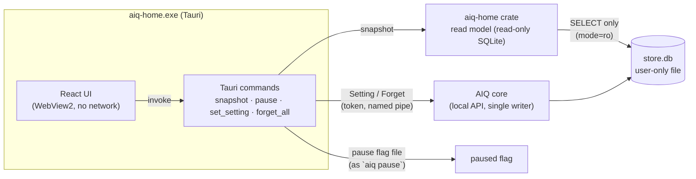

# Design: Phase 3 AIQ home app

Produced with AI-Forward `/design-slice` (v2026.10.19.4). Grounded in `docs/specs/aiq-home.md`
(Parts A–C, Q1–Q6 decided), `DESIGN.md`, the signed-off mockup `docs/mockups/aiq-home.html`
(https://claude.ai/artifact/QmFS15mdqQmETbbXfMoK3s), `docs/architecture.md` and the two earlier slice
designs.

## Goal state

| | |
|---|---|
| **Goal** | The person opens AIQ home on Windows and sees, from their own local data, their tasks, tips and captured data, and can pause, change tip settings and delete everything |
| **Done when** | The app builds for Windows in CI; Home, Tasks, Habits and tips, Your data and Settings render real store data; the keyboard and screen-reader checks pass; a laptop run shows Imran's real data |
| **Not in scope** | The rung judge and anything it feeds (kept rate, rungs, next steps, task-type detail, "This doesn't fit"); setup; delete one item / older than; sharing; quiet hours; installer |
| **Tier** | T2 (new component, new trust-relevant reader of the private store) |

## Grounding: what this design must satisfy

Quoted from the spec and architecture:
- "AIQ home adds **no new aggregate**. It is a set of read views (projections)…" (spec, domain model).
- "Tasks still queued for judging are counted separately and never guessed" (spec, grain).
- "Core down: AIQ home says so and shows the last stored data, never a blank screen" (spec NFR).
- "Home interactive ≤ 1 s after launch … every view reads only the local store" (spec NFR).
- "No network call from any view except the judge … and update checks" (spec NFR, privacy).
- "Keyboard-first: every screen and action reachable from the keyboard; command palette (Ctrl+K)" (spec NFR).
- "Pause is reachable in 1 key (P) from every page, and its state is visible on every page" (spec UX).
- ADR-0004: "Rust core, hook client and Tauri shell; TypeScript extension and UI".
- DESIGN.md §10: "Unavailable judge: views that need it say why and how to connect, and the rest works."

## Drift found, and how it is settled

| # | Drift | Settled as |
|---|---|---|
| G1 | `architecture.md` names Phase 3 "Feedback and Habit tracks" and puts the Tauri status page in Phase 6. The project plan (Imran, "go", 2026-11-01) makes Phase 3 the home app | Recorded deviation: home app first, as read views. Feedback and habits move to a later phase. Architecture phase table updated in this change |
| G2 | The spec's Home and Tasks views are built on judged tasks and task types. No judge and no job classifier exist yet (`AlwaysUnclassified`) | Every judge-fed view gets the "not judged yet" state from the mockup's `judgeOn()=false` state, with copy that says the judge arrives in a later version (no "Connect in Settings": there is nothing to connect yet) |
| G3 | The spec's Tasks page lists **task types**. Task types need the job classifier | Until then the Tasks page lists **tasks** (the Phase 1 Task rule), with "Not classified yet" and "Not judged yet". It becomes the task-type list when Phase 4 lands |

## Decisions (open non-blocking items, settled here)

| # | Question | Decision | Why |
|---|---|---|---|
| D1 | Alpha screen set for this slice | **Home, Tasks, Habits and tips, Your data, Settings**, plus the command palette. Setup, task-type detail and This doesn't fit wait for the judge; delete one / older than and sharing wait for Phase 6 | Ship what real data can fill today; every shipped screen shows real numbers |
| D2 | Default time window | **Last 30 days, 4 weekly columns** (already decided in spec Q3) | Spec |
| D3 | Time-saved estimate | **None; show how often** (spec Q4) | Spec |
| D4 | What the Home card shows with no judge | "Tasks agents finished: not judged yet", the count of tasks seen in 30 days (measured) and **tasks seen per week** as plain columns. The stacked "finished / could finish / needs you" columns and "could be" return with the judge | Honest, measured, and the same place and size, so Phase 5 swaps content, not layout |
| D5 | Rung rows with no judged tasks | The five rows stay, each explaining what the rung means (from `rung-model.md`) and showing "Not judged yet". Rows expand to the meaning | Home must explain the rungs (spec H2); empty bars would teach nothing |
| D6 | How the app reads data | **Directly from the store file, read-only**, for every view. Writes go through the core's local API | One read path that also works when the core is down (spec NFR); the core stays the only writer |
| D7 | Folder per live task | The core adds `folder` (the normalised working folder) to each prompt's `payload_meta` from now on. Older live tasks show "—" | The Tasks page needs "where"; the field is non-content metadata the person already owns. Task types later group by it |
| D8 | Imported tasks (`aiq import`, PR #15) | Shown when the import tables exist, marked "Imported" | Reads `import_session` / `import_event` as PR #15 defines them; absent tables mean none |
| D9 | Theme | Follows Windows: light, dark (`prefers-color-scheme`), high contrast (`forced-colors`) | DESIGN.md modes; no setting needed |
| D10 | Packaging | A separate `aiq-home.exe` (Tauri, WebView2), built in CI. No installer in this slice | Smallest thing Imran can run; installer when AIQ goes to others |

## Responsibility

AIQ home shows the person what AIQ has on them and lets them steer it. It computes nothing that the
core does not already own: tasks are derived with the **same Task rule** the detector uses, through
one shared function.

## Shape

- **`crates/aiq-home`** (new, in the workspace): `snapshot(paths, now) -> Snapshot`. Pure reads.
  Testable on Linux without a webview.
- **`apps/home/src-tauri`** (new, its own Cargo workspace so the core's CI does not need webkit): four
  Tauri commands, each a thin call into `aiq-home` or `aiq-core::ipc`.
- **`apps/home/src`** (new): React + TypeScript, ported from the signed-off mockup's markup and CSS.

## Data model

No new aggregate, no new table, no migration. One additive field.

| Source | Kind | Grain: one row is exactly one… | Read for |
|---|---|---|---|
| `event` (kind `prompt`) | fact | collector event | Tasks (derived), weekly counts, Your data |
| `content` | content | event's raw text | Your data (the person's own prompts) |
| `card_delivery` ⋈ `card_decision` | fact | card handed to a renderer | Tip history, tips today |
| `card_open` | fact | open of one card | Tip history "Opened" |
| `current_setting` | view over fact | setting's latest value | Settings, paused |
| `folder_rule` | fact | folder decision | Set-aside folders line |
| `import_session`, `import_event` (if present) | fact | imported session / turn | Imported tasks |

`event.payload_meta.folder` (new key, D7): writer = core ingest; compute reader = `aiq-home` task
rows. No backfill (a backfill would guess).

### Derived, not stored

| Value | Derivation | Additivity |
|---|---|---|
| Task | `aiq_domain::reprompt::split_tasks`: prompts of one session (or one surface stream for `span_surfaces`), split at gaps over the pack's idle gap. **Same function family as the live detector** (`task_key`, `starts_new_task`) | — |
| Tasks in 30 days | count of Tasks whose first prompt is in the window | additive |
| Tasks per week | count per 7-day bucket, newest last | additive |
| Prompts per task | count of prompts in the Task | additive within a task; never averaged |
| Tips today | deliveries counted today (`deliveries_counted_today`, as the trigger engine counts) | additive |
| Judged / kept / rung | **not derived: no judge**. Exposed as `judged: 0` and `rung: null` | — |

## Change surfaces (E7)

| Surface | Change |
|---|---|
| Store | None (reads only); `Store::open_read_only` |
| Domain | `task_key`, `starts_new_task`, `split_tasks` (shared Task rule; Engine uses the first two) |
| Service | Prompt `payload_meta.folder` |
| Projection / wire | `aiq-home::Snapshot` (serde JSON); Tauri commands |
| Client type | `apps/home/src/types.ts`, checked against a snapshot the Rust crate writes (`examples/fixture.rs`) in the UI tests |
| UI | Five pages, shell, palette, banners, dialogs |
| Compute reader | None new: tips today uses the trigger engine's counting rule |

## Contracts

### Consumed
| Contract | Source | Confidence |
|---|---|---|
| Store schema v1–v3 | `crates/aiq-store/src/schema_v*.sql` | Verified (read) |
| Import schema v4 | PR #15 `schema_v4.sql` | Verified by reading the PR; unmerged, so read defensively |
| Local API frames `Setting`, `Forget`, `Status` | `aiq-contracts::frames` | Verified (read; used by `aiq` CLI) |
| Pause flag file | `aiq-core::paths::pause_flag`, as `cli::pause` | Verified (read) |
| Tauri 2 commands, capabilities, CSP | Tauri 2.12 docs; built in CI | Verified by building (see Test plan) |

### Exposed
`Snapshot` (JSON, `aiq.home.v1`): `status {core, paused, last_event_ms, read_ms}`, `home {window_days,
tasks_30d, judged, weeks[4], by_tool, set_aside}`, `tasks[]`, `tips[]`, `data {events, prompts,
store_bytes, items[≤500]}`, `settings {daily_cap, copilot_tip_stays}`.

Commands: `snapshot() -> Snapshot`, `pause(on) -> Snapshot`, `set_setting(key, value) -> Result`,
`forget_all(confirm: "forget") -> Result`. `forget_all` refuses anything but the typed word.

## UI and interaction design

Archetype and tokens as DESIGN.md (H1 Windows Fluent Utility Shell). The CSS is ported from the
mockup's design region, harness removed. States per page:

| Page | loading | empty | core down | paused | error |
|---|---|---|---|---|---|
| Home | skeleton | "AIQ is watching quietly" | banner + last stored data | banner + Resume (P) | "AIQ can't open its data" + Try again |
| Tasks | skeleton rows | "No tasks yet" teaching state | banner | banner | same |
| Habits and tips | — | "No tips yet" | banner | banner | same |
| Your data | — | "AIQ has no stored history. Capture is still on." | banner; Delete everything still works (files) | banner | same |
| Settings | — | — | controls disabled, says why | banner | inline message |

Keyboard: `G` then `H/T/B/D/S` to go; `Ctrl+K` palette; `P` pause/resume; `J/K` and Enter in tables;
`Esc` closes layers; single-key shortcuts can be turned off (Settings, kept in local storage). Every
outcome is announced in one `role=status` region. Dialogs trap focus, start on Cancel, return focus.

## Patterns

| Pattern | Why | Simplifier check |
|---|---|---|
| CQRS-lite: read model over the store, commands through the core | Core stays the single writer; reads survive core down | Passes: no second write path, no cache |
| Snapshot per view refresh (one read, whole view model) | 30 days of one person's data is small; one call is simplest | Measured `read_ms`; upgrade to per-page reads if p95 > 150 ms |
| Port the mockup markup into React components | Signed-off design; no UI library | Passes: no component library, no router (hash state) |

`simplify:` no router, no state library, no data-fetch library. Ceiling: five pages and one snapshot.
Upgrade trigger: a page needs its own query or a URL a person can share.

## Error and concurrency model

Reads open SQLite with `SQLITE_OPEN_READ_ONLY` and a 1 s busy timeout. The store runs in WAL mode
(`Store::open_with`, verified by reading), so a reader does not block the core's writes and sees the
last committed state. All reads of one snapshot run in one read transaction, so the numbers on a page
agree with each other. A timeout surfaces as `AIQ-HOME-STORE-READ` with Try again. No write ever
happens through the read connection (`query_only` pragma as a second guard).

## Failure-mode analysis

| Mode | Disposition | Test |
|---|---|---|
| Store file missing (fresh install) | Empty snapshot, empty states | `snapshot_missing_store_is_empty` |
| Store locked by a write | Busy timeout, then error state with code | `snapshot_busy_reports_code` |
| Core down | `core: false`; banner; reads still work; setting changes refused with message | e2e fixture + Rust test |
| Import tables absent | No imported tasks | `snapshot_without_import_tables` |
| Prompt text deleted | Your data shows "(deleted)" | `snapshot_deleted_content` |
| Huge store | Items capped at 500 newest; counts exact | `snapshot_caps_items` |
| Stored text with control characters | Rendered as text by React; never as HTML | UI test with markup in a prompt |

## Adversarial analysis (STRIDE-lite)

| Boundary | Threat | Disposition |
|---|---|---|
| WebView → Tauri commands | **E**: injected script calls commands | Strict CSP (`default-src 'self'`), no remote content, no `dangerouslySetInnerHTML`; capability file allows only the four commands; no fs/shell plugins |
| WebView → network | **I**: prompts leak out | CSP `connect-src ipc: http://ipc.localhost` only; no update checker in this slice |
| App → store | **T**: app corrupts store | Read-only open + `query_only`; writes only via core |
| App → core | **S**: spoofed core | Same named-pipe + per-boot token as the CLI |
| Delete everything | **R/T**: accidental delete | Typed `forget`, checked in the command too, not only in the UI |

## Privacy analysis (LINDDUN-lite)

| Threat | Disposition |
|---|---|
| Disclosure | The app shows the person's own prompts only on Your data, on their own machine; nothing is sent |
| Linkability | No identifiers leave the machine |
| Unawareness | Your data says where the data lives and that it stays until deleted |
| Non-compliance | Delete everything removes store, spool and content (existing `forget`) |

## Telemetry

Local only. `Snapshot.status.read_ms` (measured each read, shown on Your data); the Tauri shell logs
each command's duration and error code to `<data>/home.log` (user-only, capped at 256 KB, rotated
once). No remote telemetry (architecture).

## Test plan

| Directive | Test |
|---|---|
| Unit (Rust) | `split_tasks` boundaries (30 min exact, span surfaces), equals Engine task ids on the same input (property) |
| Integration (Rust) | `aiq-home` snapshot over a seeded store: tasks, weeks, tips, data, settings, missing store, busy, deleted content, import tables, cap |
| Contract | Rust writes `fixture.json` from a seeded store; the UI e2e loads it, so a field rename fails the UI test |
| UI e2e (Playwright) | Each page renders fixture data; empty, core-down, paused states; palette; G-keys; P; delete dialog focus trap and typed confirm |
| Accessibility | axe-core on every page in light, dark, forced-colours: 0 violations |
| Performance | Snapshot on a seeded 30-day store (5,000 prompts): `read_ms` p95 ≤ 150 ms in the test |
| Build | CI builds `aiq-home.exe` on `windows-latest`, uploads it |
| Laptop | Run on Imran's laptop against his real data folder; screenshot each page; keyboard pass |

## Conformance notes

- No model call anywhere in the app (LOA C9 holds; no T3 component).
- No new trust boundary beyond the shell's WebView → command bridge, covered above.

## Flagged risks

- Live tasks before this change have no folder. *Accepted* (no backfill).
- PR #15's import schema may still change before merge; the reader checks table and column presence. *Flagged*, thread told.
- The Task rule (one session, idle gap 30 min) is the Phase 1 rule; grouping accuracy on real data is unproven (architecture risk). *Inherited.*
- The keyboard and screen-reader check in the real WebView2 is a laptop check; CI runs axe in Chromium, which is close but not the same engine build. *Flagged.*

## Gate record

`GATE design-slice · 2026-11-01 · Patterns, Simplifier, Test Architect, Security, Data & Persistence, UX & Accessibility (seats played by Claude in one session; not independent) · verdict: pass with conditions`
- **Data & Persistence (hard):** no new aggregate; Task derived by the shared rule; judged/kept not invented. Pass.
- **Security (hard):** CSP, capability allow-list, read-only store, typed confirm checked server side. Pass; condition: CSP verified in the built app, not only in config.
- **Test Architect (hard):** contract test across Rust and TS; a11y floor automated. Pass.
- **Simplifier:** no router, no UI library, one snapshot. Pass.
- **UX & Accessibility:** states complete per page; real WebView2 keyboard and screen-reader check owed on the laptop.
- Independent review recommended before Accepted.

## Status and next action

| | |
|---|---|
| **Completed** | Design |
| **Remaining** | Build, tests, CI Windows build, laptop check |
| **Best next action** | `/implement` this design |
