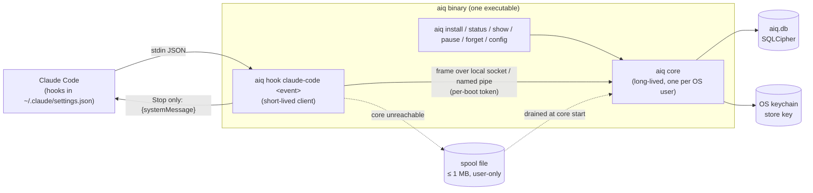

# Design: Phase 1 walking skeleton on Claude Code

- **Status:** Draft
- **Spec / architecture:** [docs/specs/coaching-loop.md](../specs/coaching-loop.md) · [docs/architecture.md](../architecture.md) · ADR [0002](../adr/0002-durable-representation.md), [0003](../adr/0003-key-management.md), [0004](../adr/0004-core-language.md), [0005](../adr/0005-collector-contract.md)
- **Delivery phase / vertical slice:** Phase 1 "Walking skeleton" (architecture, Delivery phasing).
  Real: Claude Code hook collector, core ingest, store, one fast detector (Opportunity 1,
  re-prompting), trigger engine with budget, CLI renderer. Mocked behind contracts: the pack (a
  bundled, unsigned file behind the `PackSource` seam), the Job classifier (always *Unclassified*
  behind the `JobClassifier` seam), no rung model.
- **Author(s) / date:** Imran (owner), drafted with Claude via `/design-slice`, 2026-10-31.

## Grounding: what this design must satisfy

Quoted from the accepted artifacts. If this design and these disagree, these win.

| Source | Statement this design must meet |
|---|---|
| Architecture, Phase 1 | "Re-prompt detector (Opp. 1) fires in Claude Code and a card shows as a `systemMessage` at Stop." Human check: "Rephrase a prompt 3 times in Claude Code; see one card; second qualifying event in the session is held." Test check: "scripted hook payloads → expected card / hold; core killed → hook still exits 0 in ≤ 50 ms." |
| Spec, Opportunity 1 | "Re-prompting the same request 3+ times without adding new information." Any job, fast path. |
| Spec, US-1 | Decide show / hold / drop "within 2 s (p95) of the triggering event"; below the pack's confidence threshold, "held … or dropped, never shown mid-task". |
| Spec, US-2 | One in-the-moment card per session; daily cap is the person's setting, default 5, reset at the next local day; shown only after the agent turn ends; nothing shown and nothing captured while paused. |
| Spec, US-3 | Each card has one "What we noticed" sentence citing the person's own activity, one "Why it matters", one "Try this", and an evidence link. |
| Spec, US-6 | No event, signal, card or feedback leaves the device. |
| ADR-0002 | Append-only facts plus dimensions in one SQLCipher store per OS user; current state is derived; raw content in a separate `content` table, kept until the person deletes it. |
| ADR-0003 | Store key only in the OS keychain; no recovery in the alpha. |
| ADR-0004 | Rust for the core and the hook client. |
| ADR-0005 | Never block, never decide, never write `additionalContext`; 20 ms connect+write; observation hooks async; only Stop is sync and waits ≤ 50 ms; compiled `aiq hook <event>` client; bounded 1 MB spool; `aiq.event.v1` and `aiq.card.v1`; install in `~/.claude/settings.json` only. |
| Architecture gate | Conditions for Phase 1: spool-replay property test; Windows named-pipe ACL and Linux keyring spikes before Phase 1 ships; storage size-per-year estimate. |

**Evidence that arrived during this design (Phase 0 laptop test, Windows, Claude Code 2.1.300 headless / 2.1.312 interactive, measured 2026-10-31):**
- The Stop hook's `systemMessage` renders in the interactive terminal, indented under Claude's reply,
  with a prefix Claude Code adds: `⎿  Stop says: AIQ (probe): …`. Card copy must read well after
  "Stop says:".
- UserPromptSubmit, PostToolUse and Stop fired in 3 of 3 headless runs; async hooks answered after
  Stop, so they did not hold the turn.
- A Python process per hook costs 98 ms p50 / 137 ms p95 on Windows (collector work 1.6 ms p95; the
  rest is interpreter start-up). This confirms ADR-0005's compiled client; Python is ruled out.
- Shell-form hooks run through Git Bash on Windows, which costs 452 ms p95 (663 ms with the core
  down, max 2.2 s) for the compiled client (spike S3a). Claude Code's **exec form** (`command` = the
  executable, `args` = the argument list, no shell; [hooks docs](https://code.claude.com/docs/en/hooks))
  avoids it. AIQ installs exec-form hooks only. Exec form verified with Claude Code 2.1.316 on Linux;
  the Windows direct-launch cost is 26–34 ms p95 (S3a).
- A fresh, untrusted folder shows Claude Code's trust prompt first; hooks in user settings still apply
  once the folder is trusted.

## Decision questions

Technical questions were researched, not asked. One product question was put to Imran.

| Question | Needed for | Recommendation | Status |
|---|---|---|---|
| Which machines must the first slice run on? | Done-when, CI matrix, which spikes block the slice | Windows first (dogfood on Imran's laptop), Linux in CI, macOS builds but is untested until Phase 2 | **Decided by Imran, 2026-10-31: Windows first, Linux in CI** |
| Store raw prompt text in Phase 1 before delete controls exist? | Privacy, evidence on cards | Store it (ADR-0002 already decided "keep until the person deletes"), and pull `aiq forget --all` and `aiq pause` forward into Phase 1 so the controls exist from day one | Decided by design: follows Imran's retention decision; no new choice |
| Does "3+ times" mean 3 prompts in total, or the original plus 3 rephrasings? | Detector threshold | Original plus 3 rephrasings (4 prompts), which matches the architecture's "rephrase a prompt 3 times". It is pack data, so it can be tuned | Decided by design (reading of spec + architecture); tunable |
| Who starts the core? | First-run experience | The hook client starts it on demand if it is not running; no login item in Phase 1 | Decided by design; reversible |

## Responsibility

This slice turns "the person rephrased the same request three times in Claude Code" into one card
under Claude's reply, without ever slowing or changing Claude Code. It is responsible for: capturing
prompts from Claude Code hooks; storing them as append-only facts in the encrypted store; detecting
re-prompts without new information inside one Task; deciding show / hold / drop under the budget; and
rendering the card at the next Stop.

It is **not** responsible for: other surfaces (Phase 2), feedback and Habits (Phase 3), Job
classification and signed packs (Phase 4), rung judging (Phase 5), the Tauri status page (Phase 6),
showing held cards later (no next-pause surface exists yet), or tool-call capture (see "What is not
captured").

## Shape

One Rust workspace, one shipped binary.



| Crate | Responsibility | Depends on |
|---|---|---|
| `aiq-contracts` | `aiq.event.v1`, `aiq.card.v1`, local-API frames as serde types; JSON Schemas in `contracts/` | serde |
| `aiq-domain` | Pure logic: Task grouping rule, re-prompt detector, trigger engine, card composer. No I/O. | contracts |
| `aiq-store` | SQLCipher schema, migrations, append-only triggers, views, keychain key provider | domain, rusqlite, keyring |
| `aiq-core` | Listener, single writer/decision loop, spool drain, pack loading | domain, store, interprocess |
| `aiq` (bin) | `hook`, `core`, `install`, `status`, `show`, `pause`, `resume`, `forget`, `config` | all |

Dependency direction is one-way: `bin → core → store → domain → contracts`. `aiq-domain` has no I/O
dependency; an architecture test enforces this (D3).

**Why one binary:** the hook client and the core share the contracts crate and ship together, so the
wire format can never drift between them; the hook path stays tiny because `aiq hook` does not open
the store or load the pack.

## Data model (settled first)

### Bounded context and language
Bounded context **Coaching** (spec). Terms used in this slice: Surface, Surface session, Event, Task,
Signal, Opportunity, Tip, Coaching card, Trigger rule, Interruption budget, Setting. Terms from the
spec not yet in play: Job (always *Unclassified*), Habit, Feedback, Environment blocker.

### Aggregates touched and the one invariant each protects

| Aggregate | Root | Invariant | Where enforced |
|---|---|---|---|
| Coaching session | Surface session (`surface`, `surface_session_id`) | Never more than one in-the-moment card delivered per session; never more than the daily cap per local day across all sessions; never two cards at once | Single decision loop + one transaction per delivery + unique index on `card_delivery(surface, surface_session_id)` |
| Job classification | Task | Every Task has exactly one Job or *Unclassified*; Unclassified gets only core Opportunities | The `JobClassifier` stub returns *Unclassified*; the detector registry only offers core Opportunities for it |

Habit track and Tip preference are not touched in Phase 1.

### Durable representation
As ADR-0002: dimensions plus append-only facts in one SQLCipher file per OS user. This design adds no
new representation decision, so no new ADR. It narrows ADR-0002 in one place: **budget counters are
not stored**. They are derived from `card_delivery`, which is itself persisted, so they survive a
restart without a second copy (derive-don't-store, DM7). ADR-0002 is flagged `review-suggested` to
reword that line.

### Tables, grain, additivity, history

| Table | Kind | Grain: one row is exactly one… | Key | Measures and class | History rule |
|---|---|---|---|---|---|
| `surface_session` | dimension | surface session seen by the core | `(surface, surface_session_id)` | none | Immutable after insert (`first_seen_ts`, `cwd_hash`); Type-0 |
| `event` | fact | collector event, as accepted at ingest | `event_id` (UUIDv7 from the client) | `prompt_chars` (additive within one event only; non-additive across events as a "length") | Append-only |
| `content` | content | raw text of one event | `event_id` | none | Insert, then delete only by the person (`forget`); never updated |
| `signal` | fact | detector firing on one Task | `signal_id` | `reprompt_count` (non-additive: a snapshot of one Task); `score` (non-additive) | Append-only; carries `detector_id`, `detector_version`, `pack_version` so a later pack never rewrites what an old one decided |
| `card_decision` | fact | show-ready / hold / drop decision on one signal | `card_id` | none | Append-only; carries `rule_id`, `reason_code`, `pack_version` |
| `card_delivery` | fact | card handed to a renderer | `card_id` | count (additive across sessions and days) | Append-only; stores `delivered_ts_utc` and `local_offset_min` |
| `setting_change` | fact | change to one setting | `change_id` | none | Append-only; current value = latest row per key (Type-2 by construction) |

`event.payload_meta` holds only non-content fields (hook event name, prompt length, count of file
paths mentioned, whether a code block was pasted). Text lives only in `content`.

### Derived, not stored

| Derived value | Derivation | Materialised? |
|---|---|---|
| Task | Events of one surface session, split where the gap between consecutive prompts exceeds the pack's idle gap (30 min). Task id = `event_id` of its first prompt. SQL view with a window function. | No (view) |
| Prompts already sent today / this session | `count(card_delivery)` filtered by session or by local day | No (query) |
| Current setting | Latest `setting_change` per key | No (view) |
| Paused | Latest `paused` setting is `true` | No (view) |
| Detector working set | Per open Task, the last N prompts' word sets, rebuilt from `event` + `content` at core start | In memory only; rebuild test proves equality with a cold rebuild |

### Enforced invariants and their tests
- Fact tables (`event`, `signal`, `card_decision`, `card_delivery`, `setting_change`) have
  `BEFORE UPDATE` and `BEFORE DELETE` triggers that `RAISE(ABORT, 'AIQ-STORE-APPEND-ONLY')`.
  Test: attempt an update and a delete on each; both fail. `forget --all` removes the whole file
  instead (ADR-0002), so it never needs to delete fact rows.
- `content` allows `DELETE` and forbids `UPDATE`.
- `card_delivery` has a unique index on `(surface, surface_session_id)` for in-the-moment cards.
  Test: a second insert for the same session fails, even if the decision loop is bypassed.
- Ingest is `INSERT … ON CONFLICT(event_id) DO NOTHING`. Test: replaying the same frame twice
  stores one row and produces one signal (spool-replay property test, D2).

### Writer and compute reader per persisted field

| Field group | Writer | Compute reader |
|---|---|---|
| `event.*`, `content.text` | core ingest | detector working-set rebuild; Task view; `aiq show` evidence |
| `event.payload_meta` | core ingest | detector (pasted-block and file-mention checks); `aiq status` counts |
| `surface_session.cwd_hash` | core ingest | none in Phase 1. **Dropped from Phase 1** to satisfy DM15; it returns with Phase 4 repo signals |
| `signal.*` | detector | trigger engine; `aiq show` |
| `card_decision.*` | trigger engine | `aiq show`, `aiq status` (held/dropped counts) |
| `card_delivery.*` | take-card handler | budget queries; `aiq status` |
| `setting_change.*` | `aiq config`, `aiq pause/resume` | trigger engine (cap, pause); ingest (pause) |

### Migrations
Schema version in `PRAGMA user_version`. Phase 1 creates version 1. Later changes follow
expand-migrate-contract: add columns or tables, backfill only from stored facts (never guess),
remove old ones in a later release. A migration runs in one transaction; on failure the store stays
at the old version and the core reports `AIQ-STORE-MIGRATION` and stays down (hooks still fail
open). Rollback test: a failing migration leaves `user_version` and data unchanged.

### Storage size estimate (architecture gate condition)
*Inferred, not measured.* Model: a heavy user sends 200 prompts a day across 300 working days;
average prompt 600 characters; per prompt one `event` row (~250 bytes with index) and one
`content` row (~650 bytes); signals and cards are negligible. That is about 180 KB a day, about
55 MB a year, about 110 MB a year allowing 2× for SQLite pages and indexes. Phase 1 stores no tool
output; when PostToolUse capture arrives (tool output can be KBs per call) the estimate must be
redone, and that is likely 10–50× larger. **Gap that forced the model:** no real week of usage yet;
`aiq status` reports the store size and row counts so the dogfood week measures it.

## Change surfaces (E7)

| Surface | Phase 1 item |
|---|---|
| Store | Schema v1 above, triggers, views, migration runner |
| Domain/model | `Event`, `Task`, `Signal`, `CardDecision`, `Card`, `Budget`, `Setting` in `aiq-domain` |
| Service | Core ingest, detector, trigger engine, take-card handler, spool drain |
| Projection / wire | `aiq.event.v1`, local-API frames, `aiq.card.v1`, Claude Code hook output `{"systemMessage"}` |
| Client type | `aiq-contracts` serde types, shared by hook client and core |
| UI | Card text under Claude's reply; `aiq status` / `show` CLI output |
| Compute reader | Budget queries, Task view, detector rebuild, `aiq show` |

## Contracts

### Consumed

| Contract | Shape depended on | Source | Confidence |
|---|---|---|---|
| Claude Code `UserPromptSubmit` hook input | stdin JSON with `session_id`, `hook_event_name`, `prompt`, `prompt_id`, `cwd`, `transcript_path`, `permission_mode` | [Claude Code hooks](https://code.claude.com/docs/en/hooks); Phase 0 probe; spike S4 | Verified (Linux 2.1.316, Windows 2.1.300) |
| Claude Code `Stop` hook input | stdin JSON with `session_id`, `hook_event_name`, `stop_hook_active`, `prompt_id` (same value as that turn's `UserPromptSubmit`); also carries `last_assistant_message`, which AIQ does not keep | spike S4 | Verified (Linux 2.1.316) |
| Claude Code hook output | exit 0 + stdout `{"systemMessage": "<text>"}` shows to the person, not to the model | same; probe | Verified (headless stream and Windows TUI) |
| `"async": true` on a command hook | does not hold the turn | probe | Verified |
| Hook exec form (`command` + `args`) | `command` resolved as an executable and spawned directly with `args`, no shell; on Windows `command` must be a real `.exe` | [Claude Code hooks](https://code.claude.com/docs/en/hooks); exec-form run on Linux 2.1.316 (card in stream) | Verified on Linux; on Windows the docs only (Inferred) until the first dogfood install |
| SQLCipher via `rusqlite` feature `bundled-sqlcipher-vendored-openssl` | encrypted SQLite, key set by `PRAGMA key` | crates.io: rusqlite 0.41.1 lists the feature (checked 2026-10-31) | Feature exists: Verified. Behaviour on Windows build: **spike S3** |
| OS keychain via `keyring` 4.x (`v1` API: `Entry::new`, `set_secret`, `get_secret`, `delete_credential`, `store_status`) | store/read a 32-byte secret per OS user | keyring 4.2.0 source; spike S2 | Verified on Linux: no secret service fails fast (1–33 ms) as `NoDefaultStore`; locked keyring fails as `NoStorageAccess`; unlocked works. Windows Credential Manager: S3 |
| Local sockets via `interprocess` 2.x | Unix domain socket on Linux/macOS, named pipe on Windows | crates.io: interprocess 2.4.7 (checked 2026-10-31) | Version: Verified. Setting a user-only DACL on the Windows pipe: **spike S1** (gate condition) |
| `uuid` 1.x with `v7` | time-ordered event ids | crates.io: uuid 1.29.0 | Inferred (v7 feature from memory; confirm in S3) |

### Exposed

**1. Hook command (installed into `~/.claude/settings.json`).**

```json
{
  "hooks": {
    "UserPromptSubmit": [{ "hooks": [{ "type": "command", "command": "<abs path>/aiq(.exe)", "args": ["hook", "claude-code", "UserPromptSubmit"], "async": true, "timeout": 5 }] }],
    "Stop":             [{ "hooks": [{ "type": "command", "command": "<abs path>/aiq(.exe)", "args": ["hook", "claude-code", "Stop"], "timeout": 5 }] }]
  }
}
```

Exec form, never shell form: no Git Bash or PowerShell start-up, no quoting, no env-var prefixes.
The `timeout: 5` is a safety net only; the client's own budget is 50 ms. Every AIQ entry has
`args[0..2]` = `hook`, `claude-code`, so `install` and `uninstall` find exactly their own entries and
never touch the person's other hooks.

`aiq hook` guarantees: always exits 0; never writes to stdout except one `{"systemMessage": …}` on
Stop when a card is ready; never writes `additionalContext`, `decision` or `continue`; returns in
≤ 50 ms p95 for the whole process on Stop with the core up (measured 26–34 ms on Windows, 2–3 ms on
Linux). Observation hooks are async, so their whole-process time (22–27 ms p50 on Windows) never holds
the turn; the 20 ms in ADR-0005 is the connect timeout, not a whole-process budget.

**2. `aiq.event.v1`** (JSON Schema in `contracts/aiq.event.v1.json`).

| Field | Type | Notes |
|---|---|---|
| `schema` | `"aiq.event.v1"` | |
| `event_id` | UUIDv7 string | Set by the hook client; idempotency key |
| `surface` | `"claude-code"` | |
| `surface_session_id` | string ≤ 128 | From Claude Code `session_id` |
| `seq` | integer or null | **Deviation from ADR-0005:** Claude Code gives no sequence number and each hook is a separate process, so the client sends `null`; the core orders by `event_id` time, then arrival. Recorded in ADR-0005 as review-suggested. |
| `kind` | `"prompt"` or `"stop"` | |
| `ts` | RFC 3339 UTC | Client clock |
| `collector_version` | string | |
| `payload` | object by kind | `prompt`: `{ text, chars }`; `stop`: `{ stop_hook_active, prompt_id }`; `prompt` payload also carries `prompt_id` |

Unknown fields are ignored (Postel). `payload.text` is capped at 64 KB; longer text is cut and marked
`truncated: true`.

**3. Local API frames** (newline-delimited JSON over the local socket; one frame per connection).

| Frame | Direction | Reply |
|---|---|---|
| `{"op":"ingest","token":…,"event":{…}}` | hook → core | none (client closes after write) |
| `{"op":"take_card","token":…,"event":{… kind:"stop"},"wait_ms":30}` | hook → core | `{"card": {aiq.card.v1} }` or `{"card": null}` |
| `{"op":"status"|"show"|"setting"|"forget", "token":…, …}` | CLI → core | op-specific JSON |

`token` is the per-boot token from the user-only runtime file. A frame with a missing or wrong token is
closed without reply and counted (`AIQ-API-AUTH`).

**4. `aiq.card.v1`** (JSON Schema in `contracts/aiq.card.v1.json`): `card_id`, `opportunity_id`,
`tip_id`, `noticed`, `why`, `try_this`, `evidence_ref` (`aiq show <card_id>`), `pack_version`.

**5. CLI** (Phase 1): `aiq install claude-code` (shows the exact diff to `~/.claude/settings.json`,
asks y/N, writes a backup first), `aiq uninstall claude-code`, `aiq status`, `aiq show <card_id>`,
`aiq pause`, `aiq resume`, `aiq config set daily-cap <n>`, `aiq forget --all`.

### Mock-substitutable seams
- `PackSource`: Phase 1 = `BundledPack` (a TOML file compiled into the binary). Phase 4 replaces it
  with the signed-pack loader. Contract test: both satisfy the same pack schema.
- `JobClassifier`: Phase 1 = `AlwaysUnclassified`. Phase 4 replaces it.
- `Clock`: real clock in the core; fake clock in tests (local-day boundary, idle gap).
- `KeyProvider`: `KeychainKey` in release; `TestKey` (fixed key, test builds only, compiled out of
  release by `cfg(test)` / a test-only feature). Never an env-var key in release builds.

## How the pieces behave

### Hook client (`aiq hook claude-code <event>`)
1. Read stdin (cap 256 KB; more is cut). Parse leniently; on any parse error, exit 0 silently.
2. Build `aiq.event.v1`.
3. If the pause flag file exists, exit 0 without sending (nothing captured while paused).
4. Connect to the core with a 20 ms budget; send one frame.
   - `UserPromptSubmit`: send `ingest`, close, exit 0.
   - `Stop`: send `take_card` with `wait_ms` = 30; wait up to 35 ms for the reply; if a card arrives,
     print `{"systemMessage": "<rendered card>"}`; exit 0.
5. If the connect fails: append the frame (without the token) to the spool file (≤ 1 MB; oldest lines
   dropped) and exit 0. **Only the async `UserPromptSubmit` hook starts the core** (detached, at most
   once per 10 s, guarded by a lock file). The sync Stop hook never spawns: the spool-plus-spawn path
   measured 43–89 ms p95 on Windows, over the Stop budget. No card is shown on a Stop that hit the spool.

The pause flag is a file because the hook must honour pause even when the core is down; `aiq pause`
writes both the flag file and a `setting_change` row.

### Core ingest and the decision loop
- One listener thread accepts connections and parses frames. Parsed frames go onto one bounded channel
  (capacity 1,024) to **one writer/decision thread**, which owns the store connection. One writer
  removes write races and makes the Coaching-session invariant a sequential check.
- If the channel is full, the listener drops `ingest` frames and counts `AIQ-INGEST-BACKPRESSURE`;
  `take_card` frames are never queued behind a full channel (they get `{"card":null}` immediately).
- On start: open the store (key from the keychain), migrate, rebuild the detector working set for
  Tasks active in the last idle-gap window, drain the spool in file order, then truncate it.

### Task grouping (Phase 1 rule)
A Task is the prompts of one Claude Code session, split when more than 30 minutes pass between
prompts. `simplify:` ceiling — a person who switches topics inside one session within 30 minutes gets
one Task; upgrade trigger — the Phase 0 real-data week shows grouping F1 below 0.9 on Claude Code
sessions, or Phase 2 needs cross-surface Tasks.

### Re-prompt detector (`reprompt.v1`, Opportunity 1)
A prompt *p* in a Task is a **re-prompt** of the request when:
- it is similar to an earlier prompt of the current request: Jaccard similarity of content-word sets ≥ 0.6 (words: lower
  case, ≥ 3 letters, stop words removed, as in the Phase 0 spike); **or** it is a retry cue with no
  new request (pack list: "try again", "still not working", "that's wrong", "no, I meant", …); **and**
- it adds no new information: no file path or `@`-mention not already in the Task, no pasted block
  (code fence or ≥ 3 newlines), and at most 4 content words not seen earlier in the Task.

The detector keeps a running count per Task of re-prompts of the current request; a prompt that is
neither similar nor a cue starts a new request and resets the count. When the count reaches the pack
threshold (**3**), it emits one Signal with `reprompt_count`, the evidence `event_id`s, and a
`score` = (similar re-prompts + 0.5 × cue-only re-prompts) / count. It emits at most one Signal per
request.

`assume:` the 0.6 / 4-word / 3-count values catch real re-prompting without firing on normal
follow-ups. Confirm with the Phase 0 real-data week (fact F5, "every re-prompt added new
information"). If false, cards fire on productive iteration and erode trust; the values are pack
data, so the fix is a pack change.

### Trigger engine (rule `in_moment.v1`)
On each Signal, in the decision thread, in this order:

| Check | Outcome | Reason code |
|---|---|---|
| Paused | drop | `paused` |
| Job is Unclassified and Opportunity is not core | drop | `job_mismatch` (cannot happen for Opp. 1; kept for the seam) |
| `score` < pack in-the-moment threshold (0.75) | hold | `low_confidence` |
| A card already delivered in this session | hold | `session_budget` |
| A card is already ready and undelivered in this session | hold | `one_at_a_time` |
| Deliveries today (local day) ≥ daily cap | hold | `daily_cap` |
| otherwise | show-ready | `ok` |

Decisions take well under 2 s (they are in-memory checks plus one insert) and are written as
`card_decision` rows. "Show-ready" means the card waits for the next Stop in that session. Held cards
are recorded only; nothing shows them later in Phase 1.

`assume:` 0.75 is uncalibrated. Confirm against the dogfood week. If too low, weak signals show; if
too high, nothing shows. Pack data.

### Take-card at Stop
When `take_card` arrives for a session: if `stop_hook_active` is true, reply null. Otherwise, if a
show-ready card exists for that session, re-check the budget, insert `card_delivery` in the same
transaction, and reply with the card. Delivery is recorded when the card is handed over, so a card is
shown at most once (a client that dies after receipt loses that card; accepted below). If the Signal
landed after this Stop (an async prompt hook arriving late, visible because the Stop's `prompt_id` has not been seen yet), the card waits for the next Stop.

A show-ready card that is not delivered within 30 minutes (the idle gap that closes a Task; Phase 1 does not subscribe to SessionEnd) is expired
(`card_decision` row `drop/expired`), so a stale card never appears in a later, unrelated turn.

### Local day and cap
"Today" is the local calendar day at delivery, using `local_offset_min` stored on each delivery. A
clock or time-zone change never re-opens a used budget for the same local date; the cap can only
reset when the local date moves forward.

## UI and interaction design (CLI medium)

**Medium and conventions:** text inside Claude Code's terminal UI, shown after Claude's reply as
`⎿  Stop says: <our text>`. Conventions: plain text, no colour or emoji carrying meaning, ≤ 80 columns
per line where possible, works with screen readers that read the terminal line by line (spec NFR:
"CLI renders as plain text with no colour-only meaning").

**Tokens:** none. The terminal owns colour and type; AIQ sets none. `DESIGN.md` is not produced for
this slice (no visual surface of ours); it is required at Phase 6 (Tauri). Recorded deviation.

**The card (load-bearing copy, Opportunity 1, from the bundled pack):**

```
⎿  Stop says: AIQ tip: you've reworded this request 3 times without adding new details.
   Why: rewording alone rarely changes the result; the agent needs something new to go on.
   Try this: say what was wrong with the last answer, and add one example, file or constraint.
   Details: aiq show 01J…  ·  Turn off tips for now: aiq pause
```

The first line reads correctly after Claude Code's "Stop says:" prefix. The sentence cites the person's
own activity (US-3), never their role (US-7). Exactly one "Try this". The details command is the
evidence link: `aiq show <card_id>` prints the triggering prompts (from the local store) with times.

**States:**

| Component | Default | Empty | Error | Other |
|---|---|---|---|---|
| Card at Stop | Card text as above | No card: hook prints nothing (most turns) | Core down, slow or failing: hook prints nothing; Claude Code unchanged | Paused: nothing; cap reached: nothing |
| `aiq show <id>` | Card + evidence prompts + decision reason | Unknown id: "No card with that id." | Store locked/unavailable: "AIQ can't open its data right now (AIQ-STORE-KEY). Run `aiq status`." | Evidence deleted: "The evidence for this card was deleted." |
| `aiq status` | Running/paused, cards today vs cap, events stored, store size, hooks installed | First run: "No activity yet. Use Claude Code as usual; AIQ watches quietly." | Core down: "AIQ is not running. It starts with your next Claude Code prompt, or run `aiq core`." | Spool non-empty: count of queued events |
| `aiq install` | Shows diff, asks y/N | Hooks already installed: "Already installed." | Settings file not valid JSON: refuse, change nothing, say why | Backup path printed |

**Motion:** none. **Medium adaptation:** Phase 2 renders the same `aiq.card.v1` as a Copilot CLI
progress line and a VS Code notification. **Accessibility:** plain text, no colour-only meaning,
commands are copyable text. **Performance:** card appears with the Stop hook's ≤ 50 ms budget.

**AI-UX (HAX):** G1/G2 (make clear what AIQ can do and how well — "tip" wording, details command);
G9/G10 (support efficient dismissal and correction — `aiq pause` on the card itself; feedback
controls are Phase 3); G4 (show contextually relevant information — cites the person's own last
prompts); G12 (remember recent interactions — one card per session). Wrong answer: the card says what
it counted, so the person can judge it; Phase 3 adds "This doesn't fit".

## Patterns

| Pattern | Where | Why (Patterns Expert) | Smallest? (Simplifier) |
|---|---|---|---|
| Fail-open hook (LOA F, Copilot Aside Hot Path) | `aiq hook` | Tools must work unchanged when AIQ is broken | Yes: exit 0 on every path |
| Store-and-forward spool | hook → spool → core | At-least-once delivery while the core is down | A file with one JSON line per frame; no queue library |
| Idempotent receiver | ingest by `event_id` | Spool replay and retries must not double-count | One `ON CONFLICT DO NOTHING` |
| Single writer (actor-style loop) | core decision thread | Makes the budget invariant a sequential check; SQLite prefers one writer | std thread + bounded `mpsc` channel; no async runtime |
| Append-only fact table + views (ADR-0002) | store | History is the data; budgets derive from deliveries | SQLite triggers and views; no event-sourcing engine |
| Ports and adapters (seams) | `PackSource`, `JobClassifier`, `Clock`, `KeyProvider` | Later phases swap real parts in without touching the domain | Four small traits; no DI framework |
| Strategy | detector registry | Phase 4 adds detectors from packs | One trait, one implementation now |

**Rejected:** an async runtime (tokio) — the core handles a handful of frames a minute; threads are
enough (`simplify:` ceiling — about 1,000 frames/s; upgrade trigger — Phase 2 VS Code streams
exceed it). A separate hook binary — sharing the contracts crate in one binary prevents drift.
HTTP on localhost — any local process can reach a TCP port; a user-only socket/pipe is a stronger
boundary. A message broker or SQLite WAL from the hook — the hook would open the encrypted store and
need the key on the hot path.

**Solution-Selection Ladder:** new dependencies only where std has nothing: `rusqlite`
(SQLCipher), `keyring` (OS keychain), `interprocess` (Windows named pipes), `uuid` (v7), `serde` /
`serde_json`, `toml`, `tracing` / `tracing-subscriber` (local structured logs). Dev only: `proptest`,
`jsonschema`, `tempfile`. No CLI framework (`std::env::args` for nine subcommands); no `directories`
crate (paths from `HOME` / `LOCALAPPDATA` / `XDG_*`, a few owned lines).

## Error and concurrency model
- **Hook client:** no error is visible to the person or to Claude Code; every path exits 0 within
  budget. Errors are counted in a tiny user-only `hook-errors` counter file read by `aiq status`.
- **Core:** one writer thread; one transaction per frame; delivery check-and-insert in one transaction.
  Concurrent `take_card` calls for the same session are serialised by the writer, and the unique index
  backs it up.
- **Ordering:** prompts within a session are ordered by `event_id` time (UUIDv7 ms). Two prompts
  within the same millisecond cannot occur from one person typing; ties break by arrival.
- **Idempotency:** `event_id` for events; `card_id` for decisions and deliveries.
- **Cancellation/shutdown:** on SIGTERM / console close, the core stops accepting, drains the channel
  (≤ 1 s), closes the store. Unflushed frames are lost; the hook already exited 0.
- **Single instance:** the core holds an exclusive lock file; a second `aiq core` exits with
  `AIQ-CORE-ALREADY-RUNNING`.

## Failure-mode analysis

| Failure mode | From which choice | Disposition | How it is addressed | Detection | Test |
|---|---|---|---|---|---|
| Core not running at a hook | Separate long-lived core | mitigate + recover | Spool the frame, start the core, exit 0 | spool line count in `aiq status`; `AIQ-HOOK-SPOOLED` counter | `Hook_CoreDown_ExitsZeroWithin50ms_AndSpools` |
| Core slow to answer `take_card` | Sync Stop hook | mitigate | Client waits ≤ 35 ms, then exits 0 with no output; card stays ready for the next Stop | `AIQ-HOOK-STOP-TIMEOUT` counter | `Hook_StopReplyLate_ExitsZeroNoOutput` |
| Spool full | Bounded spool | accept | Oldest lines dropped; rare (1 MB ≈ 1,500 prompts while down). Residual: a few lost prompts may hide one re-prompt run | `AIQ-SPOOL-DROPPED` counter | `Spool_OverLimit_DropsOldestKeepsNewest` |
| Spool replayed twice / partial line | At-least-once | prevent | Idempotent ingest; partial last line skipped | `AIQ-SPOOL-BAD-LINE` counter | Property test: any replay order/duplication yields the same rows and decisions (gate condition) |
| Another host runs our hook (Copilot CLI reads a repo's `.claude/settings.json`, measured on Imran's laptop 2026-10-31) | Hook installed in Claude Code's settings format | prevent | The client accepts a payload as Claude Code only if it has snake_case `session_id` and `hook_event_name` matching the argv event; Copilot payloads (camelCase `sessionId`, no event name) are dropped. AIQ installs only in user `~/.claude/settings.json`; whether Copilot also reads that file is unknown (S4) | `AIQ-HOOK-FOREIGN-HOST` counter | `Hook_CopilotShapedPayload_DroppedExitsZero` |
| Malformed or hostile stdin | Hook reads stdin | prevent | Lenient parse, size caps, exit 0 on error | `AIQ-HOOK-PARSE` counter | Fuzz/property: random bytes never panic, never print, exit 0 |
| Huge prompt (MBs) | Content capture | mitigate | Cut at 64 KB, `truncated: true` | `payload_meta.truncated` | `Hook_OversizedPrompt_TruncatesTo64KB` |
| Claude Code changes payload fields | Undocumented-ish contract | detect + degrade | Missing `prompt` → event stored with no content, no detection; schema golden tests in CI against recorded payloads | `AIQ-INGEST-SHAPE` counter, shown in `aiq status` | Golden payload tests (D6) incl. a payload missing `prompt` |
| Async prompt hook arrives after Stop | Async observation hooks | mitigate | Card waits for the next Stop; expires after 30 min | `card_decision` drop/expired rows | `TakeCard_SignalAfterStop_DeliveredAtNextStop` |
| Card handed over, client dies before printing | Deliver-on-handover | accept | Card counted but not seen; at-most-once is preferred over a duplicate card. Residual: rare lost card | none beyond the delivery row | — (accepted) |
| Two Stops race for one card | Concurrency | prevent | Single writer + unique index | `AIQ-DELIVERY-CONFLICT` (should be 0) | `TakeCard_ConcurrentStops_DeliversOnce` |
| Core restarts mid-session | Process lifecycle | recover | Budget derived from persisted deliveries; working set rebuilt | — | `Core_RestartMidSession_BudgetSurvives` + rebuild-equality test |
| Clock moves back / time-zone change | Local-day cap | prevent | Cap keyed on local date at delivery; never re-opens a used date | — | Fake-clock tests across midnight, DST and a backwards jump |
| Keychain locked or missing (Linux without a secret service) | ADR-0003 | detect + degrade | Core refuses to start (no unencrypted fallback); hooks spool; `aiq status` explains | `AIQ-STORE-KEY` | Test with a failing `KeyProvider`; spike S2 for real Linux behaviour |
| Store corrupt or migration fails | SQLite | detect | Core stays down, data untouched, status explains; `forget --all` is the reset | `AIQ-STORE-OPEN`, `AIQ-STORE-MIGRATION` | Migration rollback test |
| Disk full | Store and spool | degrade | Writes fail → frame dropped and counted; hook still exits 0 | `AIQ-STORE-WRITE` | Integration test with a full temp volume (Linux CI) |
| Ingest flood | Bounded channel | mitigate | Drop `ingest` frames beyond 1,024 queued; `take_card` answered null | `AIQ-INGEST-BACKPRESSURE` | `Core_ChannelFull_DropsIngestAnswersTakeCardNull` |
| Hook runs through a shell (Git Bash 452 ms p95 on Windows) | Install writes the command | prevent | Exec form only (`command` + `args`); `install` refuses to write shell form and runs the installed entry once as a self-test, timing it | `aiq install` reports the measured time; hook duration histogram | Golden test: installed entries always have `args`; Windows dogfood: Stop p95 ≤ 50 ms |
| Auto-started core is killed when the hook's process tree ends (Claude Code or Git Bash cleans up children) | Hook starts the core | prevent | Start the core fully detached: `setsid` on Linux/macOS; `DETACHED_PROCESS` + `CREATE_NEW_PROCESS_GROUP` + `CREATE_BREAKAWAY_FROM_JOB` on Windows (measured: survives `claude -p` exit; breakaway was refused when the caller was already in a job, and the no-breakaway fallback still survived) | next hook finds no core → `AIQ-HOOK-SPOOLED` keeps rising in `aiq status` | `Hook_CoreDown_StartedCoreSurvivesHookExit` (Linux CI, Windows dogfood) |
| Core auto-start storm | Hook starts the core | prevent | Lock file + 10 s back-off | `AIQ-CORE-START-BACKOFF` | `Hook_RepeatedCoreDown_StartsCoreOnce` |
| Detector false positives | Lexical similarity | detect + accept | Values are pack data; dogfood week checks them; `aiq pause` on every card | held/shown counts in `aiq status` | Golden set of synthetic re-prompt / follow-up Tasks (labelled synthetic) |
| Card shows mid-task | Timing | prevent | Only Stop renders | — | E2E: no stdout on `UserPromptSubmit` ever |

## Adversarial analysis (STRIDE-lite)

| Trust boundary | STRIDE threat | Disposition | Control / rationale | Negative test |
|---|---|---|---|---|
| B1 hook client → core (local socket / pipe) | S: another local process or OS user sends frames | mitigate | Socket in a user-only directory (0700) / pipe with a DACL for the current user only; per-boot token in a user-only file; core checks the peer's user id where the OS gives it | Frame without token → closed, nothing stored; another OS user cannot connect (Linux CI with a second user; Windows via spike S1) |
| B1 | T: tampered frames inject fake prompts to trigger cards | accept | Needs the same OS user and the token; such a process can already read everything the person can. Residual: none beyond existing user compromise | — |
| B1 | I: another process reads frames or the token | mitigate | User-only permissions on socket dir, token file, spool and pause file | Permission tests on created files (mode 0600 / DACL) |
| B1 | D: flood the core | mitigate | Bounded channel, frame size cap (256 KB), one frame per connection | Flood test: hook latency stays within budget |
| B1 | E: frame triggers code execution | prevent | Frames are data parsed by serde into typed structs; no eval, no paths from frames are opened | Fuzz frames |
| B2 Claude Code → hook stdin | T: hostile prompt text (e.g. control characters) echoed into the card | mitigate | The card never echoes prompt text; `aiq show` strips terminal control sequences before printing | `Show_PromptWithAnsiEscapes_PrintsSanitised` |
| B2 | E: AIQ alters the agent's behaviour | prevent | Hook never writes `additionalContext`, `decision` or `continue`; output only `systemMessage` on Stop | Contract test: hook stdout is empty or exactly `{"systemMessage": string}` |
| B3 store at rest | I: stolen disk or backup reads prompts | accept (was mitigate) | **Encryption deferred by Imran, 2026-10-31** ([note](../notes/note-20261031-encryption-deferred.md)): plain SQLite in a 0700 directory, files 0600 (Windows: per-user `%LOCALAPPDATA%` ACL). Residual: anyone with the disk, a backup or admin rights reads prompts | `store_file_is_owner_only`, `spool_file_is_owner_only` (file modes) |
| B3 | I: spool holds plain text while the core is down | mitigate + accept | Spool is user-only, ≤ 1 MB, removed on drain. Residual: plain text on disk briefly (the store is also plain text now; see row above) | File-mode test; spool empty after drain |
| B4 settings file (`~/.claude/settings.json`) | T: install corrupts the person's settings | mitigate | Parse, merge only AIQ entries, write to a temp file and rename, keep a backup, refuse on invalid JSON | Golden tests on settings files with other hooks; invalid JSON untouched |
| B4 | R: person cannot tell what AIQ changed | mitigate | `install` shows the diff and asks; `uninstall` restores only AIQ entries | Round-trip test install → uninstall → byte-identical file |
| B4 | E: repo-level hooks run AIQ for teammates | prevent | AIQ never writes to a repo's `.claude/` (ADR-0005) | Test: install never touches the working directory |
| B5 local logs | I: prompts leak into logs | prevent | Logs carry ids, counts and codes only; never prompt text (O11) | Log scan test with a canary prompt string |

## Privacy analysis (LINDDUN-lite)

| Data flow / category | LINDDUN finding | Disposition | Control / rationale | Retention and rights path |
|---|---|---|---|---|
| Prompt text (may hold code, customer data, secrets) → store | D: disclosure on a shared or lost machine | mitigate + accept | User-only files; no network. Encryption at rest deferred (Imran, 2026-10-31) | Kept until the person deletes it (ADR-0002); `aiq forget --all` deletes the store and spool. Delete-one and older-than arrive in Phase 6 |
| Prompt text → card | D: card text visible on screen-share | mitigate | Card never quotes prompt text; only counts | n/a |
| Coaching history (how someone works) | L/I: could profile the person if shared | mitigate | Nothing leaves the device; no sync, no telemetry in Phase 1 (US-6) | Same as above |
| Capture while paused | U: person unaware capture continues | prevent | Pause flag checked in the hook before sending; `aiq status` shows paused | `aiq pause` / `aiq resume` |
| Installed hooks | U: person unaware AIQ is installed | mitigate | Explicit `install` with diff and consent; card shows how to pause | `aiq uninstall` |
| Tool calls and outputs | D: code and file contents | prevent (not captured) | Phase 1 subscribes only to UserPromptSubmit and Stop | n/a |
| Logs | D: prompt text in logs | prevent | O11 log scan test | Logs rotate at 5 MB × 3 files, local only |

## What is not captured in Phase 1
PostToolUse (tool names, inputs and outputs), transcripts, the working directory, and session end.
Opportunity 1 needs only prompts. Capturing less is smaller and more private. PostToolUse returns
with the detectors that need it (Opportunities 2 and 3).

## Telemetry
All telemetry is local and never leaves the device (no exporter, US-6). RFC 9457 does not apply: there
is no HTTP surface.

- **Spans (`tracing`):** `hook.run` (attrs: `aiq.surface`, `aiq.hook_event`, `aiq.outcome`),
  `core.ingest`, `core.detect`, `core.decide`, `core.take_card`. Each frame carries a `trace_id`
  generated by the hook client (W3C format, 32 hex), so a card's decision can be traced to the hook run
  that produced it (O2–O4).
- **Logs:** JSON lines to the user-only log file, OTel severity names, no prompt text (O1, O5, O11).
- **Stable error codes (one registry, `aiq-contracts::codes`):** `AIQ-HOOK-PARSE`, `AIQ-HOOK-FOREIGN-HOST`,
  `AIQ-HOOK-SPOOLED`, `AIQ-HOOK-STOP-TIMEOUT`, `AIQ-SPOOL-DROPPED`, `AIQ-SPOOL-BAD-LINE`,
  `AIQ-API-AUTH`, `AIQ-INGEST-SHAPE`, `AIQ-INGEST-BACKPRESSURE`, `AIQ-DELIVERY-CONFLICT`,
  `AIQ-STORE-KEY`, `AIQ-STORE-OPEN`, `AIQ-STORE-MIGRATION`, `AIQ-STORE-WRITE`,
  `AIQ-STORE-APPEND-ONLY`, `AIQ-CORE-ALREADY-RUNNING`, `AIQ-CORE-START-BACKOFF`.
- **Metrics (counters and one histogram, shown by `aiq status`):** events ingested by kind;
  signals; decisions by outcome and reason code; cards delivered today; hook duration histogram
  (p50/p95 per event, measured by the client and sent in the next frame); spool lines; store size.
  Labels are bounded (surface, event kind, reason code); never session ids (O13).
- **Operator questions answered:** How long does a hook take? (histogram) How often do cards show vs
  hold? (decisions by reason) Did it fail? (error counters) How big is the store? (size).
- **Load-bearing telemetry tests (O12):** hook duration is recorded on every run; decision reason codes
  appear in `aiq status`; no prompt text in any log.

## Test plan

Triggered directives: **D0** (all tests), **D1** (T1: detector, trigger engine, budget, Task rule),
**D2** (T2: frame/stdin parsing, spool replay, local-day math), **D3** (T3: new crate layering),
**D4** (T4: SQLite/SQLCipher, filesystem spool, socket), **D6** (T7: `aiq.event.v1`, `aiq.card.v1`,
Claude Code payloads), **D7** (T8: `BundledPack`, `AlwaysUnclassified`, fake clock, `TestKey`).
Not triggered: D5 (no HTTP/gRPC), A1–A6 (no model call in this slice).

| Directive | Tests |
|---|---|
| D0 | Rust tests named `method_state_expected`; fake `Clock`; no sleeps (bounded polling with timeout); temp dirs per test; no network |
| D1 | Detector boundary set: 2 vs 3 re-prompts; Jaccard 0.59 / 0.60; 4 vs 5 new words; new file mention resets; pasted block resets; cue-only run; empty prompt; 10,000 prompts in one Task. Trigger engine: every row of the decision table, incl. daily cap = 0, cap reached at midnight. Mutation testing with `cargo-mutants` on `aiq-domain` |
| D2 | Spool replay property test (gate condition): any interleaving, duplication or truncation of replayed frames gives the same `event` rows, signals and decisions as one clean delivery. Stdin/frames: random bytes never panic, never print. Local day: deliveries never exceed the cap for any sequence of clock moves |
| D3 | Architecture test: `aiq-domain` depends only on `aiq-contracts` and std (cargo metadata check) |
| D4 | Real SQLCipher store in a temp dir: append-only triggers reject update/delete on every fact table; unique delivery index; migration rollback; rebuild equality of the detector working set; real socket round trip; spool on a real file; file permission checks |
| D6 | JSON Schemas for `aiq.event.v1`, `aiq.card.v1`, frames; golden Claude Code payloads recorded by the Phase 0 probe (Linux 2.1.316, Windows 2.1.300/2.1.312), scrubbed and labelled; unknown-field and missing-optional-field tests; hook stdout contract (empty or exactly one `systemMessage`) |
| D7 | `BundledPack` validated against the pack schema the Phase 4 loader will use; `AlwaysUnclassified` paired with the Job classification invariant test; `TestKey` compiled out of release (build test greps the release binary for the test-key marker) |
| E2E (architecture) | Scripted hook payloads through the real binary: 4 similar prompts → card at the next Stop; a second qualifying run in the same session → held; pause → nothing captured; core killed → hook exits 0 in ≤ 50 ms p95 over 50 runs, on Linux CI and on Imran's Windows laptop |
| Human check | Imran, Windows laptop, real Claude Code: reword a prompt 3 times, see one card under the reply; do it again in the same session, see no second card; `aiq status` shows one shown, one held |

## Spikes required before `/implement` completes

| Spike | Question | Blocks |
|---|---|---|
| S1 Windows named pipe ACL | **Done 2026-10-31** (`prototypes/design-spikes/results/windows-s1-s3.md`): the default pipe DACL grants Everyone and Anonymous read; `interprocess` with SDDL `D:P(A;;FA;;;<user sid>)` gives one ACE (the user); same-user connect works; a second pipe with the same name is refused (no squatting). Not observed: a connect attempt from a second account (none available) | — (closed with residual) |
| S2 Linux keyring fallback | **Done 2026-10-31** (`prototypes/design-spikes/`): fails fast with distinct errors, never hangs. Decision: the core refuses to start (`AIQ-STORE-KEY`), no file-key fallback; kernel keyutils rejected (lost on reboot) | — (closed) |
| S3 Windows build and budget | **Mostly done 2026-10-31.** Hook client builds with MSVC (12 s); Stop with core up 26–34 ms p95 direct (meets 50 ms); via Git Bash 452 ms (so exec form only); core started from a hook survives. **Open: S3c** — `bundled-sqlcipher-vendored-openssl` fails to build on the laptop without a native Perl (Git for Windows' perl lacks `Locale::Maketext::Simple`) | `/implement` of the store on Windows |
| S4 Claude Code Stop payload | **Done 2026-10-31** for Claude Code: `stop_hook_active` and a shared `prompt_id` verified; empty Stop output adds nothing to the stream. Still open, moved to the Copilot CLI revisit: does Copilot CLI also run hooks from user `~/.claude/settings.json`? | Contract confidence |

## Conformance notes
- **LOA F (hot path):** no model, no network, no blocking in the hook; fail-open on every path.
- **C5/C6:** no external side effects; `event_id` and `card_id` are idempotency keys.
- **C7 fallback:** spool + auto-start for the collector; hold for the renderer.
- **C9:** no model on the hot path.
- **C1–C3:** not applicable (no model call in this slice).
- **Deviations:** `seq` is null for Claude Code (ADR-0005 flagged); `DESIGN.md` deferred to Phase 6;
  `aiq pause` and `aiq forget --all` pulled forward from Phase 6; budget counters derived rather than
  stored (ADR-0002 flagged).

## Flagged risks and residual unknowns
- Re-prompt values (0.6, 4 words, 3, score 0.75) are uncalibrated. Real-data week decides. *Flagged.*
- Windows pipe ACL proven for the same user (S1); denial for a second account is inferred from the DACL, not observed. *Residual.* Linux keyring closed by S2.
- SQLCipher's vendored OpenSSL needs a native Perl to build on Windows (S3c). Affects developer and CI builds, not people who install AIQ. *Flagged; deferred to `/implement` by Imran, 2026-10-31.*
- Claude Code hooks are a moving contract; golden payload tests catch drift only when re-recorded
  against new versions. *Inferred risk.*
- **Windows Stop budget: met, with little margin.** The compiled client measured 26–34 ms p95 with the core up (S3a), against 50 ms. Under Copilot CLI a `.cmd` took 77 ms p95, so process start is most of the cost on Windows. A slow or busy laptop could push it over; the hook duration histogram in `aiq status` watches it. *Residual.*
- At-most-once delivery can lose a card if the client dies after receipt. *Accepted.*
- Plain-text spool while the core is down. *Accepted by Imran, 2026-10-31; bounded.*
- Forged frames from software already running as the person. *Accepted by Imran, 2026-10-31.*
- All gate seats were played by one author session, so the gate is not independent. *Recorded.*

## Status and next action
| | |
|---|---|
| **Completed** | Detailed design for the Phase 1 walking skeleton on Claude Code (collector, core, store schema v1, re-prompt detector, trigger engine, card) |
| **Remaining** | S3c (SQLCipher build on Windows); Phases 2–6 designs; revisit Copilot CLI and VS Code (Phase 2) |
| **Best next action** | `/implement` this design; prove the SQLCipher Windows build (S3c) during implementation (Imran, 2026-10-31) |

## Implementation notes (`/implement`, 2026-10-31)

Built in `crates/` (Proof Pack: [docs/proof/claude-code-skeleton.md](../proof/claude-code-skeleton.md)).
Where the build differs from the text above:

- **Encryption at rest deferred (Imran, 2026-10-31).** Plain SQLite (`rusqlite` `bundled`), no SQLCipher,
  no `keyring`, no `KeyProvider` seam, no `TestKey`. S3c is moot. ADR-0002 / ADR-0003 flagged.
- **Task is derived in one place**, the `aiq-domain` grouping rule, not also as a SQL view (two
  definitions of one quantity is a DM7 defect signature). The detector rebuild reads `event` + `content`.
- **`card_decision` key is `decision_id`**, with `card_id` as a column: expiry appends a second decision
  row (`drop/expired`) for the same card, so `card_id` alone cannot be the key.
- **Cue-only re-prompts do not join the request's word window**, so a repeated "try again" stays cue-only
  (score 0.5) instead of counting as "similar" to the previous cue.
- **Daily-cap rule:** a delivery is allowed when deliveries with local day ≥ today are below the cap
  (`deliveries_counted_today`). Counting only "today" let a clock moved backwards re-open used days;
  property-tested over random clock and offset moves.
- **Spool drain sorts by `event_id` and de-duplicates**, so any interleaving or duplication replays the
  same; the drain renames the spool aside first so concurrent hook appends are never lost.
- **`take_card` honours `wait_ms` on the core side:** a request that waited longer than the client will
  wait is answered null and delivers nothing, so a card is never handed to a client that already left.
- **Hook timings** are written by the hook to a small user-only log (in-process time), and `aiq status`
  reports p50/p95 from it, instead of being sent in the next frame. Whole-process time is measured by
  the e2e test and on the laptop.
- **Not built (recorded):** JSON Schema for local-API frames (serde types are shared by both ends in one
  binary); peer-uid check on the Unix socket (0700 directory + token instead); graceful SIGTERM drain
  (the store is transactional; unflushed frames are lost as already accepted); install self-test uses
  `stop_hook_active: true` so it stores one Stop event for a synthetic session and never takes a card.

## Gate record
`GATE design · 2026-10-31 · Patterns Expert ⇄ Simplifier, Test Architect, Security & Identity, Distributed Systems, Data & Persistence, SRE, Privacy, UX & Accessibility (all seats played by Claude in one session; not independent) · verdict: pass with conditions`
- **Patterns ⇄ Simplifier:** Simplifier removed tokio, a CLI framework, the `directories` crate,
  PostToolUse capture and stored budget counters; Patterns Expert kept the single-writer loop and the
  unique index as the structural guard for the session invariant. Both accepted.
- **Data & Persistence (hard):** grain, additivity and history rule declared for every table;
  `cwd_hash` dropped because it had no compute reader (DM15); append-only triggers and rebuild
  equality tested. Cleared.
- **Distributed Systems (hard):** at-least-once with idempotent ingest; spool replay property test
  in the plan; late async prompt handled by deliver-at-next-Stop + expiry. Cleared.
- **Security & Identity (hard):** every boundary walked; Linux keyring proven by S2; Windows pipe
  user-only DACL and anti-squatting proven by S1 (cross-account denial inferred from the DACL, not
  observed). Condition met for the alpha; not cleared by the author for production.
- **Test Architect (hard):** every triggered directive (D0–D4, D6, D7) mapped; D5 and A1–A6 not
  triggered, with reason. Cleared.
- **SRE:** every handled failure mode has a code or counter and a test; operator questions mapped.
  Cleared.
- **Privacy:** LINDDUN walked; pause and forget-all pulled into Phase 1. Cleared.
- **UX & Accessibility:** plain text, no colour-only meaning, copy checked against the "Stop says:"
  prefix. Cleared; hallway test is a Phase 1 human check.

---
**Handoff:** → `/implement`.
