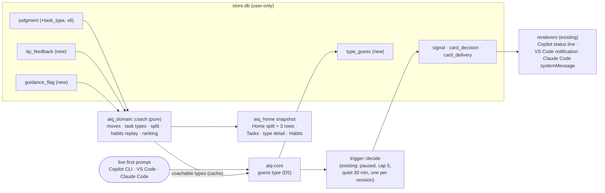

# Design: coaching from rung results

Produced with AI-Forward `/design-slice` (v2026.10.19.4), cloud-only (no laptop, no folder access).
Covers architecture Phase **3b** (feedback and habit tracks) and the coaching half of Phase **5**
(Opportunity 4 "delegation-fit tip at next pause" and Opportunity 6 "drafted doc with no source
check"). Builds on the rung judge, **PR #24 (branch `claude/project-thread-qydcmj`, not merged)**.

## Goal state

| | |
|---|---|
| **Goal** | A person sees, for each recurring kind of task, the next rung and the one move to get there, gets that move as a tip at the start of their next task of that kind (Copilot paths first), and sees honest numbers for "Tasks agents finished" and their habits |
| **Done when** | This design, ADR-0008, rollups, index and audit entries are merged; `/implement` can build it without a new decision except the one question left to Imran (Q-A) |
| **Not in scope** | Building it; F2 (person's share of the final change) reader; F9 repo-reuse reader (Factory); weekly summary; team or aggregate views (never); VS Code `vscode.lm` judging; signed packs; revisiting the Claude credential decision (closed) |
| **Tier** | T2 (new stored facts, new in-the-moment trigger, new judge field) |
| **Fan-out cap** | 1 (one session, no sub-agents) |

## Grounding: what this design must satisfy

Quoted from the specs and decisions it implements.

- "Success = at least one recurring task type moves up a rung" and "Key views: task distribution across rungs + opportunity to move up" (brief; aiq-home H3).
- "Given a judgment whose potential-rung confidence is below 0.8 … that task's gap is not offered" and "Uncertain … never used by the coaching loop" (rung-model US-6; Imran's constraint for this slice).
- "Given potential equals current and no Blocker … Right rung and is never the subject of a tip"; a Blocker means "no habit tip is generated" (rung-model US-2).
- "At most one in-the-moment tip per session"; daily cap default 5; "a tip on any surface starts a 30-min quiet period on all" (coaching-loop D3, Phase 2).
- "Habit … Tried after one observed use; Adopted when seen in more than half of eligible tasks over 14 days, with at least 3 eligible tasks"; "can fall back from Adopted to Tried"; "status changes only from observed behavior in eligible tasks, never from self-report" (coaching-loop D5, US-5, Habit track invariant).
- "Kept task: the person wrote at most about 20% of the final change (F2) and sent no re-prompt that corrected the agent (F5)"; "Could be: … a judged task not kept, whose task type's potential rung is Delegated or higher at judge confidence ≥ 0.8" (aiq-home Q1 and model).
- "Opportunity row: one task type whose potential rung is above its current rung, with its job, how often it happens and the one next step"; "at most 3, ranked by times per week … no time-saved number" (aiq-home).
- "This doesn't fit … that guidance is withdrawn for this task type, the rung is unchanged, and the person can undo" (aiq-home US-H4; rung-model US-4).
- "Don't show this again … never shown again on any surface until re-enabled"; "Snooze … 7 days"; "Not helpful twice … within 30 days … ranking drops below every Tip type without negative feedback"; dismiss = "no answer" (coaching-loop US-4).
- "No card text contains a rung number, score or comparison with other people"; "never names or implies the person's role" (coaching-loop Part C, US-7).
- "Model-written text renders as plain text" (TR-5); "an imported prompt can never raise a card" (history-import US-5).
- Imran (2026-11-02): target users almost all use Copilot; prioritise Copilot paths. Prefer AIQ deciding by itself with an easy override. Say whether each number is measured or guessed.

## Drift found, and how it is settled

| # | Drift | Settled as |
|---|---|---|
| C1 | aiq-home and the mockup count and rank **task types** ("Writing unit tests", "Reviewing pull requests"); the judge (PR #24) returns only a **job**. Nothing groups tasks into recurring kinds | The judge also returns a **task type from a fixed per-job list** in the pack (D1). Answer schema `aiq.judge.v2`; `judgment` gains `task_type` (schema v6, expand only) |
| C2 | Kept task needs **F2**, which slice 1 of the judge cannot read (rung-judge J6: unknown) | Not settled by AIQ: it changes a definition Imran decided. **Question Q-A** to Imran, with a recommended interim rule. Until he answers, the design builds the recommendation behind one pack constant |
| C3 | The judge's `gap` is free model text. Tips must not carry model text (TR-5, injection), and habits need a stable identity to count | The coached **move** is derived on device from the judgment's facts: the next rung's unmet guardrail fact (D2). Pack-written text per move. The model's gap stays on the task detail as "For your last task: …" in plain text |
| C4 | Opportunity 4 says "tip at the next pause", but a task is only judged after it closes (30-min idle gap, then the 10-minute judge cycle). The pause after the judged task has passed | The tip is shown at the **first pause of the next task of the same type** (D4): still in the moment, and when the move can still be used |
| C5 | Phase 3b (feedback controls, habit tracker) was planned before the judge; its "eligible task" is defined per fast detector | Habits are defined over **judged facts**, one source for all habits (D6). Feedback tables are designed here (D8), so 3b and the coaching half of 5 ship as one slice |
| C6 | aiq-home grain says "one judged Task"; with 11 of 20 eval tasks Uncertain, counting Uncertain as "Needs you" would make the headline measure the judge's doubt, not the person's work | Uncertain judgments are **left out** of the split and counted beside it ("12 tasks AIQ isn't sure about are left out") (D9). Same rule PR #24 uses for `rungs` |

## Decisions (settled here; reversible)

| # | Question | Decision | Why |
|---|---|---|---|
| D1 | How to group tasks into recurring kinds | **The judge picks one task type from a fixed list per job** (pack data, below), with a confidence; below 0.7 or not on the list → `other` within the job. One more field in the same call; no new call | Deterministic grouping that can be counted and shown with stable names; the spike's job classification was 93–98% with excerpts in the same call. Free-text clustering would rename rows week to week. Ladder rung C (reuse the existing call) |
| D2 | What is the "next step" | **The move** = for potential rung P = current + 1, a fact P's guardrail needs that this judgment has **confidently not met** (value false at confidence ≥ the fact bar, or a rule-out fact confidently present). More than one → pack order. A fact that is only *unknown* is never a move ("AIQ isn't sure yet") | Deterministic, explainable with the person's own facts, and the same identity every time, so it can be tipped, flagged and tracked as a habit |
| D3 | Which tasks and types are coachable | Task: PR #24's `coachable` (not Uncertain, potential > current, potential confidence ≥ 0.8, no Blocker) **and** a move exists. Task type: **recurring** (≥ 3 judged tasks in 30 days), and the same move is coachable on more than half of its non-Uncertain tasks at the type's current rung | Imran's 0.8 and Uncertain rules at task level; the majority rule stops one odd task from coaching a whole type. 3 matches D5's minimum and the Factory repetition rule |
| D4 | When the next-rung tip shows | When a **live** task starts (first prompt after the idle gap), the core guesses its task type from the person's own judged tasks (D5). If the guess is confident and the type is coachable, a signal goes into the existing trigger engine; the card shows at that turn's end (Copilot `agentStop` → status line, VS Code notification, Claude Code `Stop` → `systemMessage`) | Same delivery path, budget and quiet period as Phase 2. First pause of the task is the earliest moment hooks can show, and the move still applies |
| D5 | How to guess a new task's type before it is judged | **Nearest neighbour over the person's own judged first prompts**: the `text::features` word sets of the new first prompt against each judged task's first prompt in 30 days (Jaccard, existing `text::jaccard`); best match ≥ 0.45 and at least 2 of the top 3 agree on the type | No model, no network, no new dependency, < 5 ms for a few hundred tasks (to measure). Learns the person's own phrasing. Ladder rung B (reuse in codebase) |
| D6 | What a habit is | **One habit per (job, move)**, plus core habits that apply to any job (F5 "say what was wrong before asking again"). Observed only from judged facts. Eligible task = judged, not Uncertain, same job, the fact known at confidence ≥ the fact bar, and the habit's `eligible_when` holds (e.g. F5 only with ≥ 1 re-prompt). Behaviour seen = the fact has the value the guardrail needs | One source of truth (the judgment). Unknown facts neither count for nor against the person |
| D7 | Is habit state stored | **No. Derived by replaying observations** in day order with the D5 rule (Not yet → Tried → Adopted → Tried on lapse). Milestone cards are idempotent by id `habit:<habit>:<day>` in the existing `card_delivery` | Derive-don't-store (DM7). Re-judgments and deletions change the history, so a stored state would drift |
| D8 | Feedback | Two append-only facts: `tip_feedback` (helpful · not_helpful · snooze · off · on · no_answer, per card and tip id) and `guidance_flag` (flag · undo, per job + task type + move, with the spec's reasons). Ranking and suppression derived | Spec US-4 rules need history (30-day windows, undo); facts make them replayable |
| D9 | Home split grain | **One judged, not-Uncertain task whose first prompt is in the last 30 days.** Uncertain counted beside it. Shown only with ≥ 10 such tasks (aiq-home US-H2) | C6 |
| D10 | Self-check of the type guess | Every guess is a `type_guess` row. When that task is later judged, the guess is checked against the judged type (derived). With ≥ 10 checked guesses and fewer than 8 in 10 right, **AIQ turns next-rung tips off by itself** and Settings says why, with "Turn back on" | Imran: AIQ decides by itself with an easy override. Measured on the person's own work, never guessed |
| D11 | Imported history | Imported judgments count in every number, row and habit, and act as neighbours for D5. They never raise a card themselves: only a **live** first prompt can | history-import US-5 forbids cards *from* imported prompts; here the card is raised by a live prompt |
| D12 | Cooldown per move | The same tip id shows at most once per 72 h, and never while its habit is Adopted | Spec's per-trigger cooldown; no point tipping an adopted habit |
| D13 | Fast path vs next-rung tip in one session | No new priority rule: the existing "one per session, first come" holds. The next-rung tip fires at the first turn end; the re-prompt tip needs 3 prompts, so they rarely compete | Smallest change; measured later from `card_decision` reasons |

## Responsibility

Turn the person's current judgments into (a) one move per recurring task type, (b) at most one
in-the-moment tip that carries that move, (c) Home's split, opportunity rows and next step, and
(d) habit states, with every number derivable from stored facts and every tip written by the pack.

## Shape



- **`aiq_domain::coach`** (new, pure, no I/O): `moves(facts, current, potential)`, `type_rollup(judgments)`,
  `split(judgments, rollup)`, `habit_replay(observations, rule)`, `rank(rows, feedback, flags)`,
  `guess_type(first_prompt_features, neighbours)`. One definition used by the core and by AIQ home.
- **`aiq_domain::rung`** (PR #24): `missing(facts, rung) -> Vec<Gate>` beside `gate()` (lists every
  unmet need, not only the first); answer schema v2 with `task_type`.
- **`aiq_store`**: schema v6; inserts for the three new facts; `judgments_since(ms)`.
- **`aiq-core`**: on a live first prompt, guess the type, write `type_guess`, emit a signal with
  `detector_id = "task_type"`, `opportunity_id = "next_rung"`. Holds the coachable-type cache.
- **`aiq` CLI**: `aiq helpful|not|snooze|off <card>`, `aiq on <tip>`, `aiq flag <job>/<type> <reason>`,
  `aiq unflag …`; `aiq show <card>` also prints the move's starter prompt.
- **VS Code extension**: feedback buttons on the notification (Helpful · Not helpful · Snooze · Don't show again).
- **`apps/home`**: Home split + rows + best next step; Tasks grouped by type; type detail with
  "This doesn't fit"; Habits page; Settings tip types and the D10 state.

## Pack data (bundled pack, `bundled-5`; moves into signed packs in Phase 4)

### Task types (judge answers one; `other` when unsure)

| Job | Task types (id · label) |
|---|---|
| Code a change | `fix_bug` Fixing a bug or failing test · `feature` Adding a feature · `tests` Writing tests · `refactor` Refactoring or cleaning up · `build_fix` Fixing lint and build errors · `deps` Upgrading dependencies · `review` Reviewing code or a pull request · `explain` Explaining or exploring code · `scaffold` Setting up or scaffolding · `other` Other coding |
| Write a spec or doc | `spec` Writing a spec or PRD · `design_note` Writing a design note · `status` Writing a status update · `criteria` Writing acceptance criteria · `research` Summarising research · `howto` Writing a README or how-to · `notes` Turning notes into a summary · `other` Other writing |

Labels follow the mockup's Tasks page ("Writing unit tests", "Reviewing pull requests"). The list is a
first guess (assume: it covers most of Imran's real tasks; confirm when `other` is under 25% of judged
tasks in the first week; if not, the list is re-cut from the `other` tasks' judge evidence).

### Moves (one per rung step and fact; text is pack-written, never model-written)

| Move id | Step | Fact the next rung needs | Job | Habit name (Habits page) | Tip `noticed` (card, ≤ 140 chars, `{type}` = lower-case type label) |
|---|---|---|---|---|---|
| `brief` | 1 → 2 | F4 goal, context, constraints | any | Give the agent the goal, context and limits up front | "this looks like {type}. Last times, the request had no goal or limits." |
| `new_info` | 1 → 2 | F5 re-prompts add information (eligible when ≥ 1 re-prompt) | any | Say what was wrong before asking again | "this looks like {type}. Last times, rewording without new details cost extra rounds." |
| `check_code` | 1 → 2 | F6 output checked | code | Check the diff or run the tests before using the result | "this looks like {type}. Last times, the result was used without a check." |
| `check_sources` | 1 → 2 | F6 output checked | doc | Check drafted claims against a source | "this looks like {type}. Last times, the draft's claims weren't checked against a source." |
| `hand_over` | 2 → 3 | F13 whole outcome with done criteria | code | Hand over the whole task with a done test | "this looks like {type}. Last times, you handed it over a step at a time." |
| `hand_over_doc` | 2 → 3 | F13 whole outcome with done criteria | doc | Ask for the whole draft with what "done" means | "this looks like {type}. Last times, you asked for it a section at a time." |
| `let_agent_edit` | 2 → 3 | F1 agent made the edits; not F12 | code | Let the agent make the edits | "this looks like {type}. Last times, you made most edits yourself." |
| `written_brief` | 3 → 4 | F7 written spec, brief or instructions file | any | Give the agent a written brief or instructions file | "this looks like {type}. A written brief would let the agent plan it alone." |
| `agent_checks` | 3 → 4 | F3 agent ran the checks | code | Ask the agent to run the tests itself | "this looks like {type}. Last times, you ran the checks yourself." |
| `split_and_check` | 3 → 4 | F8 sub-agent with an automated check between steps | any | Split the work with an automated check between steps | "this looks like {type}. Splitting it with a check between steps lets agents run it end to end." |

Each move also carries `why` (one line), `try_this` (one line) and a `starter` prompt template with
`<placeholders>` (copied, never sent: aiq-home US-H4). Example for `agent_checks` on `tests`:
`try_this` = "ask the agent to run the tests and keep fixing until they pass."; starter = "Write tests for
<function> covering <cases>. Run them with <command>. Keep fixing until they all pass, then show me the
diff and the test output." Rendered card (Copilot CLI status line, existing renderer):
`AIQ tip: this looks like writing tests. Last times, you ran the checks yourself · aiq show 01J…`.
No rung name or number appears on a card (coaching-loop Part C); rungs appear only in AIQ home.

### New pack parameters (all tunable; first guesses until measured)

| Key | Value | Basis |
|---|---|---|
| `coach.recurring_min` | 3 tasks in 30 days | D3; same as D5 minimum |
| `coach.type_majority` | > 0.5 | D3 |
| `coach.match_threshold` | 0.45 Jaccard | Guess; the re-prompt detector's 0.6 is for *same* request, a new task of the same kind shares fewer words. Set from the offline check (test plan) |
| `coach.match_agree` | 2 of top 3 | Guess |
| `coach.guess_check_min` / `coach.guess_precision` | 10 / 0.8 | D10; 0.8 mirrors the coaching bar |
| `coach.move_cooldown_h` | 72 | D12 |
| `coach.split_min` | 10 tasks | aiq-home US-H2 |
| `coach.kept_rule` | `delegated_no_correction` | Q-A interim (below); `f2_share` once F2 exists |
| `judge.task_type_threshold` | 0.7 | Same as the job threshold |

## Data model

### Bounded context and aggregates (Coaching; shares Task, Job, Task fact with Rung assessment)

| Aggregate (root) | Invariant it protects | Stored as |
|---|---|---|
| **Habit track** (habit per person) | State changes only from observed judged facts in eligible tasks; Adopted never from fewer than 3 eligible tasks; never from self-report | Derived (D7) from `judgment` |
| **Tip preference** (tip id per person) | "Don't show again" is never overridden by ranking; it lifts only on the person's own "on" | `tip_feedback` facts |
| **Task-type guidance** (job + task type + move) | Once flagged, that move is never coached for that type, by any re-judgment, until the person undoes it; the rung is unaffected | `guidance_flag` facts |
| **Coaching session** (existing) | One card per session, cap, quiet period | Existing tables, unchanged |

Value objects: Task type, Move, Habit, Observation (task, habit, eligible, seen, day), Opportunity row.

### Stored facts (schema v6, expand only)

| Table | Grain: one row is exactly one… | Measures | History rule | Writer | Compute reader |
|---|---|---|---|---|---|
| `judgment.task_type`, `.task_type_confidence` (new columns) | (unchanged) judgment version of one task | confidence non-additive | Append-only (PR #24); NULL on rows judged before v6 = type unknown | `aiq judge` | `coach::type_rollup`, D5 neighbours, D10 check |
| `type_guess` (new) | guess of one live task's type, made at its first prompt | `similarity` non-additive | Append-only | `aiq-core` | D10 precision; card evidence |
| `tip_feedback` (new) | answer the person gave to one card (or one tip id from Settings) | counts additive | Append-only; current preference = latest per tip id (derived) | `aiq-core` (CLI, VS Code, home via control) | trigger suppression, `coach::rank`, tip history |
| `guidance_flag` (new) | flag or undo on one (job, task type, move) | counts additive | Append-only; current = latest per key | `aiq-core` | `coach::rank`, type detail, D3 |

```sql
ALTER TABLE judgment ADD COLUMN task_type TEXT;            -- pack task-type id; NULL = judged before v6
ALTER TABLE judgment ADD COLUMN task_type_confidence REAL;
CREATE TABLE type_guess (
  guess_id TEXT PRIMARY KEY, task_id TEXT NOT NULL, surface TEXT NOT NULL,
  job TEXT NOT NULL, task_type TEXT NOT NULL, similarity REAL NOT NULL,
  neighbours TEXT NOT NULL,                                 -- JSON array of judged task ids (no text)
  utc_ms INTEGER NOT NULL);
CREATE TABLE tip_feedback (
  feedback_id INTEGER PRIMARY KEY AUTOINCREMENT, card_id TEXT, tip_id TEXT NOT NULL,
  answer TEXT NOT NULL CHECK (answer IN ('helpful','not_helpful','snooze','off','on','no_answer')),
  surface TEXT NOT NULL, utc_ms INTEGER NOT NULL);
CREATE TABLE guidance_flag (
  flag_id INTEGER PRIMARY KEY AUTOINCREMENT, job TEXT NOT NULL, task_type TEXT NOT NULL, move TEXT NOT NULL,
  action TEXT NOT NULL CHECK (action IN ('flag','undo')),
  reason TEXT CHECK (reason IN ('evidence_wrong','not_useful','blocked','other')),
  note TEXT CHECK (length(note) <= 200), utc_ms INTEGER NOT NULL);
-- no-update triggers on all three; no-delete triggers except through `aiq forget` (same as judgment).
```

Migration: expand only. Rows judged before v6 have `task_type` NULL. They still count in the split
(their own `coachable` decides "could finish" only through their type, so a NULL type is "Needs you")
and are **re-judged lazily**: `JUDGE_VERSION` moves to `j2`, the queue takes tasks whose newest
judgment is not `j2`, newest first, within the same daily budget. No backfill guesses a type.

### Derived, not stored

| Value | Derivation (in `aiq_domain::coach`) | Additivity |
|---|---|---|
| Move per task | D2 over the judgment's `facts`, current and potential | — |
| Task-type row | Group current judgments in 30 days by (job, task_type): count, times a week (count × 7 / 30), today's rung (most common current rung among non-Uncertain, ties lower), move (D3), potential (today + 1 when a move is coachable), blocked (any Blocker on the majority) | Count additive; rates non-additive |
| Opportunity rows (Home, ≤ 3) | Rows with a coachable move, not flagged, ranked by times a week, then rungs to gain, then label; moves with 2 "not useful" flags in 30 days for the job rank last (rung-model US-4) | — |
| Split: Agents finished / could finish / Needs you | Over D9's grain. Finished = kept rule (Q-A). Could finish = not finished and its type row's potential ≥ Delegated with a coachable move. Needs you = the rest. Shown as `finished %` "could be" `finished + could %` | Non-additive: recomputed per window from counts, never averaged across weeks |
| Weekly columns | Same split per week of first prompt; a week with < 3 tasks shows "too few tasks" | Non-additive |
| Habit observations | Per judgment × habit (D6) | Counts additive within a window |
| Habit state | Replay (D7) | — |
| "Seen in N of M tasks in 14 days" | Observations in the last 14 days | Counts |
| Tip suppression | Latest `tip_feedback` per tip id: off → never; snooze → 7 days; 2 × not_helpful in 30 days → ranks last | — |
| Guess precision | `type_guess` joined to the task's later judgment | Ratio of counts |

## Change surfaces (E7)

| Surface | Change |
|---|---|
| Store | `schema_v6.sql`; `insert_type_guess`, `insert_tip_feedback`, `insert_guidance_flag`, `judgments_since`, `tip_feedback_all`, `guidance_flags_all`; `forget` paths cover the three tables |
| Domain | `aiq_domain::coach` (new); `rung::missing`; `aiq.judge.v2` response field `task_type` + `task_type_confidence`; pack `PackV1` gains `task_types`, `moves`, `coach` (serde defaults) |
| Service | `aiq judge` writes the type and re-queues pre-`j2` judgments; core guesses the type at a live first prompt, emits the signal, honours suppression and cooldown; control frames for feedback and flags |
| Projection / wire | `aiq.home.v1` additive: `home.split`, `home.opportunities`, `home.best_next`, `task_types[]`, `habits[]`, `settings.next_rung_tips`, `settings.type_guess {checked, right, auto_off}` |
| Client type | `apps/home/src/types.ts` |
| UI | Home (split card, ≤ 3 rows, best next step, Repo fixes), Tasks (one row per type), type detail (move, starter, facts, This doesn't fit, undo), Habits and tips, Settings; VS Code feedback buttons; CLI `aiq show` adds the starter |
| Compute reader | `aiq_domain::coach` is the only computation; core and AIQ home both call it |

## Contracts

### Consumed

| Contract | Status |
|---|---|
| `judgment` row and `facts` JSON shape, `coachable`, `state` | PR #24, read from branch `claude/project-thread-qydcmj` (`schema_v5.sql`, `aiq_domain::rung`). Not merged: if its shape changes before merge, this design's `coach` inputs change with it |
| `aiq.judge.v1` answer schema | PR #24 `aiq_contracts::judge`. v2 adds two required keys; strict parse unchanged |
| Trigger engine `decide` / `may_deliver`, `card_delivery` one-per-session index, quiet period | main (`aiq_domain::trigger`, `schema_v1.sql`) |
| Copilot CLI status-line and VS Code notification renderers | main (`aiq_contracts::card::render_status_line`, Phase 2 extension); laptop-checked for Copilot CLI 2026-11-01 |
| `text::features`, `text::jaccard` | main (`aiq_domain::text`) |
| Task rule (`split_tasks`, idle gap 30 min) | main (`aiq_domain::reprompt`) |

No new external contract: nothing here calls a network, a provider or a new tool. No spike needed.

### Exposed

CLI: `aiq helpful|not|snooze|off <card>`, `aiq on <tip>`, `aiq flag <job>/<type> <reason> [note]`,
`aiq unflag <job>/<type>`, `aiq config set next-rung-tips <auto|on|off>`. Frames:
`Request::TipFeedback`, `Request::GuidanceFlag` (additive). `aiq.home.v1` additive fields above.

## Card flow for a next-rung tip (Copilot CLI first)

1. Copilot `userPromptSubmitted` → hook → core (unchanged, ≤ 100 ms p95 hook budget untouched: all new
   work is in the core).
2. Core: the task rule says this prompt starts a new task. It takes the coachable-type cache (rebuilt
   when the count of judgments changes; `simplify:` an in-memory cache, ceiling a few thousand
   judgments; upgrade when the rebuild passes 50 ms), runs D5, writes `type_guess`.
3. If the guessed type has a coachable move, the move's tip is not off or snoozed, not in its 72 h
   cooldown, its habit is not Adopted, and next-rung tips are on (or auto and not turned off by D10):
   signal (`score` = similarity, `threshold` = `match_threshold`, job = the type's job) → existing
   `decide()`. Everything after that is Phase 2 as built: hold for the turn end, re-check
   `may_deliver`, deliver once, start the 30-minute quiet period on every surface.
4. Copilot `agentStop` → status line `AIQ tip: … · aiq show <id>`; lifetime per "Copilot CLI tip stays".
   VS Code agent mode: notification with Try this, Helpful, Not helpful, Snooze, Don't show again.
   Claude Code: `systemMessage` at `Stop`.
5. `aiq show <id>` prints noticed, why, try this, the starter prompt, and the evidence: the judged
   tasks the guess leaned on (time, tool, type), never their prompt text.

## Error and concurrency model

- All new writes go through the core (single writer); AIQ home writes feedback and flags via
  `aiq_core::control`, as delete and pause do today. Core down: the CLI writes feedback directly to
  the store as `forget` does (same busy timeout); VS Code queues nothing and says "AIQ isn't running".
- `aiq judge` runs in its own process (PR #24) and only appends `judgment`; the core's cache sees new
  rows on its next first-prompt event. No lock between them is needed beyond SQLite WAL.
- Habit replay and the split are pure functions over one read transaction (AIQ home's snapshot rule),
  so every number on a page agrees.

## Failure-mode analysis

| Mode (category) | Effect | Disposition | Detect |
|---|---|---|---|
| No judgments yet (input: empty) | No rows, no tips, no habits | **Mitigate**: Home shows "progress toward 10 judged tasks"; Habits empty state (mockup copy) | Snapshot `judged = 0` |
| Judgment without task type (pre-v6, state) | Can't join a type | **Recover**: lazy re-judge to `j2`; counted as Needs you meanwhile | `task_types[].unknown` count |
| Judge sets `other` too often (dependency: model) | Rows collapse into "Other coding" | **Detect + accept** first week: `other` share shown in `aiq status`; re-cut the list if > 25% (assume line above) | `aiq status` line |
| Wrong type guess (input) | Tip for the wrong kind of task | **Mitigate**: majority-of-3 rule, threshold; **recover**: D10 auto-off at < 8 in 10; person can "Don't show again" | `AIQ-COACH-GUESS-LOW` logged once when auto-off fires |
| Two surfaces start a task at once (concurrency) | Two signals | **Prevent**: existing one-per-session index and the cross-surface quiet period | Existing `card_decision` reasons |
| Re-judgment flips a move (state) | Tip and habit change under the person | **Accept**: newest judgment wins (spec); flagged moves stay withdrawn (guidance aggregate) | — |
| Person deletes a task's content (state) | Judgment stays; evidence says deleted | **Mitigate**: as rung-model US-3; observations from the judgment still count (facts are not content) | — |
| Person deletes everything (state) | All facts gone | **Prevent stale numbers**: derived values have no store of their own | `forget` e2e |
| Cache rebuild slow with many judgments (resource) | First-prompt decision late | **Detect**: rebuild time measured into `core.log`; the 2 s decision budget (coaching-loop US-1) asserted in an e2e with 5,000 judgments | `coach_cache_ms` |
| Clock change or day boundary (time) | 14-day and 30-day windows shift | **Prevent**: windows from `Now` (injectable clock) | Property tests |
| Pack update changes the move list (input) | Old flags name a move that no longer exists | **Accept**: an unknown move id in a flag is ignored; the flag stays in history | Unit test |
| Imported task's judgment seeds a tip (input) | Card from imported work? | **Prevent**: only a live first prompt can raise a signal (D11) | Test `imported_prompt_never_raises_next_rung_card` |

## Adversarial analysis (STRIDE-lite)

Trust boundaries: (B-J) judge answer → store (model output steered by task content); (B-H) hook →
core (existing); (B-U) AIQ home → core control (existing, same user).

| Boundary | Threat | Disposition | Test |
|---|---|---|---|
| B-J | **Tampering:** injected content steers the task type or facts to fake a move or a habit | **Mitigate**: type is an enum from the pack (strict parse rejects others); moves come from guardrails over two merged runs; tips carry pack text only, so injection cannot write a card | `judge_v2_rejects_unknown_task_type`; `card_text_never_contains_model_text` |
| B-J | **Info disclosure:** a tip quotes another task's prompt | **Prevent**: cards and `aiq show` evidence list time, tool and type only; `type_guess.neighbours` stores ids, not text | `show_evidence_has_no_prompt_text` |
| B-H | **Spoofing/Tampering:** forged first prompt frames raise tips | **Accept** (existing accepted risk: software running as the user can forge frames); worst case is a tip | — |
| B-U | **Repudiation:** "I never turned that tip off" | **Mitigate**: `tip_feedback` and `guidance_flag` rows carry time and surface; Settings lists them | Store test |
| B-U | **Elevation:** a flag or feedback changes a rung | **Prevent**: no write path touches `judgment`; tested by an attempted update (append-only trigger) | `flag_never_changes_rung` |
| All | **Denial of service:** flood of first prompts | **Mitigate**: guess runs only on a task start (idle gap), at most one card per session, daily cap | Existing budget tests |

## Privacy analysis (LINDDUN-lite)

Personal data touched: the person's own task judgments (how they work), feedback, flags. Nothing new
leaves the device; nothing new is sent to any provider except one extra enum field in the existing judge
answer.

| Threat | Finding | Disposition |
|---|---|---|
| Linkability / Identifiability | Habits and task types reveal working patterns | **Mitigate**: user-only store; no team view (never); no aggregate in this slice |
| Non-repudiation | Feedback rows prove what the person said | **Accept**: private to them; deletable with `forget` |
| Detectability | A tip on screen shows a colleague looking over the shoulder that AIQ runs | **Accept**: same as Phase 2; Pause is one action |
| Disclosure | Tip text visible in a shared terminal recording | **Mitigate**: no prompt text, no rung, no score in tips (Part C rules) |
| Unawareness | The person doesn't know imports feed habits | **Mitigate**: Habits page footnote "Includes tasks AIQ imported from your history" when any are |
| Non-compliance (retention, rights) | New tables must be covered by delete and export | **Mitigate**: `forget --all`, `forget --imported` (imported judgments' observations disappear with them) and export cover all three |

## Telemetry (local only, measured on the normal path)

| Question an operator asks | Source |
|---|---|
| How long does the first-prompt decision take? | `core.log` event `coach.guess` with `ms`, `neighbours`, `similarity`, outcome; error code `AIQ-COACH-GUESS-LOW` when D10 turns tips off |
| How often is the guess right? | `type_guess` × later judgment; shown in Settings and `aiq status` as "right N of M" (measured) |
| How often do next-rung tips show, hold or drop, and why? | Existing `card_decision` rows with `opportunity_id = next_rung` |
| Do people act on them? | `tip_feedback` counts; habit transitions after a tip (derived) |
| Did a recurring task move up? (success metric) | Type row's today's rung per 14-day window; Home banner "Writing tests moved up to Delegated" (derived, no card) |
| How much of the split is uncertain? | `home.split.uncertain` shown beside the headline |

Every number shown is labelled at its source: counts of AIQ's records are **measured**; rungs, facts
and task types are **the judge's estimates** (Home: "Judged by your Copilot · 141 tasks"); times a week
is a measured count divided by 30 days × 7.

## UI design

Archetype and tokens are unchanged (aiq-home Part C, `DESIGN.md`; coaching-loop Part C for cards). New
states and copy only; every token reference is an existing `DESIGN.md` token.

| Component | States (incl. empty / loading / error) | Copy (load-bearing strings) |
|---|---|---|
| Home split card | judge off · fewer than 10 · ready · uncertain shown · core down (last stored) | "Tasks agents finished" · "{f}% could be {f+c}%" · "{k} of {n} tasks · {u} AIQ isn't sure about are left out" · "Judged by your Copilot" |
| Opportunity row | ready · blocked by the environment (Repo fixes) · flagged (hidden, undo in detail) | "{times} a week" · "{today} → {potential}" (names, then numbers) |
| Type detail | move · no move ("AIQ isn't sure yet") · right rung ("This is the right rung for this task.") · flagged ("You flagged this. Undo") · blocked | "For your last task: {judge gap}" (plain text, TR-5) |
| Habits page | empty (mockup copy) · Not yet · Tried · Adopted · moved back to Tried banner · adopted banner | "Seen in {n} of {m} tasks in 14 days" · "Includes tasks AIQ imported from your history" |
| Settings > Tips | next-rung tips on · off · auto-off by AIQ | "AIQ guessed the kind of task right {r} of {m} times, so it stopped these tips. Turn back on" |
| VS Code notification | shown · feedback given · core down | Buttons "Try this", "Helpful", "Not helpful", "Snooze 7 days", "Don't show again" |
| Copilot CLI status line | as Phase 2 | "AIQ tip: this looks like {type}. {noticed tail} · aiq show {id}" |

Accessibility: WCAG 2.2 AA as aiq-home; habits carry words, never colour alone; split card has a text
alternative ("Agents finished 41%, could be 67%"); the VS Code buttons are keyboard-reachable
(platform default). HAX: G2 (uncertain counts shown), G11 (why: facts and evidence), G9/G15 (feedback),
G16 (Settings says what feedback changes). The UI craft gate (`ui-craft-gate.py`) runs on the built
pages in CI as in Phase 3.

## Test plan (Testing Strategy: D0 + triggered directives)

| Directive | Tests |
|---|---|
| D0 hygiene | fmt, clippy `-D warnings`, existing suites green |
| Unit (domain, `coach`) | `missing()` lists every unmet need; a move only from a confident "no"; unknown → no move; pack order breaks ties; type row today's rung ties go lower; D3 majority at exactly half is not coachable; split excludes Uncertain; < 10 → no split; a NULL type is Needs you; ranking by times a week then gain; 2 × not_useful puts a move last; flagged move never coachable; undo restores |
| Unit (habits, D5 boundary set) | 1 observation → Tried; 3 eligible with 2 seen → Adopted; 2 eligible both seen → Tried; Adopted then 3 eligible with 1 seen → Tried, no card; Adopted with 2 eligible later → stays Adopted; F5 not eligible with 0 re-prompts; unknown fact neither eligible nor seen; day boundary and offset change |
| Property | Replay is deterministic and order-independent within a day; split parts sum to the grain count; potential never > current + 1; no card text contains a digit 1–5 adjacent to a rung name, a rung name, or any judge string |
| Store | v6 migration from v5 and from v4 (PR #24 not merged yet); append-only triggers on the three tables (attempted update fails); `forget` empties them |
| Integration (core) | First prompt of a new task with a matching coachable type → signal → card at `agentStop` (Copilot), `Stop` (Claude Code), VS Code; second task in 30-min quiet → hold `quiet_period`; cap 5 → hold `daily_cap`; off → drop; snooze → none for 7 days; 72 h cooldown; Adopted habit → no card; imported-only → no card; D10 auto-off at 7 of 10 and back on by setting |
| Performance | Guess + decision ≤ 2 s p95 with 5,000 judgments (coaching-loop US-1); cache rebuild measured; hook p95 unchanged (≤ 100 ms) |
| Judge eval (measured) | PR #24's held-out eval extended: label the 20 held-out tasks' task type by construction; report type agreement (bar to set from the run; first guess ≥ 80%) |
| Offline matcher check (laptop, counts only) | `aiq coach check-guess`: leave-one-out over Imran's judged tasks; prints precision and coverage at 0.35/0.45/0.55. Sets `match_threshold`. Prints no text |
| Home | Snapshot fields; UI e2e for every state in the UI table; axe clean light/dark/high contrast; model text rendered literally |
| Copilot laptop check | One next-rung tip on Copilot CLI and one in VS Code agent mode on Imran's real judged history |

## Conformance notes

- No model on the hot path (LOA C9): the guess is word overlap in the core; the hook is untouched.
- Coaching never acts for the person: starters are copied, never sent (archetype: advisory).
- Pack-written cards only; the judge's text reaches only the type detail, as plain text.

## Questions for Imran (only what a human must decide)

| # | Question | Needed for | Recommendation |
|---|---|---|---|
| Q-A | AIQ can't yet measure how much of the final change you wrote yourself (F2), which your "Tasks agents finished" rule needs. Until it can, what should the headline count? | Home split, weekly columns | **Count a task as finished when it was judged Delegated or higher and you sent no re-prompt correcting the agent.** Show the rule under the number. Switch to your 20% rule when F2 is built, with a one-time note. Alternatives: hide the headline until F2 exists; or build F2 (a git diff after each agent turn) first |

Everything else above is decided here and reversible.

## Flagged risks

- Judge accuracy on real work is unproven (PR #24: 20 synthetic tasks); every move rests on it. The
  0.8 and Uncertain gates keep doubtful tasks out, so the risk is *too few* tips, not wrong ones. *Flagged.*
- F6 came back below the fact bar on 6 of 20 eval tasks; habits `check_code` and `check_sources` may
  rarely be eligible. Measured on Imran's real Copilot tasks first (PR #24). *Flagged.*
- Task-type list and `match_threshold` are guesses until the first real week. *Flagged; tunable pack data.*
- Lazy re-judging to `j2` uses the daily budget (50 tasks/day): Imran's ~333 imported tasks take about a
  week (inferred from PR #24's budget, not measured). *Flagged.*
- Interim kept rule (Q-A) over-counts if the person rewrote a delegated result by hand without a
  re-prompt. *Flagged until F2.*

## Gate record

`GATE design-slice · 2026-11-02 · Data & Persistence, Security & Privacy, Test Architect, Simplifier, Patterns Expert, UX & Accessibility, SRE (seats played by Claude in one session; not independent) · verdict: pass with conditions`
- **Data & Persistence (hard):** grain declared for each new fact; habits, rows and the split derived; expand-only v6; no guessed backfill (lazy re-judge). Pass.
- **Security & Privacy (hard):** pack-only card text closes the injection-to-card path; no prompt text in evidence; flags can't touch rungs. Pass; independent review recommended.
- **Test Architect (hard):** every D5 boundary case and every suppression rule has a test; the 2 s budget has a load test. Pass.
- **Patterns Expert ⇄ Simplifier:** nearest neighbour over existing features instead of a classifier or a second model call (Simplifier); a fixed task-type enum instead of free text (Patterns: controlled vocabulary). Both pass. Simplifier challenged `type_guess` as a table; kept because D10's self-check needs the guess history.
- **UX & Accessibility:** every new state has text; no rung on cards. Pass.
- **SRE:** guess latency, precision and auto-off are measured and visible. Pass.
- **Condition:** Q-A answered by Imran before Home's headline ships; PR #24 merged first.

## Status and next action

| | |
|---|---|
| **Completed** | Design for Phase 3b + the coaching half of Phase 5: task types, moves, next-rung tips, Home split and rows, habits, feedback |
| **Remaining** | Imran's answer to Q-A; PR #24 merge; `/implement` of this design; F2 and F9 readers (later slices) |
| **Best next action** | `/implement` after PR #24 merges, starting with `aiq_domain::coach` and the v2 judge field, then the core trigger on Copilot CLI |
