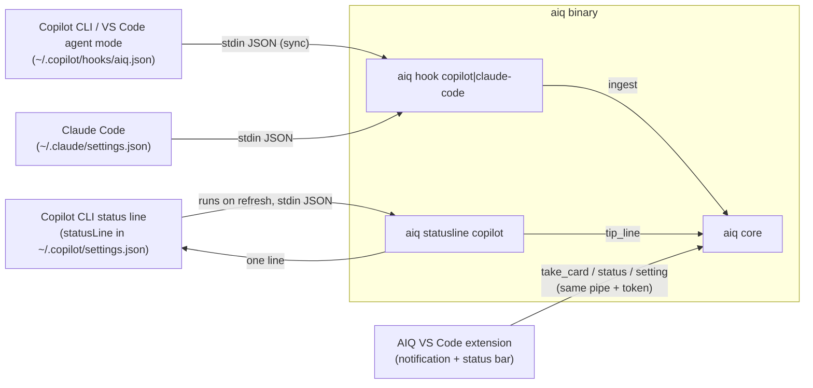

# Design: Phase 2 coaching loop on Copilot CLI and VS Code

- **Status:** Draft. Parts marked **(P1–P4)** wait on the laptop probe in `prototypes/phase2-probe/`.
- **Spec / architecture:** [coaching-loop spec](../specs/coaching-loop.md) · [AIQ home spec](../specs/aiq-home.md) (Settings > Tips) · [architecture](../architecture.md) Phase 2 · [ADR-0005](../adr/0005-collector-contract.md) rules 5, 5a, 6 · [surface spike](../investigations/surface-spike-copilot-vscode.md) · [Phase 1 design](claude-code-skeleton.md)
- **Delivery phase / vertical slice:** Phase 2. Real: one user-level Copilot collector (CLI and VS Code
  agent sessions), Copilot CLI status-line renderer, VS Code extension (notification + status bar),
  per-person budget across surfaces. Mocked as in Phase 1: bundled pack, `AlwaysUnclassified`, no rung model.
- **Author(s) / date:** Imran (owner), drafted with Claude via `/design-slice`, 2026-11-01.

## Grounding: what this design must satisfy

| Source | Statement this design must meet |
|---|---|
| Architecture, Phase 2 | "Same loop on Copilot CLI and VS Code; budget shared across surfaces." Human check: "Trigger on Claude Code, then on Copilot CLI in the same session: second is held; the Copilot tip appears in the status line." Test check: "E2E per surface + cross-surface budget test." |
| Spec, Surface parity | "The interruption budget and cooldowns are per person across surfaces, so using two agents never doubles the tips. Where a surface can't show a card mid-task, the card waits for that surface's next pause; the bar is never lowered for that surface." |
| Spec, US-2 | "Given an in-the-moment card was already shown in this session (on any surface) When another Opportunity qualifies Then it is held." Cards show only after the agent turn ends; nothing captured while paused. |
| Spec, NFR | "Same card schema renders on all three surfaces"; "Cards keyboard-operable and screen-reader announced in VS Code"; "Pause AIQ is reachable in ≤ 2 steps from every surface"; "A card never takes focus from the editor or terminal input." |
| ADR-0005 rule 5 | Copilot CLI: one-line tip in Copilot CLI's status line, reading the pending card from the core, `aiq show` for the full card; lifetime is the person's setting, default clear on the next prompt; the core owns that state, the status-line command only reads it. VS Code: notification + status bar from the AIQ extension. Never `additionalContext` or exit code 2. |
| ADR-0005 rule 5a | Copilot hooks are synchronous: subscribe to `userPromptSubmitted` and `agentStop` only; exec form, never a shell. |
| ADR-0005 rule 6 | Install at user level only (`~/.copilot/hooks/`), never a repo's `.github/hooks/`. |
| AIQ home spec, Settings > Tips | "Copilot CLI tip stays": *Until the next prompt* (default) · *For 2 prompts or 5 minutes, then `1 tip waiting · aiq show`* · *Until I open it*. All tips are kept in Tips history. |
| Phase 1 (laptop) | Hook speed limit 100 ms p95 whole process (Imran, 2026-11-01). Windows data home `%USERPROFILE%\.aiq`. |

**Evidence already in hand (laptop, 2026-10-31, Copilot CLI 1.0.104/1.0.105):** all hook events fire
at user level; payloads carry `sessionId`, `timestamp`, `cwd` and no event name; `userPromptSubmitted`
carries `prompt`; `agentStop` carries `stopReason`; no hook output reaches the person; hooks are
synchronous; Copilot's own start-up per hook is 110–210 ms with `exec`. Copilot reads a repo's
`.claude/settings.json`, and `copilot -p` fires the person's hooks.

## Decision questions

| Question | Needed for | Recommendation | Status |
|---|---|---|---|
| What does "shared budget" mean across surfaces? | Trigger engine | Daily cap counts deliveries on every surface (already true in Phase 1), **plus a person-wide quiet period**: after a card is delivered on any surface, cards on all surfaces are held for 30 minutes (pack data). This is how the architecture's check "trigger on Claude Code, then on Copilot CLI: second is held" passes, since the two tools never share a session id | Decided by design (spec: "cooldowns are per person across surfaces"); tunable |
| Speed budget wording for Copilot hooks | NFR, tests | AIQ's own client ≤ 100 ms p95 (as Claude Code); Copilot's own start-up measured and shown in `aiq status`, not counted against AIQ | **Decided by Imran, 2026-11-01 16:53: AIQ's own part only** |
| When is a Copilot CLI tip "delivered"? | Budget, lifetime | When the status-line command first renders it, after the turn has ended. Not at `agentStop`: the hook cannot show anything, so counting it then would count tips nobody saw | Decided by design |
| Where does tip lifetime live? | ADR-0005 | Derived in the core from facts (delivery time, later prompts in the session, `card_open` rows) and the setting. Nothing about lifetime is stored as state | Decided by design (derive-don't-store) |
| VS Code in Phase 2 | Scope | Observe VS Code agent sessions through the same hooks if P3 shows they fire there and can be told apart; render through the extension. If not, Phase 2 ships the extension as renderer + pause only, and VS Code observation moves to a later slice | **Waits on P3** |
| Person already has a Copilot status line | Install | Do not replace it. `install` stops and prints the one line to add to their own script (`aiq statusline copilot`), so their status line keeps working and shows the tip too | Decided by design |

## Responsibility

Make the Phase 1 loop (observe prompts → detect re-prompting → decide under budget → show one card at a
turn end) work for Copilot CLI and VS Code Copilot agent sessions, with one budget per person across
all three surfaces. Not responsible for: tool-call capture, feedback controls (Phase 3), jobs (Phase 4),
the rung judge (Phase 5), the Tauri app (Phase 6), VS Code ask mode, inline chat and completions (no
hook fires there), a desktop notification on Copilot CLI (revisit later, Imran 2026-11-01).

## Shape



What is new, by crate:

| Crate | Change |
|---|---|
| `aiq-contracts` | Surfaces `copilot-cli`, `vscode`; frames `tip_line`, `take_card` for a surface without a session; setting `copilot_tip_stays`; card renderers `render_status_line`, `render_waiting_marker`; new codes |
| `aiq-domain` | Trigger check `quiet_period`; pure `tip_line_state` function for the three lifetime rules |
| `aiq-store` | Schema v2 (expand only): `card_open` fact table; queries "last delivery on any surface", "prompts in session after t", "opened?" |
| `aiq-core` | Ops `tip_line`, `take_card_any`; `show` writes `card_open` |
| `aiq` (bin) | `aiq hook copilot <event>`; `aiq statusline copilot`; `aiq install|uninstall copilot`; `aiq config set copilot-tip-stays` |
| `extensions/vscode` (new, TypeScript) | Status-bar item, poll loop, notification, Pause/Resume and Details commands |

## Data model

No new bounded context or aggregate. **Coaching session** keeps its root (surface session) and gains a
second, person-wide rule, which belongs to the existing **Interruption budget** invariant
("never more than the daily cap per local day across all sessions; never two cards at once"):

| Aggregate | Invariant | Where enforced |
|---|---|---|
| Coaching session | ≤ 1 in-the-moment card per surface session | Unique index on `card_delivery(surface, surface_session_id)` (Phase 1) |
| Interruption budget (per person) | ≤ daily cap per local day across surfaces; **no delivery within `quiet_min` of the last delivery on any surface** | Single decision loop: checked at decision and re-checked at delivery, in the delivery transaction |

### Tables

| Table | Kind | Grain: one row is exactly one… | Change in Phase 2 | History |
|---|---|---|---|---|
| `event` | fact | collector event | New `surface` values; Copilot `prompt_id` is null; `payload_meta` adds `host` (`copilot-cli` / `vscode`) | Append-only |
| `card_delivery` | fact | card handed to a renderer | Copilot CLI: written by `tip_line` on first render; VS Code: by `take_card_any` | Append-only |
| `card_open` (new, v2) | fact | one time the person opened a card's details (`aiq show`, VS Code "Details") | `card_id`, `surface` (where opened), `utc_ms` | Append-only (triggers) |
| `setting_change` | fact | setting change | New key `copilot_tip_stays` ∈ `next_prompt` (default) · `two_prompts_or_5_min` · `until_opened` | Append-only; latest row wins |

Measures: `card_open` count is additive. No stored tip-line state.

### Derived, not stored

| Derived value | Derivation |
|---|---|
| Last delivery on any surface | `max(delivered_utc_ms)` over `card_delivery` |
| Copilot tip line for a session | `tip_line_state(setting, delivered_at, prompts_after, opened, now)` → `Full` / `Waiting` / `Gone`; inputs are facts |
| Prompts after delivery | `count(event)` with `kind='prompt'` in the session and `ts > delivered_utc_ms` |

`tip_line_state` rules:

| Setting | Full | Waiting marker | Gone |
|---|---|---|---|
| `next_prompt` | 0 prompts since delivery | never | ≥ 1 prompt, or opened |
| `two_prompts_or_5_min` | < 2 prompts and < 5 min | after that, until opened | opened |
| `until_opened` | until opened | never | opened |

A tip that is `Gone` is still in Tips history (`card_delivery` row) and in `aiq show`.

### Writers and compute readers

| Field | Writer | Compute reader |
|---|---|---|
| `card_open.*` | `aiq show` (core `show` op), extension "Details" | `tip_line_state`; Phase 3 habit tracking; Tips history (Phase 6) |
| `setting_change` `copilot_tip_stays` | `aiq config set`; later the Tauri Settings page | `tip_line` op |
| `event.payload_meta.host` | hook client | `aiq status` per-surface counts |

### Migration
`user_version` 1 → 2: `CREATE TABLE card_open` plus its append-only triggers. Expand only, no backfill.
One transaction; rollback test as in Phase 1.

## Change surfaces (E7)

| Surface | Phase 2 item |
|---|---|
| Store | Schema v2 (`card_open`), three queries |
| Domain | `quiet_period` check; `tip_line_state` |
| Service | Copilot ingest; `tip_line`; `take_card_any`; `show` records opens; setting validation |
| Projection / wire | `aiq.event.v1` surfaces; frames `tip_line`, `take_card_any`; status-line stdout; `aiq.card.v1` unchanged |
| Client type | `aiq-contracts` serde types; TypeScript types in the extension generated by hand from the JSON Schemas, checked by a schema test |
| UI | Status-line text; VS Code notification + status-bar item; `aiq status` per surface |
| Compute reader | Budget (daily cap + quiet period) across surfaces; lifetime from facts |

## Contracts

### Consumed

| Contract | Shape depended on | Source | Confidence |
|---|---|---|---|
| Copilot hook file `~/.copilot/hooks/*.json` | `{"version":1,"hooks":{"<event>":[{"type":"command","exec":…,"args":[…],"timeoutSec":…}]}}` | Copilot CLI hooks reference; laptop probe 2026-10-31 | Verified (run) |
| `userPromptSubmitted` stdin | `sessionId`, `timestamp`, `cwd`, `prompt` | laptop probe | Verified (run) |
| `agentStop` stdin | `sessionId`, `timestamp`, `stopReason`, `transcriptPath` | laptop probe | Verified (run) |
| Copilot CLI `statusLine` | `{"type":"command","command":…}` in `~/.copilot/settings.json`; `experimental: true`; Windows `feature_flags.enabled: ["STATUS_LINE"]`; JSON session data on stdin on each refresh, incl. a session id and cwd | Third-party READMEs, Oh My Posh docs, copilot-cli#2266 | **Flagged → P1, P2** |
| Same session id in hooks and status line | Lets the tip show only in the session it belongs to | — | **Unknown → P4** |
| VS Code agent mode runs user-level Copilot hooks | Same file, same events | VS Code hooks docs (Preview) | **Docs only → P3** |
| Telling VS Code from the CLI in a hook | `VSCODE_*` env in the hook process, or a payload field | — | **Unknown → P3** |
| Node `net.connect` to a Windows named pipe / Unix socket | Extension talks to the core over the same user-only channel | Node docs (`net` IPC paths) | Verified (docs); tested in the extension's integration test |

### Exposed

**1. Copilot hook file** `~/.copilot/hooks/aiq.json` (whole file is AIQ's, so install and uninstall
never edit another file's entries):

```json
{ "version": 1, "hooks": {
  "userPromptSubmitted": [{ "type": "command", "exec": "<abs>/aiq.exe", "args": ["hook", "copilot", "userPromptSubmitted"], "timeoutSec": 5 }],
  "agentStop":           [{ "type": "command", "exec": "<abs>/aiq.exe", "args": ["hook", "copilot", "agentStop"],           "timeoutSec": 5 }]
}}
```

`aiq hook copilot` guarantees: always exits 0; **never writes to stdout or stderr** (Copilot shows
nothing anyway, and stderr on exit 2 would change the agent); never opens the store. Both events are
plain `ingest` frames: there is nothing to wait for at `agentStop`, because the tip is rendered by the
status line. A payload is accepted as Copilot's only if it has camelCase `sessionId` and no
`hook_event_name` (Claude Code's shape is refused, and vice versa). A hook process started with
`AIQ_INTERNAL=1` (AIQ's own future `copilot -p` judge calls) is ignored.

**2. Status-line command** `aiq statusline copilot`: reads stdin (cap 64 KB), finds the session id
(field name from P2), sends `tip_line`, prints at most one line, exits 0. Budget: 100 ms p95 whole
process, same as hooks; it does not block the agent, but it runs on every refresh. If the core is down,
it prints nothing. It never starts the core (it may run very often).

**3. Frames** (added to the Phase 1 set; same token rule):

| Frame | Reply |
|---|---|
| `{"op":"tip_line","token","surface":"copilot-cli","session":<id or null>,"color":bool}` | `{"line": string or null}` |
| `{"op":"take_card_any","token","surface":"vscode"}` | `{"card": aiq.card.v1 or null}`: delivers one show-ready card of any `vscode` session whose last event is a `stop` |
| `{"op":"show",…}` | unchanged reply; now also appends `card_open` |

`tip_line` with `session` = null (if P2 finds no id) uses the most recent show-ready or delivered
`copilot-cli` card. `simplify:` ceiling: two Copilot CLI windows open at once could show one session's
tip in the other; upgrade trigger: P2/P4 give a usable id.

**4. Settings**: `aiq config set copilot-tip-stays next-prompt|two-prompts-or-5-min|until-opened`.

**5. Install**: `aiq install copilot` writes `~/.copilot/hooks/aiq.json`, and adds `statusLine`
(+ `experimental`, + the Windows feature flag if P1 shows it is needed) to `~/.copilot/settings.json`
with the Phase 1 rules: show the diff, ask y/N, back up, temp-file-and-rename, refuse invalid JSON,
refuse to replace an existing `statusLine` (print the line to add instead). Runs the installed hook
once as a self-test and prints its time. `aiq uninstall copilot` removes the hook file and only an
AIQ `statusLine`.

**6. VS Code extension** (`extensions/vscode`, publisher-less VSIX for the alpha, installed by
`code --install-extension`): polls `take_card_any` every 2 s while a window is focused; shows the card
as a non-modal information message; status-bar item; commands *AIQ: Pause*, *AIQ: Resume*,
*AIQ: Show tip details*. No dependencies beyond `@types/vscode` and the TypeScript compiler.
`simplify:` polling, not push; ceiling: 0.5 frames/s per focused window; upgrade trigger: a second
VS Code consumer of core events (Phase 3 feedback) makes a subscription channel worth it.

### Mock-substitutable seams
Unchanged from Phase 1 (`PackSource`, `JobClassifier`, `Clock`). New: the extension's `CoreClient`
interface, faked in its unit tests.

## How the pieces behave

### Copilot CLI turn, end to end
1. Person sends a prompt → `userPromptSubmitted` → `aiq hook copilot` → `ingest` (≤ 20 ms connect).
   Core stores the event, runs the detector, maybe decides show-ready (Phase 1 table + quiet period).
2. Agent works. The status line may refresh; the core sees the session's last event is a `prompt`, so a
   show-ready card is **not** rendered mid-turn (spec: cards show only after the turn ends).
3. Agent finishes → `agentStop` → `ingest` of a `stop` event.
4. Status line refreshes → `tip_line`: the session's last event is a `stop` and a show-ready card exists
   → re-check budget (paused, session, daily cap, quiet period) → insert `card_delivery` → reply
   `AIQ tip: you've reworded this 3 times without new details · aiq show 01J…`.
5. Later refreshes reply with the line, the waiting marker, or nothing, per `tip_line_state`.

`assume:` the status line refreshes after the agent's turn ends (P1). If it refreshes only on a
timer or on the person's input, step 4 happens a little later; if it never refreshes without input,
the tip shows at the next keystroke. Neither breaks the budget.

### Trigger engine change
One check is added to `in_moment.v1` (becomes `in_moment.v2` in the pack, so old decisions keep their
rule id), after `session_budget` and before `one_at_a_time`:

| Check | Outcome | Reason code |
|---|---|---|
| A card was delivered on any surface less than `quiet_min` (30) minutes ago | hold | `quiet_period` |

`may_deliver` gains the same check. A card held for `quiet_period` is not retried later (Phase 1 holds
are final; the next qualifying signal decides afresh).

### VS Code (if P3 passes)
The hook client sets `surface = "vscode"` when the hook's environment shows VS Code (P3 names the
variable), else `copilot-cli`. The extension's poll takes VS Code cards after the turn ends; status
bar shows `AIQ` · `AIQ paused` · `AIQ: 1 tip`. `simplify:` with several VS Code windows open, the first
focused window to poll shows the card; ceiling: one person, a few windows; upgrade trigger: a payload
field that ties a session to a window.

## UI and interaction design

**Copilot CLI status line (terminal medium).** One line, ≤ 100 columns, plain words first:

```
AIQ tip: you've reworded this 3 times without new details · aiq show 01J…
1 tip waiting · aiq show 01J…
```

No colour carries meaning; with colour on, "AIQ tip:" is bold yellow as in Claude Code; `NO_COLOR`
gives plain text. Never quotes prompt text. `aiq show` prints the full card (Noticed / Why / Try this /
evidence), records the open, and ends with `Turn off tips for now: aiq pause`.

**VS Code.** Non-modal `showInformationMessage` (never steals focus, announced by screen readers):
"AIQ tip: you've reworded this request 3 times without adding new details. Try this: say what was
wrong with the last answer, and add one example, file or constraint." Buttons: **Details**, **Pause
AIQ**. Status-bar item text and accessible label: "AIQ on" / "AIQ paused" / "AIQ: 1 tip waiting";
click opens a quick pick (Show tip · Pause/Resume). Pause in ≤ 2 steps from the status bar.

| Component | Default | Empty | Error | Other |
|---|---|---|---|---|
| Status line | Tip line | Nothing (most refreshes) | Core down / slow: nothing | Waiting marker; paused: nothing |
| VS Code notification | Card | — | Core down: none; status bar "AIQ not running" with tooltip "Starts with your next agent prompt" | Paused: none |
| VS Code status bar | "AIQ on" | First run: "AIQ on" tooltip "AIQ watches quietly" | "AIQ not running" | "AIQ paused", "AIQ: 1 tip waiting" |
| `aiq install copilot` | Diff + y/N | "Already installed." | Invalid JSON: refuse; existing statusLine: print the line to add | Backup path, self-test time |

Tokens: none (host theme only), as Phase 1; `DESIGN.md` floors apply to the Tauri app, not here.
Keyboard/screen reader: VS Code commands are in the Command Palette; notification buttons are
keyboard reachable. The real screen-reader check stays with the Tauri app (carried from Phase 1).
**AI-UX (HAX):** G1/G2 ("tip" wording, details), G9 (dismiss by just typing the next prompt), G10
(pause one step away), G12 (one tip at a time across surfaces).

## Patterns

| Pattern | Where | Why | Smallest? |
|---|---|---|---|
| Fail-open hook (LOA F) | `aiq hook copilot`, `aiq statusline` | Copilot blocks on hooks | Exit 0 on every path, no output |
| Derived state over stored state (DM7) | Tip lifetime | Lifetime is a function of facts | One pure function + 3 queries |
| Single writer | Budget across surfaces | Quiet period is a sequential check | Existing loop |
| Polling consumer | VS Code extension | One small read every 2 s | No push channel, no deps |
| Reuse the Phase 1 binary and pipe | All | No second wire format | — |

Rejected: rendering at `agentStop` (nothing reaches the person); a separate Copilot binary; a
WebSocket/HTTP server for the extension (any local process could reach a port); storing tip-line state.

## Error and concurrency model
As Phase 1. New: `tip_line` delivery is check-and-insert in the writer, so two status-line refreshes
can never deliver twice; the unique session index backs it up. Status line and extension never start the core.

## Failure-mode analysis

| Failure mode | Disposition | How | Detection | Test |
|---|---|---|---|---|
| Copilot prompt hook slows every prompt | prevent | Ingest only, 20 ms connect, no wait; budget 100 ms p95 for AIQ's part | hook timings by surface in `aiq status` | e2e timing over 50 runs |
| Core down at a Copilot hook | mitigate | Spool + start core (≤ once per 10 s); a sync hook pays the spawn cost rarely | `AIQ-HOOK-SPOOLED` | `hook_copilot_core_down_exits_zero_and_spools` |
| Status line not supported / not refreshing (P1) | detect + degrade | `aiq show` and `aiq status` list undelivered ready cards; card expires after 30 min | `AIQ-TIPLINE-NEVER-ASKED` (ready cards expired with no `tip_line` call) | expiry test |
| Tip shown in the wrong Copilot window (no session id) | accept (`simplify:`) | See frame 3 | — | — |
| Tip shown mid-turn | prevent | Only when the session's last event is a `stop` | — | `tip_line_mid_turn_returns_none` |
| Claude-shaped payload in the Copilot hook, or the reverse | prevent | Shape check per host | `AIQ-HOOK-FOREIGN-HOST` | both directions |
| AIQ's own `copilot -p` observed | prevent | `AIQ_INTERNAL=1` ignored | — | `hook_internal_env_ignored` |
| Two surfaces fire at once (spec boundary) | prevent | Single writer + quiet period re-check at delivery | — | `quiet_period_two_surfaces_second_held` |
| Person's existing status line overwritten | prevent | Install refuses, prints the line to add | — | golden test |
| Extension polls a down core | degrade | Status bar "AIQ not running", backoff to 10 s | — | extension unit test with a fake client |
| Org policy disables user hooks | detect | `aiq status` shows "no Copilot events yet" after install | per-surface event counts | — |

## Adversarial analysis (STRIDE-lite)

| Boundary | Threat | Disposition | Control | Negative test |
|---|---|---|---|---|
| B1 hook / status line / extension → core | S: another user's process | mitigate | Phase 1 pipe DACL + token; extension reads the same user-only token file | frame without token closed |
| B2 Copilot → hook stdin | T: hostile prompt text echoed into the status line | mitigate | Tip line never echoes prompt text; control characters stripped from any text printed | `tip_line_never_contains_prompt_text` |
| B2 | E: AIQ alters the agent | prevent | Copilot hook prints nothing, always exits 0 | stdout/stderr empty contract test |
| B4 `~/.copilot/settings.json` | T/R: install corrupts config or hides changes | mitigate | Diff + consent + backup + rename; uninstall removes only AIQ's entries | round-trip install → uninstall byte-identical |
| B4 | E: teammates run AIQ | prevent | Never writes `.github/hooks/` or a repo's settings | test install never touches cwd |
| B6 extension | E: extension runs commands from frames | prevent | Extension only renders card fields as text; no command URIs from core data | unit test: markdown/command links in card text shown literally |

## Privacy analysis (LINDDUN-lite)
Same data categories as Phase 1 (prompt text, coaching history), now also from Copilot. New flows:
the status line and VS Code notification show only the card text (counts, no prompt text), which
matters on screen-share (Disclosure: mitigated). `card_open` records that the person opened a tip
(Linkability/Unawareness: local only, shown in `aiq show` history; deleted by `forget --all`). Nothing
leaves the device. Pause stops capture on all surfaces (one flag file read by every hook).

## Telemetry
Phase 1 spans and logs, with `aiq.surface` on every span. New codes: `AIQ-TIPLINE-NEVER-ASKED`,
`AIQ-EXT-CORE-DOWN` (extension log only). `aiq status` gains per-surface rows: events, cards shown,
hook p50/p95 per surface and event, status-line p95. Operator questions: does the Copilot hook stay
under budget (histogram)? Do tips actually render on Copilot (deliveries by surface vs expired ready
cards)? Labels bounded: surface, event, reason.

## Test plan

Triggered: D0, D1 (quiet period, `tip_line_state`), D2 (Copilot payload parsing, status-line stdin),
D3 (layering, unchanged), D4 (schema v2 migration, `card_open` append-only, real pipe from Node),
D6 (Copilot payload goldens from the 2026-10-31 probe + P2 status-line payload; frames), D7 (fake
`CoreClient` in the extension). Not triggered: D5, A1–A6.

| Directive | Tests |
|---|---|
| D1 | Every row of the decision table incl. `quiet_period` at 29:59 / 30:00; `tip_line_state` for each setting at 0/1/2 prompts and 4:59/5:00 min, opened/not opened |
| D2 | Random stdin never panics or prints for `hook copilot` and `statusline copilot` |
| D4 | v1 → v2 migration and rollback; `card_open` rejects update/delete; Node client round trip to a real core socket (Linux CI) |
| D6 | Golden Copilot payloads (scrubbed); status-line payload golden once P2 lands |
| E2E | Scripted: 4 similar Copilot prompts → `agentStop` → `statusline` prints the tip; next prompt → tip gone (default); Claude Code card delivered → Copilot signal within 30 min held `quiet_period`; pause → nothing captured on either surface |
| Human (laptop) | Reword 3 times in Copilot CLI → tip in the status line after the reply; next prompt clears it; then trigger in Claude Code within 30 min → held. VS Code (if P3): reword in agent mode → notification |

## Spikes (laptop probe, `prototypes/phase2-probe/`)

| Spike | Question | Blocks |
|---|---|---|
| P1 | Does Copilot CLI show a status-line command's output, does it need `experimental`/the feature flag, and when does it refresh? | Copilot render path |
| P2 | Status-line stdin: is there a session id, under what key? | `tip_line` session matching |
| P3 | Do user-level hooks fire in VS Code agent mode, and can the hook tell VS Code from the CLI? | VS Code observation in Phase 2 |
| P4 | Same session id in hooks and status line? | Per-session tips |

## Conformance notes
LOA F hot path (no model, no network, fail-open). Deviations: `seq` null for Copilot too; extension
uses polling (`simplify:`); `DESIGN.md` not applicable (host-themed surfaces).

## Flagged risks
- Status line is experimental and VS Code hooks are Preview; either may change. *Flagged.*
- Copilot's own 110–210 ms per hook is outside AIQ's control and adds to every prompt. *Measured.*
- The reword detector is too literal (Phase 1 laptop finding); Copilot will show the same gap. Not
  fixed in this slice. *Flagged; next small change.*
- All gate seats played by one author session; not independent. *Recorded.*

## Gate record
`GATE design · 2026-11-01 · Patterns ⇄ Simplifier, Test Architect, Security, Distributed Systems, Data & Persistence, SRE, Privacy, UX & Accessibility (one author session; not independent) · verdict: pass with conditions (P1–P4)`
- Simplifier removed: rendering at `agentStop`, a stored tip-line state table, a push channel to VS Code.
- Data & Persistence: one new fact table with a writer and reader; lifetime derived; expand-only migration. Cleared.
- Distributed Systems: delivery is check-and-insert in the single writer across surfaces. Cleared.
- Security: new boundaries B4 (Copilot settings) and B6 (extension) walked. Cleared for alpha.
- Test Architect: directives mapped; P2 golden pending. Cleared with condition.

## Status and next action
| | |
|---|---|
| **Completed** | Phase 2 design: Copilot collector, status-line renderer with lifetime setting, cross-surface quiet period, VS Code extension, install |
| **Remaining** | P1–P4 results |
| **Best next action** | Run the laptop probe, fold results in, then `/implement` |
