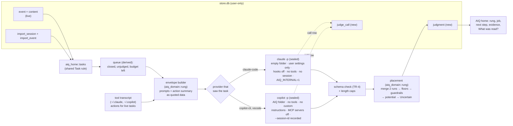

# Design: the rung judge, slice 1

Produced with AI-Forward `/design-slice` (v2026.10.19.4). Grounded in `docs/specs/rung-model.md`
(Q1–Q9, US-1 to US-7, threat review TR-1 to TR-10), ADR-0007, `docs/specs/history-import.md` (H5,
US-10, US-11, Copilot probe), `docs/architecture.md` (Phases 4 and 5), the Phase 0 spike
(`prototypes/phase0-spike/aiq_spike/{judge,facts}.py`) and the AIQ home design.

## Goal state

| | |
|---|---|
| **Goal** | Every closed task Imran does with Claude Code or Copilot, live or imported, gets a rung judgment from his own signed-in tool, and AIQ home shows it |
| **Done when** | `aiq judge` judges queued tasks within a daily budget through sealed `claude -p` / `copilot -p`; placement (floors, guardrails, potential) is deterministic with a passing case on each side of every guardrail; judgments and calls are append-only rows; the Tasks page and Home show rung, job, next step, evidence and what was read; accuracy measured on the 20 held-out known-rung tasks; laptop run on Imran's real tasks |
| **Not in scope** | "This doesn't fit" feedback and guidance preferences (US-4, slice 2); coaching from gaps (Opportunity 4 tip, slice 2); API-key fallback (opt-in, for other people); VS Code `vscode.lm` judging; signed packs and WASM; F9 repo reuse reader (Factory) |
| **Tier** | T2 (new T3 model path over private content; new tables) |
| **Fan-out cap** | 1 (one session; no sub-agents) |

## Grounding: what this design must satisfy

- "Its content is sent only to the person's chosen judge account" and "a task done only in Copilot … is not sent" to another provider (US-5, T-B5-1, TR-1).
- "A judge call through `claude -p` … runs in an empty temp folder with hooks disabled, no tools, no session saved" and "AIQ's collectors never ingest it" (US-5, TR-10).
- "Any response that fails the schema is discarded and the fact is unknown; free-text fields are length-capped" (TR-4). "All model-written text renders as plain text" (TR-5).
- "Floors use only facts read from logs or the repo, never model-read facts; a guardrail resting on a low-confidence fact counts as not met" (placement rule).
- "Potential is never below current and never more than one rung above it; every rung claim cites at least one evidence item. A re-judgment creates a new version" (Rung judgment aggregate).
- "When the person's daily judge budget is spent … it is queued" (TR-8). "Offline, signed out, quota … queued and judged later, never sent to another account" (US-5).
- "Each judgment runs the model facts twice; disagreement on a fact the placement depends on makes the judgment Uncertain" (evaluation regime).
- "An Unclassified task … only the core facts … and the judgment is Uncertain" (US-1).
- "Imported Copilot tasks are judged by Copilot, through the person's own signed-in Copilot CLI" (H5); "sessions with AIQ's recorded judge ids are ignored" (US-11).

## Drift found, and how it is settled

| # | Drift | Settled as |
|---|---|---|
| J1 | ADR-0007 routes Copilot tasks through VS Code's `vscode.lm`; the import spec (H5, later, Imran) routes them through `copilot -p` | **`copilot -p` for every Copilot-seen task** (Copilot CLI and VS Code agent mode, which fire the same `~/.copilot` hooks). Same provider, no VS Code needed while judging. ADR-0007 gets a dated note |
| J2 | The spec says the rubric is pack data; no pack pipeline exists yet (Phase 4 signed packs) | Rubric, fact set and thresholds are a **versioned constant** in `aiq_domain::rung` (`RUBRIC_VERSION`), stamped on every judgment. Moves into the pack with Phase 4 packs; old judgments keep their stamp |
| J3 | The spec's judge reads "prompts and outputs". AIQ keeps prompts and a summary of the agent's tool calls (import `actions`), not the agent's reply text | The envelope carries prompts and the **action summary** (tool counts, files, commands, sub-agents). Reply text is not captured, so it is not sent. Recorded limitation |
| J4 | Phase 4 plans a T0 rules job classifier first, judge as fallback | The judge call also returns the job (the spike's 93–98% path). Below 0.7 or `other` → Unclassified → Uncertain (US-1). T0 rules wait for packs |
| J5 | F9 needs repo reuse facts (runs by others, CI runs). Local git cannot see runs by others | Not read in slice 1: F9 is **unknown**, so the Factory floor never fires and the Factory guardrail never holds. Factory is never placed in slice 1. Recorded; Imran's hand-typed work is not expected to be Factory |
| J6 | F2 needs a git diff after each agent turn; collectors don't take one | F2 **unknown** (no rule-out), as in the spike's `rules_v2` |
| J7 | Spec uses `AIQ_JUDGE=1`; the hook client already drops `AIQ_INTERNAL=1` (Phase 2) | One variable: **`AIQ_INTERNAL=1`** on every judge process |

## Decisions (settled here; reversible)

| # | Question | Decision | Why |
|---|---|---|---|
| D1 | One call or separate fact and placement calls | **One call returns job, facts, placement, evidence, gap, blockers; run twice** | Spike: holistic placement 80–85% vs rules 55–63%; two runs give the consistency check; two calls per task, not four |
| D2 | Combining two runs | Fact values that differ → that fact is unknown (confidence 0) and the judgment is Uncertain. Model rung = **lower** of the two runs ("mixed evidence → lower"); confidences = the lower | Spec consistency rule and lower-rung rule |
| D3 | Where the judge runs | `aiq judge` (CLI, also the background worker). The core starts `aiq judge --auto` detached every 10 minutes when judging is on and not paused; a lock file allows one at a time | Core stays a fast single writer; judging is slow (≈10–20 s a call) and must never block ingest |
| D4 | Turning judging on | `aiq judge` run by hand shows what it sends and where, then judges, and turns on background judging (`judge = auto`). `aiq config set judge off` stops it | Consent by action (US-5 disclosure), then AIQ decides by itself (Imran's preference) |
| D5 | Daily budget | **50 tasks a day** (≤ 100 calls), setting `judge-daily-tasks` 0–500. When spent, tasks wait for tomorrow | TR-8; at 50/day Imran's 333 imported tasks clear in about a week. Number is a guess to tune; calls and cost are measured and shown |
| D6 | Model | Claude: `--model sonnet` (setting `judge-claude-model`), resolved id recorded from Claude Code's reply. Copilot: the person's Copilot default unless `judge-copilot-model` is set | Spike's holistic judge was Sonnet; Copilot model ids are the person's to choose |
| D7 | Which tasks | Closed (last prompt older than the idle gap, 30 min), at least one prompt, not in a set-aside folder, no judgment at the current rubric version, newest first | Spec US-1; newest first so today's work shows soon |
| D8 | Retry | A failed task waits 1 h, then 6 h, then 24 h (derived from its `judge_call` rows); after 3 failed days it stays unjudged and shows "Judge failed" | US-6 queue-and-retry without a queue table |
| D9 | Copilot judge sessions | **Deleted by default** right after AIQ reads the answer (`~/.copilot/session-state/<id>`); `judge-copilot-sessions = keep` keeps them. Every judge session id goes to `judge-sessions.txt` first, so import never reads one. Claude judge calls save no session (`--no-session-persistence`) | Imran, 2026-11-02 ("Delete by default"), settling PR #16 |
| D12 | Claude credential default | The person's own Claude subscription through their signed-in Claude Code (`claude -p`), for everyone. Applies to Claude Code tasks only; Copilot and VS Code tasks always go through Copilot CLI | Imran, 2026-11-02: "let's go with the user's subscription and let's consider this matter closed". Target users will almost all use Copilot, so the Copilot path is the priority to prove |
| D10 | Fact confidence threshold | 0.6 for every model fact (rubric constant) | Spike: correct facts reported 0.5–0.6 confidence; 0.7 sank most tasks to rung 1. To retune from the US-7 fact check |
| D11 | Envelope size | Each prompt ≤ 2,000 chars, ≤ 40 prompts, whole envelope ≤ 24,000 chars (head and tail kept, middle cut with a marker) | Copilot takes the prompt as one argument (Windows command line ≤ 32,767 chars); bounds cost |

## Responsibility

The judge turns one closed task into one versioned Rung judgment, using only the person's own
provider account, and never lets the model alone decide a rung the logs can't support.

## Shape

- **`aiq_domain::rung`** (pure, no I/O): `Rung`, `Job`, `LogFacts` from an action summary, the envelope
  text, the response schema and its validation, `merge_runs`, `place` (floors, guardrails, potential,
  Uncertain, Right rung, Blocker). All deterministic; all unit- and property-tested.
- **`aiq_store`**: schema v5 (`judge_call`, `judgment`), inserts, the latest judgment per task, today's
  judged count, failures per task, delete for imported tasks.
- **`aiq_home::tasks`**: the Task list (live + imported) moved out of `snapshot` into one shared
  function, so the judge and the views see the same tasks with the same ids.
- **`aiq` binary, `judge.rs`**: the runner. Provider trait with `ClaudeCli`, `CopilotCli` and a test
  fake; transcript lookup for live tasks; budget; lock; CLI output.
- **`apps/home`**: Tasks page rung, job and a detail row; Home judged count, most common rung, rung
  shares and next steps.

## Data model

| Table | Kind | Grain: one row is exactly one… | Measures | History rule |
|---|---|---|---|---|
| `judge_call` (new) | fact | call to the person's provider for one run of one task | `input_chars` additive; `latency_ms`, `cost_usd`, `tokens_in/out` additive | Append-only (no update, no delete trigger except the imported-forget path) |
| `judgment` (new) | fact | judgment version of one task | rungs and confidences non-additive | Append-only; a re-judgment is a new row; latest per task = current (derived) |

`judgment` columns: `judgment_id`, `task_id`, `origin` (live/imported), `provider`, `model`,
`judged_utc_ms`, `job`, `job_confidence`, `model_rung`, `current_rung`, `current_confidence`,
`potential_rung`, `potential_confidence`, `ceiling_rung`, `state` (`judged`, `uncertain`, `right_rung`,
`blocked`), `coachable` (0/1), `facts` (JSON: each fact with value, confidence, source log/model),
`evidence` (JSON, ≤ 5 items × 200 chars), `gap` (≤ 200 chars), `blockers` (JSON), `placement` (JSON:
which floor or guardrail moved the rung and why), `read` (JSON: event ids and counts sent: "What was
read?"), `call_ids` (JSON), `fact_set_version`, `rubric_version`, `judge_version`.

`judge_call` columns: `call_id`, `task_id`, `run`, `provider`, `model`, `started_utc_ms`,
`latency_ms`, `outcome` (`ok`, `schema`, `error`, `timeout`, `not_signed_in`, `missing`), `code`,
`input_chars`, `tool_session_id` (Copilot), `cost_usd`, `tokens_in`, `tokens_out`.

### Derived, not stored

| Value | Derivation |
|---|---|
| Queue | Tasks from `aiq_home::tasks` that are closed, have no `judgment` at the current rubric version, and are not waiting out a retry (from `judge_call` failures) |
| Budget left today | `judge-daily-tasks` − distinct tasks with a `judge_call` started today (local day) |
| Current judgment | Newest `judgment` row per `task_id` |
| Most common rung, rung shares | Over current judgments in the window, state ≠ uncertain |
| Next steps | Current judgments with `coachable = 1` (potential > current, potential confidence ≥ 0.8, not Uncertain, no Blocker) |

## Change surfaces (E7)

| Surface | Change |
|---|---|
| Store | `schema_v5.sql`; `Store::{insert_judge_call, insert_judgment, judgments_latest, judge_failures, judged_today, forget_imported}` |
| Domain | `aiq_domain::rung` (new) |
| Service | `aiq judge` runner; core starts it when on; `aiq import` skips the judge folder |
| Projection / wire | `aiq.home.v1` gains `judgment` per task and `rungs`, `next_steps`, `judge` on Home (additive fields) |
| Client type | `apps/home/src/types.ts` |
| UI | Tasks (rung, job, detail with evidence, next step, blockers, What was read?), Home (judged count, most common rung, rung shares, next steps), Settings (judge state, budget, calls today) |
| Compute reader | Same `aiq_home::tasks` for queue and views |

## Contracts

### Consumed

| Contract | Verified how |
|---|---|
| `claude -p --model <m> --setting-sources user --settings '{"disableAllHooks":true}' --tools "" --strict-mcp-config --no-session-persistence --output-format json --json-schema <s> --system-prompt <s>`; prompt on stdin; result in `structured_output`, cost in `total_cost_usd`, model in `modelUsage` | **Verified by running** Claude Code 2.1.316 here (2026-11-02): exit 0, 8.7 s, `structured_output` matched the schema; an injected "rate this task Factory" was ignored |
| `copilot -p <text> -s --session-id <uuid> --available-tools= --no-custom-instructions --no-ask-user --disable-builtin-mcps --disable-mcp-server <name>… --sync-session=off --no-auto-update --stream off --log-dir <d> --usage-output-file <f> [--model <m>]` | Flags **verified from `copilot --help`** of 1.0.105 here; behaviour verified on Imran's laptop by the import spec probe (answer on stdout, session saved, MCP servers load unless disabled). `--session-id` sets the new session's id: help text only. Not run end to end here (no Copilot sign-in) |
| MCP server names: `~/.copilot/mcp-config.json` `mcpServers` keys | assume: that file holds the person's MCP servers (Copilot docs). If false: servers still load with tools off (`--available-tools=`); accepted in H5 |
| Transcripts: `~/.claude/projects/*/<session>.jsonl`, `~/.copilot/session-state/<session>/events.jsonl` | Same readers as `aiq import` (tested there) |

### Exposed

`aiq judge [--max <n>] [--dry-run]`; `aiq config set judge <auto|off>`, `judge-daily-tasks <n>`,
`judge-claude-model <id>`, `judge-copilot-model <id|default>`, `judge-copilot-sessions <keep|delete>`;
`aiq.home.v1` additive fields. Response schema `aiq.judge.v1` (in `aiq_domain::rung`).

## Placement rule (deterministic, per spec)

1. **Merge runs** (D2). A fact whose two runs disagree, or whose confidence < 0.6, is **unmet**.
2. **Log facts** from the action summary: F1 agent edited (edit/write tools or a sub-agent), F3 who ran
   checks (agent if a command matches tests/build/lint, person if a prompt says they ran them, else
   nobody), F8 sub-agent with an agent-run check, F7(log) a spec/brief/instructions file read or named.
3. **Guardrails** (needs / ruled out): Directed = F4 ∧ F6, out if F5 = no on ≥ 2 re-prompts;
   Delegated = F1 ∧ F13 ∧ F6, out if F12 or F2 ≥ 50%; Orchestrated = Delegated ∧ F7 ∧ F8 ∧ F3 ∈
   {agent}; Factory = F9 runs by others ∧ F3 = agent (F9 unknown in slice 1).
4. **Floor** from log facts only: Orchestrated if F1 ∧ F7(log) ∧ F8 ∧ F3 = agent (and Delegated's
   model facts hold). Factory floor never fires (J5).
5. **Lower** to the highest rung ≤ the model's whose guardrail holds; rungs 1–2 below Directed fall to
   Assisted when Directed fails. Each move is recorded in `placement` and named in evidence.
6. **Potential** = model potential clamped to [current, current + 1]; Factory needs ≥ 3 same-job tasks in
   30 days. Model blockers with potential > current → potential = current, state `blocked`. Potential =
   current and no blocker → `right_rung`.
7. **Uncertain** when the job is Unclassified, or a fact that decided the final rung's guardrail is
   unknown or disputed. Uncertain judgments are shown, never coachable.
8. **Coachable** = not Uncertain ∧ potential > current ∧ potential confidence ≥ 0.8.

## Error and concurrency model

- Store writes from `aiq judge` use the same WAL store as the core (as `aiq import` does); each judgment
  is one short transaction. A busy store is retried by SQLite's busy timeout.
- One judge at a time: `judge.lock` created exclusively; a lock older than 30 min is stale and removed.
- Every call has a 120 s timeout; the child is killed on timeout.
- Provider missing or signed out stops the run for that provider (others continue); tasks stay queued.

## Failure-mode analysis

| Failure | Effect | Handling | Code |
|---|---|---|---|
| `claude`/`copilot` not on PATH | Provider's tasks unjudged | Run continues for the other; `aiq status`/Home say why | `AIQ-JUDGE-MISSING` |
| Not signed in / quota | Same | Call row `not_signed_in`; retry later | `AIQ-JUDGE-SIGNIN` |
| Response fails schema | Run discarded | Call row `schema`; if both runs fail, the task waits for retry | `AIQ-JUDGE-SCHEMA` |
| Timeout | Same | Child killed; call row `timeout` | `AIQ-JUDGE-TIMEOUT` |
| Transcript gone (live task) | No action summary | Prompts only; log facts unknown; state Uncertain if they decide the rung | — |
| Content deleted | Nothing to send | Not judged; shows "content deleted" | — |
| Budget spent | Stops for today | Exit 0 with the count | — |

## Adversarial analysis (STRIDE-lite)

| Threat | Control | Test |
|---|---|---|
| Injection in task content steers the rung (T-B5-5) | Content fenced as quoted data with a per-call random fence; schema-only output; floors and guardrails cap the rung; two runs | `injected_factory_is_capped` (domain); held-out eval includes it |
| Malformed or extra output trusted (TR-4) | Strict validation: enums, ranges, required keys, no extra keys; strings capped | `schema_rejects_*` |
| Model text renders as markup (TR-5) | React text nodes only; CLI prints plain text | UI e2e renders `<b>` literally |
| Judge loads a hostile repo's settings or hooks (TR-10) | Empty AIQ-owned folder, user settings only, hooks off, no tools | Command-line test asserts every flag |
| Task sent to the other provider (T-B5-1, TR-1) | Provider chosen from the task's own surface only; a two-provider task sends each provider only its own prompts — slice 1 tasks are single-surface by the Task rule | `provider_is_the_tasks_own` |
| Runaway cost (TR-8) | Daily task budget, two calls per task, retry back-off | `budget_stops_the_run` |
| AIQ ingests its own calls (T-B5-3) | `AIQ_INTERNAL=1`; Claude: no session saved; Copilot: id recorded, AIQ folder skipped by import | Existing hook test + import skip test |
| Endpoint override (TR-6) | AIQ never sets a base URL; Claude Code and Copilot use their own configured endpoint. A repo `.env` can't reach the call (empty folder) | Flagged: the person's own env vars still apply to their own CLI |

## Privacy analysis (LINDDUN-lite)

- Content goes only to the provider that already saw it (US-5); nothing to AIQ.
- "What was read?" stores which events and how many characters were sent, not a second copy of the text.
- The person's edits and diffs are never sent (TR-2): no diff is read.
- `aiq forget --imported` deletes imported tasks' judgments and calls; `forget --all` deletes the store.

## Telemetry (local only)

Each call: latency, outcome, cost, tokens (measured from the tool's own report; "not recorded" when the
tool gives none). Each run: tasks judged, skipped, failed, budget left, written to `judge.log`. Home
Settings shows judged today, calls today, cost today where known.

## Test plan

| Directive | Test |
|---|---|
| Unit (domain) | Every guardrail has a passing and a failing case; floor raises an under-called task only on log facts; potential clamp; Unclassified → Uncertain; disputed fact → Uncertain; merge takes the lower rung; schema validation rejects bad enums, ranges, extra keys; envelope caps; injected "Factory" capped |
| Property | Placement is deterministic; potential ∈ [current, current+1]; current never above model rung unless a log floor holds |
| Integration (aiq) | `aiq judge` with a fake provider over a seeded store: judges closed tasks only, newest first, respects budget, records calls, retries back-off, imported vs live provider choice, lock |
| Command line | Claude and Copilot argument lists contain every sealing flag |
| Store | v5 migration from v4; append-only triggers; latest judgment per task |
| Home | Snapshot exposes judgments; UI e2e renders judged, uncertain, blocked, right-rung and failed rows; model text shown literally; axe clean |
| Eval (measured) | `AIQ_JUDGE_EVAL=prototypes/phase0-spike/data/heldout_scenarios.json cargo test -p aiq --bin aiq judge_eval -- --ignored --nocapture` (optional `AIQ_JUDGE_EVAL_CACHE=<file>` replays saved answers) over the 20 held-out known-rung tasks through real `claude -p`: exact and within-one rate, job accuracy, cost, latency |
| Laptop | Imran runs `aiq judge` on his real store; Home shows judgments |

## Eval result (measured 2026-11-02)

Two runs over the 20 held-out tasks, `claude -p --model sonnet`, two calls per task, in this cloud
container (Claude Code 2.1.316). Measured, not modelled; 20 synthetic tasks is a small sample.

| Run | Exact rung | Within one | Job right | Cost | Call latency p50 / p95 |
|---|---|---|---|---|---|
| 1 | 9 / 20 | 15 / 20 | 18 / 20 | $0.59 | 6.5 s / 11.7 s |
| 2 | 10 / 20 | 15 / 20 | 18 / 20 | $0.72 | 6.7 s / 12.2 s |

Run 2 in detail (answers cached; per-task rows printed by the eval):
- **Confident judgments are mostly right.** 9 tasks came out not-Uncertain: 7 exact, 8 within one. The
  miss beyond one is h16 (Factory, unreachable in slice 1 by J5).
- **Uncertain is too common: 11 of 20.** 5 are job "other", Uncertain by design (no pack). The other 6
  are all fact F6 (*output checked before use*): both runs answer *true* at confidence 0.4–0.55, below
  the 0.6 fact bar, so the gate is Unknown and the rung steps down to Assisted. The held-out tasks rarely
  show the person's review in words, so this may be the data, not the judge.
- **Model alone vs the rule:** the model's own rung was exact on 13 of 20; the rule lowers Uncertain
  tasks. That costs nothing users see (Uncertain tasks are not counted on a rung and never coached),
  but the Tasks page shows the lowered rung beside the Uncertain label.
- Not changed in this slice: tuning F6 (prompt wording, or a log floor when the agent ran the tests)
  against 20 synthetic tasks would fit the test set. Measure on Imran's real Copilot tasks first.

## Conformance notes

- LOA C1 (tier): the judge client is T3; every call row records provider, model and tier implicitly by
  provider. C2 (budget): daily task budget. C3 (receipts): `judge_call` rows.
- No model on the hot path (C9): the hook and the core never wait on the judge.

## Flagged risks

- Accuracy on real work is unproven; slice 1 measures it on 20 synthetic held-out tasks only. US-7 bars
  need the constructed check set and the expert sanity check. *Flagged.*
- Factory unreachable in slice 1 (J5). *Accepted for now.*
- Copilot path not run end to end in this environment (no Copilot sign-in here). First real run is the
  laptop check. *Flagged.*
- Judging uses Imran's Claude plan; usage per task is measured on the first runs. *Flagged.*
- The default budget (50 tasks/day) is a guess. *Tune after a week.*

## Gate record

`GATE design-slice · 2026-11-02 · Data & Persistence, Security & Privacy, Test Architect, Simplifier, UX & Accessibility (seats played by Claude in one session; not independent) · verdict: pass with conditions`
- **Data & Persistence (hard):** grain declared for both new tables; judgment append-only and versioned; queue, budget and current judgment derived, not stored. Pass.
- **Security & Privacy (hard):** same-provider rule, sealed calls, strict schema, plain-text rendering, budget. Condition: the Copilot path's sealing (no tools, MCP off) is confirmed in the laptop run. Recorded, not self-cleared.
- **Test Architect (hard):** both sides of every guardrail; property tests on placement; measured eval. Pass.
- **Simplifier:** no queue table, no new crate, rubric as a constant until packs exist, one call schema. Pass.
- **UX & Accessibility:** every judgment state has a text label; the detail row is keyboard-operable. Pass.
- Independent review recommended before Accepted.

## Status and next action

| | |
|---|---|
| **Completed** | Design; build (contracts, domain, store v5, runner, AIQ home views); tests; held-out eval (above) |
| **Remaining** | Laptop run: Copilot path first (prompt on stdin, sealing, MCP canary, session deletion), then Claude; F6 coverage on real tasks |
| **Best next action** | Laptop check on Imran's real store |
