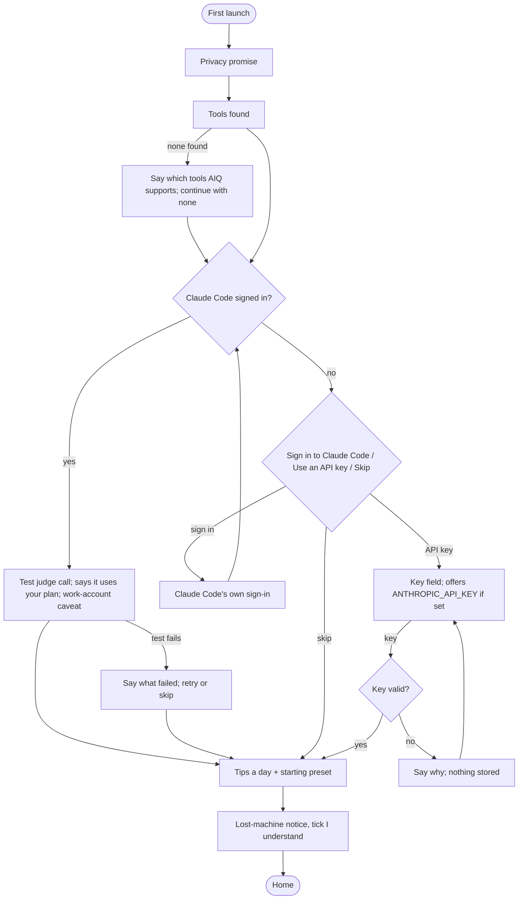
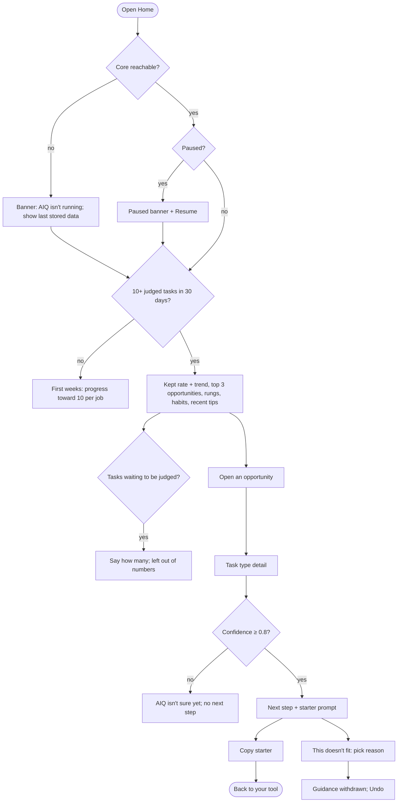
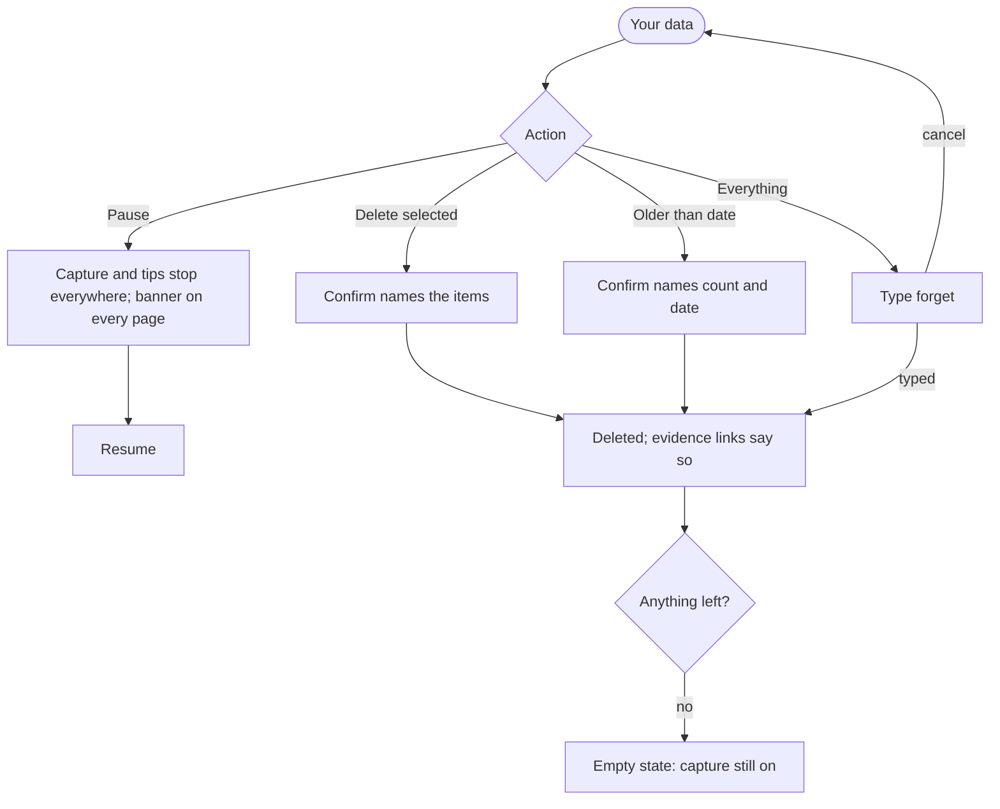

# Spec: AIQ home (desktop app views)

Produced with AI-Forward `/specify` (v2026.10.19.4) as the UX layer `/ui-design` needs before it can
design AIQ home. **Status: draft for Imran's review. Q1–Q6 decided; Part C produced by /ui-design.** Starting point: round-1 mockups
(`docs/mockups/aiq-ui-round1.html`, https://claude.ai/artifact/SAhC7cYJCHDqmVvGmWKwwH).

This spec fills the gap both sibling specs leave open: `rung-model.md` puts "the rung distribution
view and the opportunity view in AIQ home" out of scope ("own spec"), and `coaching-loop.md` puts
"AIQ home views" out of scope.

## Questions settled (decision interrogation, asked one at a time)

| # | Question | Needed for | Recommendation |
|---|---|---|---|
| Q1 | What counts as a task "finished without you redoing it" (the Home headline)? | Home hero, the outcome-first framing, any trend | **Decided (Imran, 2026-11-01): kept with small edits and no re-prompt.** The person wrote at most about 20% of the final change (rung-model F2) and sent no re-prompt that corrected the agent in that task (F5). Threshold is tunable |
| Q2 | Which screens ship in the alpha app? | Scope, IA, effort | **Decided (Imran, 2026-11-01): all six.** Setup, Home, Task detail, Habits and tips, Your data, Settings. Sharing shown as off with a preview only |
| Q3 | Default time window for Home? | Every number on Home | **Decided (Imran, 2026-11-01): last 30 days, with a weekly trend line** |
| Q4 | Show an estimated time saved per opportunity? | Opportunity rows, trust | **Decided (Imran, 2026-11-01): no.** Show how often the task happens (times per week) instead |
| Q5 | Ask for the API key during setup, or when the first rung view is ready? | Setup flow, first-run drop-off | **Decided (Imran, 2026-11-01): mostly no key at all.** The Claude judge runs through the person's own signed-in Claude Code (`claude -p`); AIQ never reads Claude Code's credentials. Setup detects that Claude Code is signed in. Only if it isn't, setup offers the API-key step (detect `ANTHROPIC_API_KEY` first; skippable; tips work without it). Copilot work is judged through VS Code's language model API. Supersedes the key-only credential rule in ADR-0007 (H11) |
| Q6 | Is there a full task list, or only the top opportunities? | IA, navigation | **Decided (Imran, 2026-11-01): yes, a Tasks page** listing every task type, sortable by how often and by rungs to gain. Home keeps the top three |

## Part A — Functional specification

### Problem
People who work with AI agents cannot see, in one private place, how much of their work agents now
finish, which recurring tasks agents could take further, and what single change would get them there.
They also need to trust AIQ: see what it captured, pause it, and delete it.

### Target users & personas
Developers and PMs first (shared surfaces); data scientists and other knowledge workers later.
Coaching follows the job being done (Code a change; Write a spec or doc), never the job title.
Roles are presets only (coaching-loop D7).

### Core scenario
Once a week, or after a tip, a person opens AIQ home. In under a minute they see how much of their
work agents finished without rework, the top recurring task where agents could do more, and one
next step with a starter prompt. They try it on their next task in their own tool.

### In scope / Out of scope
In scope: setup; Home; task detail (rung judgment, evidence facts, next step, "This doesn't fit");
habits and tip history; your data (capture log, pause, delete one / older than / all); settings
(tip limit, quiet hours, tip types, work mix and preset, judge, sharing).

Out of scope: any team or manager view (never); the in-tool cards (`coaching-loop.md`); how the
rung is judged (`rung-model.md`); sync across devices; weekly summary emails.

### Decisions already made (inherited, not re-opened)
| Ref | Decision | Source |
|---|---|---|
| H1 | Only the person sees their data; no manager or team view; sharing is opt-in and must be easy to reason about | Imran, 2026-10-31 |
| H2 | Lead with the user outcome (agents do more with less rework); rungs explain underneath | Imran, 2026-10-31 |
| H3 | Task-level, not person-level, framing; success is a recurring task moving up a rung | Imran, 2026-10-31 |
| H4 | Rung ladder: 1 Assisted, 2 Directed, 3 Delegated, 4 Orchestrated, 5 Factory; names first, numbers second | Brief; rung-model Part C |
| H5 | People never reclassify a rung; "This doesn't fit" gives feedback on the guidance with a reason | rung-model Q3 |
| H6 | No next step coached below 0.8 confidence | rung-model |
| H7 | Raw prompts stay on device until the person deletes them (one item, older than a date, all) | ADR-0002 |
| H8 | Lost machine means lost history; stated at setup | Imran, 2026-10-31 |
| H9 | Daily tip limit 1, 3 or 5, default 5, set at setup and in Settings | coaching-loop D3 |
| H10 | Habit states Not yet / Tried / Adopted (rule D5) | coaching-loop D5 |
| H11 | Judge runs under the person's own account: their signed-in Claude Code (`claude -p`), else their own API key; Copilot via VS Code's language model API; work-account caveat shown at setup | ADR-0007, amended by Q5 (Imran, 2026-11-01). Basis: Claude Code legal-and-compliance page allows signing in to unmodified Claude Code with one's own plan |
| H12 | Keyboard-first UI style | coaching-loop |
| H13 | AIQ home is a Tauri desktop app with a React UI; no server holds user data | ADR-0004 |

### Conceptual domain model
AIQ home adds **no new aggregate**. It is a set of read views (projections) over aggregates owned by
the sibling specs, plus the person's own controls. Terms it adds to the ubiquitous language:

- **Task type** (from `rung-model.md`): a kind of task the person repeats, e.g. "Writing unit tests".
  The Tasks page lists task types, never single tasks.
- **Kept task** (new, value object derived per Task): a Task where the person wrote at most about 20%
  of the final change (rung-model F2) and sent no re-prompt that corrected the agent (F5). Derived,
  never stored as its own field (one definition of the quantity).
- **Kept rate** (new, measure): kept tasks ÷ judged tasks in a window. **Non-additive**: computed from
  the counts, never averaged across weeks or jobs.
- **Could be** (new, measure, *accepted by Imran 2026-11-01*): the share of judged tasks
  agents finished plus those agents could finish. "Agents could finish" = a judged task not kept,
  whose task type's potential rung is Delegated or higher at judge confidence ≥ 0.8; the rest are
  "Needs you". Non-additive like Kept rate. Home shows it as weekly 100% stacked columns: Agents
  finished / Agents could finish / Needs you. Covers only work done with an AI tool AIQ watches.
- **Most common rung** (new, projection, *accepted by Imran 2026-11-01*): the rung holding the
  largest share of judged tasks in the window, with the number of days it has held that place. Shown at
  the top of Home as a five-step rung scale with that rung marked. Task-level, never a grade of the person.
- **Opportunity row** (projection): one task type whose potential rung is above its current rung, with
  its job, how often it happens and the one next step.
- **Environment finding** (from `coaching-loop.md`): a blocker outside the person's habits; shown on
  its task type, never counted against the person.

Grain of the Home numbers: one judged Task in the last 30 days (Q3). Tasks still queued for judging
are counted separately and never guessed.

### User stories & acceptance criteria

**US-H1 — Set up in a few minutes, knowing what AIQ will and won't do.**
- **Given** a first run **When** setup opens **Then** it shows, in order: the privacy promise, the tools AIQ found, the judge connection, the tip limit and starting preset, and the lost-machine notice; each step can go back.
- **Given** Claude Code is installed and signed in **When** setup reaches the judge step **Then** it asks for nothing extra: it runs one test judge call and says, in plain words, that judge calls use the person's Claude Code plan usage; AIQ never reads or stores the sign-in (rung-model, PR #11).
- **Given** Claude Code is not installed or not signed in **When** setup reaches the judge step **Then** it offers three choices: "Sign in to Claude Code" (Claude Code's own flow, never an AIQ login), "Use an API key instead" (kept only in the OS keychain; offers `ANTHROPIC_API_KEY` if set, never used without a yes), or "Skip for now" (tips work without it).
- **Given** any judge choice **When** shown **Then** the work-account caveat is on the same step (admin policies, logging and retention apply), and setup copy never claims Anthropic approves the arrangement.
- **Given** an API key Anthropic rejects **When** checked **Then** setup says it is not valid and how to fix it, and stores nothing.
- **Given** the lost-machine notice **When** the person has not ticked "I understand" **Then** "Start AIQ" is disabled.

**US-H2 — See at a glance whether agents are finishing more of my work.**
- **Given** at least 10 judged tasks in the last 30 days **When** Home opens **Then** the first number is the kept rate, with the count behind it ("58 of 141 tasks") and a weekly trend for the last 4 weeks.
- **Given** fewer than 10 judged tasks **When** Home opens **Then** no kept rate is shown; Home shows progress toward 10 per job instead.
- **Given** tasks waiting to be judged **When** Home opens **Then** it says how many are waiting, and those tasks are left out of every number.
- **Given** AIQ is paused **When** Home opens **Then** a banner says so, with Resume one action away.

**US-H3 — Find where agents could do more, and the one next step.**
- **Given** opportunity rows exist **When** Home opens **Then** it shows at most 3, ranked by times per week, each with its job, today's rung, potential rung, times per week and next step; **no time-saved number** (Q4).
- **Given** a task type capped by an environment finding **When** listed **Then** it is labelled as blocked by the environment, with what to fix, and is never ranked as a habit opportunity.
- **Given** the Tasks page **When** opened **Then** it lists every task type seen in 30 days, sortable by times per week and by rungs to gain, and filterable by job.

**US-H4 — Understand why a task type sits where it does, and say when the guidance misses.**
- **Given** a task type's detail page **When** opened **Then** it shows the next step and a starter prompt, the facts the judge used, why it is on its rung today, and the judge's source ("judged by your Claude Code").
- **Given** confidence below 0.8 **When** the detail opens **Then** no next step is shown; it says AIQ isn't sure yet.
- **Given** "This doesn't fit" **When** the person picks a reason (evidence wrong · step doesn't fit how I work · blocked by something outside my control · other) **Then** that guidance is withdrawn for this task type, the rung is unchanged, and the person can undo.
- **Given** the starter prompt **When** copied **Then** nothing is sent anywhere.

**US-H5 — Follow my habits and find a tip I dismissed.**
- **Given** the Habits page **When** opened **Then** each habit shows Not yet, Tried or Adopted and "seen in N of M tasks in 14 days".
- **Given** a tip shown in the last 90 days **When** the person opens tip history **Then** it is listed with time, tool and their answer, and a turned-off tip type can be turned back on from there.

**US-H6 — See, pause and delete what AIQ captured.**
- **Given** Your data **When** opened **Then** it lists captured events newest first, with time, tool, kind and content, and shows total count and size.
- **Given** a selected item, an older-than date, or "everything" **When** the person deletes **Then** AIQ names exactly what will go and asks for confirmation; "everything" requires typing `forget`.
- **Given** a deletion **When** done **Then** the items are gone from every view and from evidence links, which say the evidence was deleted.
- **Given** Pause **When** pressed (P, or the palette) **Then** capture and tips stop on every surface, and every screen shows that AIQ is paused.

**US-H7 — Change how AIQ coaches me, and decide about sharing with full sight of what is sent.**
- **Given** Settings **When** opened **Then** the person can set tips a day (1, 3, 5), how long a Copilot CLI status-line tip stays (until the next prompt (default, Imran 2026-11-01), 2 prompts or 5 minutes, or until opened), quiet hours, tip types on/off, starting preset, rung model connection ("Claude through your signed-in Claude Code", "your own API key" or "Copilot with VS Code consent") and judging budget.
- **Given** sharing is off (default) **When** the person opens "See exactly what would be sent" **Then** the full message for this week is shown before any opt-in, and nothing is sent until they choose to share.

### Non-functional requirements (ISO/IEC 25010)
| Quality | Requirement |
|---|---|
| Performance | Home interactive ≤ 1 s after launch on the alpha laptop with 30 days of data; every view reads only the local store |
| Usability | Keyboard-first: every screen and action reachable from the keyboard; command palette (Ctrl+K) lists every page and action |
| Accessibility | WCAG 2.2 AA; no meaning in colour alone (rungs carry names, habits carry words) |
| Privacy | No network call from any view except the judge (through the person's own Claude Code or key) and update checks |
| Reliability | Core down: AIQ home says so and shows the last stored data, never a blank screen |
| Portability | Windows first; Linux in CI; macOS untested until Phase 2 (as the slice) |

### Applicable governance lenses
Privacy (central; inherited from the privacy review), accessibility, performance, observability (local
only). Threat model: no new trust boundary; the judge path is already modelled (rung-model TR-1..TR-9).
The `claude -p` change (Q5) needs the judge-path STRIDE rows re-read by the architecture thread. *Flagged.*

## Part B — UX specification

### Personas & jobs
- **Dev, Code a change, rung 2–3:** opens AIQ home after a tip or on Monday. Job: "show me the one
  thing that would let agents finish more of my coding work."
- **PM, Write a spec or doc, rung 1–2:** same surfaces. Job: "show me where drafting with an agent
  still costs me rewrites."
- **Anyone, trust job:** "show me what AIQ has on me, and let me stop or erase it."

### Information architecture
Seven places, flat (no nesting beyond a detail page):

| Nav (key) | Page | Answers |
|---|---|---|
| G H | **Home** | Are agents finishing more? Where next? |
| G T | **Tasks** → task type detail | Where does each recurring task sit, and why? |
| G B | **Habits and tips** | Which habits have I adopted? What tips did I get? |
| G D | **Your data** | What has AIQ captured? Pause, delete |
| G S | **Settings** | Tips, work mix, judge, sharing |
| — | **Setup** | First run; re-run from Settings |
| Ctrl+K | **Command palette** | Every page and action by name |

Labels for the glossary: *Kept task, Kept rate, Task type, Next step, Starter prompt, This doesn't fit,
Blocked by the environment, Tried, Adopted, Pause AIQ, Delete everything.*

### User flows

### Wireframe-level structure
- **Shell:** left nav (seven places with key hints), status block at its foot (watching which tools,
  tips used today, P to pause), command palette on Ctrl+K.
- **Home:** period line → kept-rate card (number, count, 4-week trend) beside the top opportunity →
  "Where agents could do more" (≤ 3 rows) → "How you work with agents" (rung bars, today vs potential,
  rung names first) → habits and recent tips.
- **Tasks:** table of task types: name · job · today → potential · times a week · kept rate; sort and
  job filter; Enter opens detail.
- **Task type detail:** next step + starter prompt + This doesn't fit → facts the judge used → why
  this rung today → judge source and time.
- **Habits and tips, Your data, Settings, Setup:** as round-1 mockup, with the setup judge step per US-H1.

### UX acceptance criteria
- Home answers "are agents finishing more?" without scrolling at 1280×800.
- From Home, a next step's starter prompt is copied in ≤ 2 actions.
- Pause is reachable in 1 key (P) from every page, and its state is visible on every page.
- Every flow above ends in a shown result, a stated hold, or a stated failure with a way forward.
- No page shows a rung number without its name, or a comparison with other people.

## Part C — UI specification
Produced by `/ui-design` (2026-11-01): **`DESIGN.md`** (tokens, states, copy, modes) and the mockup
**`docs/mockups/aiq-home.html`**; review in `docs/reviews/ui-aiq-home.md`.

- **Archetype:** H1 · Windows Fluent Utility Shell, deviations `x-framework: tauri-webview2-react`,
  `Density: Comfortable|Compact`, `Feedback: Calm`, `Persistence: LocalOnly`. Rationale: the JTBD is
  "check, then act in my own tool" on a Windows-first desktop utility; reading-first, serial only in
  setup and confirms.
- **UI acceptance criteria:** WCAG 2.2 AA in light, dark and high contrast (0 failures in the
  mockup sweep); targets ≥ 24×24 px; one focal point on Home (the kept rate); every modal traps focus
  and returns it; every pause, resume and delete outcome announced in a status region; single-key
  shortcuts can be turned off; no rung number without its name; no score or comparison with others.

## Flagged risks & residual unknowns
- Kept rate depends on rung-model facts F2 and F5 meeting their fact bar; until then Home's headline
  is *Uncertain* and must say so. *Flagged.*
- `claude -p` judging uses the person's plan limits; the daily judging budget must stop it eating
  their Claude Code allowance. Budget default to be set from dogfood measurement. *Flagged.*
- Whether `claude -p` judging fits "ordinary, individual usage" in Anthropic's terms at a 40-task
  daily budget is a reading of the docs, not a ruling. *Flagged.*
- The 20% threshold in Kept task is a first guess; tunable pack data.
- "Could be" leans on the potential rung, which is a model judgment; tasks below the 0.8
  confidence bar count as "Needs you", so the figure errs low. *Flagged.*

## Gate record
Author-run adversarial pass, 2026-11-01 (independent review still owed; the author does not clear vetoes):
- **Simplifier:** seven places is the floor for the decided scope (Q2 + Q6); the rung bars duplicate
  the Tasks page in summary form and are kept only because Home must explain the rungs (H2). Soft, no veto.
- **Test Architect:** every Then above names an observable result; thresholds (10 tasks, 3 rows, 0.8,
  20%, 90 days) are stated. No unverifiable criterion found.
- **Data & Persistence:** no new aggregate; kept rate derived from facts, non-additive, grain declared.
- **UX Researcher/IA:** flows cover first run, no tools, no judge, bad key, core down, paused,
  queued, low confidence, delete and cancel. Open: Tasks page empty state (covered by US-H2's
  first-weeks rule; to be drawn in /ui-design).
- **Verdict:** ready for `/ui-design`, pending Imran's review of this draft.
