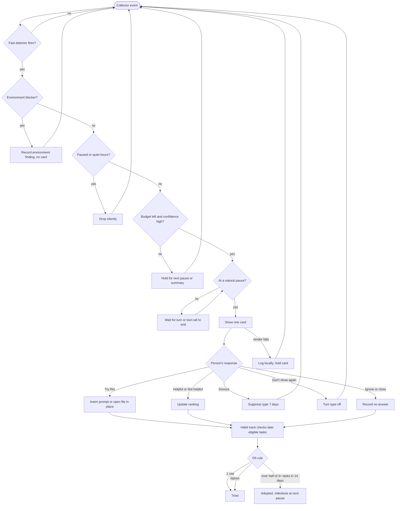

# Spec: In-the-moment coaching loop

Produced with AI-Forward `/specify` (v2026.10.19.4), run interactively with Imran.
Source of truth: AIQ brief and Design > Coaching tab (https://claude.ai/artifact/6PhqpuQvWMcU6xBD7rBbRw).

## Decisions so far

| # | Decision | Source |
|---|---|---|
| D1 | Specify the coaching loop (card + triggers) first | Imran, 2026-10-31 (decision card) |
| D2 | Surfaces: VS Code, Claude Code and GitHub Copilot CLI, all from the start | Imran, 2026-10-31 (decision card) |
| D3 | Frequency: at most one in-the-moment tip per session and per-trigger cooldowns (Design > Coaching > Guardrails). Daily cap is chosen by the person at setup and in Settings (1, 3 or 5), **default 5** | Guardrails: recorded owner ruling; cap: Imran, 2026-10-31 (thread reply) |
| D4 | Only the person sees their data; AIQ never posts anything others can see | Imran, 2026-10-31 (privacy rule) |
| D5 | Habit states: **Tried** after one observed use; **Adopted** when seen in more than half of eligible tasks over 14 days, with at least 3 eligible tasks. Thresholds are tunable and expected to change | Imran, 2026-10-31 (thread reply) |
| D6 | PMs are primary users of this loop on the same surfaces: they are expected to work in CLI agents and possibly VS Code | Imran, 2026-10-31 (thread reply) |
| D7 | Coaching is keyed to the job being done, not the person's job title. Packs are organised by job (e.g. coding, writing specs and docs, analysis, research, status reporting); a role is only a preset of which job packs start on and how they are weighted. Alpha ships two job packs: **Code a change** and **Write a spec or doc** | Imran, 2026-10-31 (thread reply: "aligning to the jobs-to-be-done framework") |

## Part A — Functional specification

### Problem
Developers are expected to let agents do more of their work, but most still use AI one prompt at a
time. They repeat habits that cap what agents can do (re-prompting without new information, pasting
context by hand, rewriting agent output instead of fixing the instruction) and get no feedback while
it matters. Reports a week later don't change habits; feedback during the task does.

### Target users & jobs-to-be-done
AIQ coaches the **job**, not the title (D7). Developers, PMs and data scientists increasingly do each
other's jobs, with different emphasis. The person's role only sets defaults.

Jobs in this spec (alpha job packs):
- **Code a change:** fix a bug, add a feature, refactor, write tests, with an agent or completions.
- **Write a spec or doc:** a spec, PRD, design note, research summary or status update drafted with
  an agent in a CLI or VS Code.
- **Ask or research** (added 2026-11-02, Imran's card: 9 of his first 10 real tasks were questions or
  research): the result is an answer for the person, not a change to their files. How-to questions,
  understanding code or concepts, finding a cause, comparing options, finding facts, research, data analysis.

People (anyone doing those jobs on VS Code, Claude Code or Copilot CLI):
- **Rung 1–2 (primary):** uses completions and chat; rarely hands over a whole task. Motivated
  (self-selected), short on time, wary of being watched. Typically devs and PMs today.
- **Rung 3 (secondary):** hands whole tasks to a CLI agent; loses time to rework and missing context.
- **Role presets:** Developer (Code a change weighted higher), PM (Write a spec or doc weighted
  higher), Data scientist (no alpha job pack yet; gets role-neutral tips). The preset is chosen at
  setup, can be changed anytime, and AIQ then follows the mix of jobs it actually observes.

Out of this spec: jobs on Office, Teams and planning tools (summary-only today) and job packs beyond
the two above.

### Core scenario
Priya asks the agent to fix a failing test. After her third rephrase with no new information, AIQ
shows one card at the agent's next pause: "You've rephrased this three times without new
information. Try giving it the failing test output and the expected result." It has a one-click
"insert starter prompt" action and links to the three prompts as evidence. She uses it, the agent
fixes the test, and over the next week AIQ sees her include test output up front in most similar
tasks. It records the habit as adopted, privately.

The same week Priya drafts a design note with Claude Code: "Write a spec for retrying failed
uploads." AIQ notices the request has no audience, goal or constraints (Opportunity 5) and, as the
agent turn ends, offers a short brief template to fill in. Her job title never enters into it; the
job does.

### In scope / Out of scope (explicit non-goals)
In scope: detect → choose → show → collect feedback → check adoption, for VS Code, Claude Code and
GitHub Copilot CLI;
the coaching card; trigger rules (condition, cooldown, surface, priority); the interruption budget;
per-person tip ranking and suppression from feedback.

Initial Opportunity types (seeded from the Design > Coaching tab):

| # | Opportunity | Job | Path |
|---|---|---|---|
| 1 | Re-prompting the same request 3+ times without adding new information | Any job (core) | Fast |
| 2 | Pasting large context by hand that the agent could read itself | Any job (core) | Fast |
| 3 | Long manual edits of AI output instead of fixing the instruction | Any job (core) | Fast |
| 4 | A coding task that usually fits handing to an agent end to end | Code a change | Slow (next pause; needs rung model) |
| 5 | Asking for a spec or doc without a brief (audience, goal, constraints, sources) | Write a spec or doc | Fast |
| 6 | Accepting an AI-drafted spec or doc with claims and no source check | Write a spec or doc | Slow (next pause) |

Out of scope: rung model scoring (separate spec; this spec consumes "a rung estimate is available or
not"); AIQ home views; weekly summary; browser and closed-app surfaces; job packs beyond the two alpha ones; any sharing; any
org or aggregate reporting; authoring UI for packs.

### Conceptual domain model (bounded context: Coaching)
Ubiquitous language:
- **Task**: one unit of work the person does with AI, grouped from events (prompt, tool calls, edits).
- **Job**: what a Task is for (e.g. Code a change, Write a spec or doc), classified from the Task
  itself, never from the person's title. Selects which job pack's Opportunities apply.
- **Job pack**: coaching content (detectors, tips, rubric examples, golden set) for one Job.
- **Role preset**: a starting weighting of job packs; a default, never a filter on what is observed.
- **Signal**: a fact a detector derives from a Task ("3 re-prompts, no new context").
- **Opportunity**: a habit the person could change, tied to one or more Signals and a target rung.
- **Environment blocker**: a cause outside the person (missing instructions file, no tool access).
  Never counted against them and never coached as a habit.
- **Tip**: pack content that addresses one Opportunity type with one Try-this step.
- **Coaching card**: one Tip shown for one Opportunity, with evidence, at one moment, on one surface.
- **Trigger rule**: when a card may appear (condition, cooldown, surface, priority).
- **Interruption budget**: the person's remaining allowance of in-the-moment cards.
- **Habit**: the target behavior an Opportunity points to. States: *Not yet* → *Tried* (one
  observed use) → *Adopted* (rule D5). A Habit can fall back from Adopted to Tried if it lapses.
- **Eligible task**: a Task where the Habit applies (the Opportunity's detector would fire without it).
- **Feedback**: helpful / not helpful / snooze / don't show again, plus optional reason.

Aggregates and the invariant each protects:
- **Coaching session** (root: the person's session on a surface): never more than the budgeted number
  of in-the-moment cards; never two cards at once.
- **Habit track** (root: Habit per person): status changes only from observed behavior in eligible
  tasks, never from self-report; Adopted is never reached from a single task.
- **Tip preference** (root: Tip type per person): a "don't show again" is never overridden by ranking.
- **Job classification** (root: Task): every Task has exactly one Job or *Unclassified*; an
  Unclassified Task gets only core Opportunities (1–3).

Value objects: Signal, Evidence link, Feedback, Trigger rule.

### User stories & acceptance criteria

**US-1 — As anyone working with AI, I want AIQ to notice a habit that is costing me time while I'm still in the task, so that I can change it when it matters.**
- **Given** a fast detector's condition is met in a Task on VS Code, Claude Code or Copilot CLI **When** the Signal is emitted **Then** AIQ decides show / hold / drop within 2 s (p95) of the triggering event.
- **Given** the Opportunity's cause is an Environment blocker (e.g. no agent instructions file in the repo) **When** AIQ evaluates it **Then** no habit card is shown and the finding is recorded as an environment finding, never against the person.
- **Given** a detector's confidence is below the pack's in-the-moment threshold **When** it fires **Then** the card is held for the next pause or dropped, never shown mid-task.

**US-2 — As anyone working with AI, I want at most one tip at a time, shown at a natural pause, so that coaching never breaks my flow.**
- **Given** an in-the-moment card was already shown in this session (on any surface) **When** another Opportunity qualifies **Then** it is held, not shown.
- **Given** the person's daily cap (their setting; default 5) is reached **When** an Opportunity qualifies **Then** nothing is shown until the next local day; on-demand requests still work.
- **Given** an agent turn is still streaming or a tool call is running **When** a card is ready **Then** it is shown only after that turn or call ends.
- **Given** quiet hours or the pause control is on **When** an Opportunity qualifies **Then** nothing is shown and nothing is captured while paused.

**US-3 — As anyone working with AI, I want each card to show what it noticed, why it matters, one thing to try, and the evidence, so that I can trust and act on it in one step.**
- **Given** any card **When** it renders **Then** it has exactly one "What we noticed" sentence that cites the person's own activity, one "Why it matters", one "Try this" action and an Evidence link to the triggering events.
- **Given** the Try-this action is a starter prompt or file **When** the person selects it **Then** it is inserted or opened in the current surface without leaving it, and nothing is sent or committed on their behalf.
- **Given** the evidence events were deleted by the person **When** they open Evidence **Then** the card says the evidence was deleted and offers to dismiss the card.

**US-4 — As anyone working with AI, I want to say whether a tip helped, snooze it or turn it off, so that AIQ learns what's useful for me.**
- **Given** a card **When** the person picks "Don't show this again" **Then** that Tip type is never shown to them again on any surface until they re-enable it in Settings.
- **Given** "Snooze" **When** chosen **Then** that Tip type is not shown for 7 days.
- **Given** "Not helpful" twice for the same Tip type within 30 days **When** that type next qualifies **Then** its ranking for that person drops below every Tip type without negative feedback.
- **Given** the person dismisses a card without choosing **When** it closes **Then** it counts as "no answer", not "not helpful".

**US-5 — As anyone working with AI, I want AIQ to tell me when I've tried and then adopted a habit, so that I can see my own progress.**
- **Given** a Habit in *Not yet* **When** its behavior is observed once in an eligible task **Then** it becomes *Tried*.
- **Given** a Habit in *Tried* **When** in the last 14 days there were ≥ 3 eligible tasks and the behavior appeared in more than half of them **Then** it becomes *Adopted* and a milestone card is queued for the next pause (counts against the daily cap).
- **Given** 2 eligible tasks in 14 days, both with the behavior **When** evaluated **Then** it stays *Tried* (below the minimum).
- **Given** an *Adopted* Habit **When** it appears in half or fewer of eligible tasks over a later 14-day window with ≥ 3 eligible tasks **Then** it returns to *Tried*, with no card shown.

**US-6 — As anyone working with AI, I want all of this to stay on my machine and visible only to me.**
- **Given** normal operation **When** AIQ runs for a week **Then** no event, Signal, card or feedback leaves the device (verified by network capture with only pack and update checks allowed).
- **Given** a card would appear in a PR or work-item view **When** shown **Then** it is visible only in the person's own client; AIQ makes no API call that writes to GitHub or any shared system.

**US-7 — As someone whose work spans coding and writing, I want tips that fit the job I'm doing right now, not my job title.**
- **Given** a person with the PM preset **When** a Task is classified *Code a change* **Then** Code a change Opportunities apply to it exactly as for a person with the Developer preset.
- **Given** a Task that cannot be classified with the pack's minimum confidence **When** evaluated **Then** it is *Unclassified* and only core Opportunities (1–3) can fire.
- **Given** 4 weeks of observed Tasks **When** the person opens Settings **Then** they see their own job mix (share of Tasks per Job) and can switch presets; switching changes weighting only, never what is captured.
- **Given** any card **When** rendered **Then** it never names or implies the person's role or title.

### Non-functional requirements (ISO/IEC 25010)
| Attribute | Requirement (measurable) |
|---|---|
| Performance efficiency | Show/hold/drop decision ≤ 2 s p95 from triggering event; AIQ's own hook client takes ≤ 100 ms p95 whole process on every surface (Imran, 2026-11-01); a host's own hook start-up (Copilot: 110–210 ms) is measured and shown in `aiq status`, not counted against AIQ; core idle CPU < 1% and RSS < 150 MB on a reference dev laptop (budgets to confirm in the Phase 0 spike) |
| Reliability | If the core is down, every collector fails open: the IDE and agents work unchanged, and no hook blocks or errors visibly |
| Security | Collectors have least-privilege permissions; local API accepts only the current OS user; pack rules run sandboxed with no network or store access |
| Privacy | All data on device, encrypted at rest; capture log viewable; pause on every surface; full export and delete |
| Usability | A first-time user understands a card without docs (≥ 80% in a 5-person hallway test can say what to do next) |
| Accessibility | Cards keyboard-operable and screen-reader announced in VS Code; CLI renders as plain text with no colour-only meaning |
| Compatibility | VS Code stable (current and previous minor); Claude Code and Copilot CLI current releases; Windows, macOS, Linux |
| Maintainability | Detectors, tips, thresholds (incl. D5) and caps are pack data, changeable without a core release |
| Portability | Same card schema renders on all three surfaces |

### Boundary set
Zero events in a session; a session spanning midnight (daily cap reset); two surfaces firing the
same Opportunity at once; the core restarting mid-session (budget must survive); clock change; pack
update mid-session; a person with every Tip type turned off; 10,000+ events in one Task; malformed
or hostile hook payloads; evidence deleted after a card was shown.

### Comparables & user evidence
| Claim | Source | Confidence |
|---|---|---|
| Timely, specific feedback during a task changes behavior more than delayed reports | Feedback-intervention literature (e.g. Kluger & DeNisi 1996; Hattie & Timperley 2007) | Inferred (citation not re-checked here) |
| In-the-moment writing coaches show one inline suggestion with a reason and one-click fix | Grammarly | Flagged (from memory) |
| Private, person-only work-pattern insights exist and are positioned as non-surveillance | Microsoft Viva Insights personal insights | Flagged (from memory) |
| Org AI-adoption dashboards report usage to admins, not coaching to the person | GitHub Copilot usage metrics | Flagged (from memory) |
| Habit apps reward "tried" and streaks to sustain early behavior | Duolingo | Flagged (from memory) |
| Developers want this coaching | None yet; AIQ users self-select (brief) | Flagged: validate in Phase 1 alpha |

### Applicable governance lenses
- [x] Quality attributes / NFRs: above
- [x] Threat model (STRIDE): applies (collectors see code and prompts). **Gap:** run in `/define-architecture`
- [x] Privacy & data governance: D4, US-6; third-party privacy review before launch (brief)
- [x] Accessibility: NFR row; Part C
- [x] Performance budget: NFR row; numbers to confirm in the spike
- [x] Release / rollback: pack versions are rollback-able; thresholds tunable (D5)
- [x] Observability: local-only health and capture log; **no** remote telemetry

### AI-integrated allocation
- **Archetype:** advisory assistant. AIQ suggests and never acts on its own; the person chooses every action.
- **Tier allocation:** fast path = deterministic pack rules (no model); slow path = small on-device model (rung model spec). Cheapest sufficient tier for in-the-moment decisions is rules.

### Surface parity (two CLI agents)
The loop, card content, budget and adoption rule are the same on every surface; only the collector
and renderer differ. The interruption budget and cooldowns are per person across surfaces, so using
two agents never doubles the tips. Where a surface can't show a card mid-task, the card waits for that
surface's next pause; the bar is never lowered for that surface.

## Part B — UX specification

### Personas & jobs-to-be-done
- **Priya, rung 1–2, Developer preset, doing Code a change (and sometimes Write a spec or doc):** "When I'm stuck re-prompting, help me get unstuck without making me stop
  and read." Success: fewer loops, no feeling of being watched.
- **Dana, rung 2, PM preset, doing Write a spec or doc:** "When I ask an agent for a spec or status report and then rewrite most of it,
  show me what brief would have got it right first time." Success: drafts she ships with light edits.
- **Marcus, rung 3 dev:** "When I hand a task to an agent, tell me what context would have avoided the
  rework." Success: first-try agent PRs more often.

### Information architecture
- **Coaching card** (on the surface): Noticed · Why · Try this · Evidence · Feedback.
- **Habit status** (AIQ home, out of scope here except labels): Not yet · Tried · Adopted.
- **Controls:** Pause AIQ (per surface and global) · Quiet hours · Tip types (on/off) in Settings.
- Labels for the glossary: *Job, Job pack, Role preset, Coaching card, Try this, Evidence, Snooze, Don't show this again, Tried, Adopted, Pause AIQ.*

### User flows

Recovery paths: a card hidden by mistake can be found in AIQ home's coaching history; a tip type
turned off can be re-enabled in Settings; Pause AIQ is always one action away on each surface.

### Wireframe-level structure
- **VS Code:** status-bar item (AIQ state: on / paused / card waiting) → card as a non-modal
  notification or side-panel entry: Noticed (1 line) / Why (1 line) / [Try this] primary action /
  Evidence link / feedback row (👍 👎 Snooze ⋯ Don't show again).
- **CLI agents:** a short block printed after the agent's turn ends, or a status-line hint when the
  agent offers no message hook: `AIQ · <noticed> · Try: <action> · aiq why` with keyboard commands
  for feedback (`aiq helpful|not|snooze|off`).

### UX acceptance criteria
- From any card, the person can act on Try this in 1 step, and give feedback in 1 step.
- Pause AIQ is reachable in ≤ 2 steps from every surface.
- Every flow branch above ends in either a shown card, a recorded hold or drop, or a specified failure; none is a dead end.
- A card never takes focus from the editor or terminal input.

## Part C — UI specification

### UI Archetype Signature
- **Archetype:** B1 · Keyboard-Velocity GUI (nearest row; no catalog row covers an embedded coaching card)
- **Signature deviations:** `Layout: EmbeddedCard` (lives inside the host surface, not its own app), `Density: Compact`, `Feedback: Calm` (no gamified or celebratory motion), `Persistence: LocalOnly`, `Color: HostTheme`.
- **Selection:** auto-selected from the JTBD. The job is "get unstuck mid-task without leaving the keyboard or the tool", which maps to B-series fast, keyboard-first developer tools (Raycast, Warp), not to A4 gamified loops: tone must be coaching, not grading.

### Medium(s) & platform guidelines
VS Code extension UX guidelines (notifications, status bar, webview views); terminal/CLI conventions
(plain text, respects `NO_COLOR`, no box-drawing that breaks screen readers).

### Visual intent & tokens
Use host theme tokens only (VS Code theme colours; terminal default colours). Qualities: calm, brief,
specific, respectful. Not: loud, grading, cute, naggy. No new colour primitives; design-language doc
(`DESIGN.md`) to be produced in `/design-slice`.

### Key screens & component states
Coaching card: default, focused, Try-this running, Try-this done, feedback given, snoozed, evidence
unavailable, render error. Status-bar item: on, paused, quiet hours, card waiting, core unavailable.
CLI block: shown, feedback acknowledged, core unavailable (prints nothing).

### Motion, copy, accessibility & performance
- No motion beyond the host's own notification animation; nothing animates under reduced motion.
- Copy rules: second person, present tense, no scores or rung numbers on the card, ≤ 140 characters
  for Noticed. Example: "You've rephrased this three times without adding anything new. Try giving
  the agent the failing test output and what you expected."
- WCAG 2.2 AA: contrast via host tokens, every control keyboard-reachable, card announced politely
  (not assertive) to screen readers.
- Render budget: card visible ≤ 200 ms after the show decision.

### AI-UX
HAX G1/G2 (make clear what AIQ can do and how well), G4 (show contextually relevant information),
G9 (support efficient dismissal), G11 (make clear why: the Evidence link), G15 (granular feedback),
G17 (global controls: Pause, Settings). Uncertainty shown in words ("This may be…") when confidence is
below the mid-task bar and the card is shown at a pause instead.

### UI acceptance criteria
- Card uses only host theme tokens (lint: no hard-coded colours in the card component).
- All card controls are reachable and operable by keyboard alone in VS Code; screen reader reads Noticed, then Try this.
- CLI output is readable with `NO_COLOR=1` and carries no meaning in colour alone.
- No card text contains a rung number, score or comparison with other people.

## Flagged risks & residual unknowns
- Whether each CLI agent's hooks can show a message mid-session is unverified for both Claude Code and Copilot CLI. Probe: Phase 0 spike, one detector end to end per agent.
- Hook coverage and latency per surface are unproven. Probe: same spike, measure the 2 s and 50 ms budgets.
- Classifying Tasks into Jobs from the Task alone is unproven. Probe: label a week of the team's own sessions by Job and measure agreement.
- Grouping events into Tasks has no evidence yet. Probe: hand-label a week of the team's own sessions.
- D5 thresholds are a first guess. Probe: alpha data on Tried→Adopted rates; tune via pack data.
- Comparables are from memory (Flagged). Probe: `/collectknowledge` on feedback timing and comparable coaches.

## Gate record
`GATE specify · 2026-10-31 · Simplifier, Test Architect, UX Researcher/IA, UX & Accessibility, Security & Privacy (run by Claude in one session; not independent) · verdict: pass with conditions · vetoes→resolution:`
- Simplifier (soft): PR and work-item notes cut from this spec's must-haves; kept only as the US-6 "never writes to shared systems" guard. Resolved.
- Test Architect (hard): "low dismiss rate" and "fast" replaced with numbers; US-5 got a below-minimum case. Resolved.
- UX Researcher/IA: added render-failure and lapse paths to the flow, and recovery via coaching history. Resolved.
- UX & Accessibility: screen-reader politeness and `NO_COLOR` added. Resolved.
- Security & Privacy (hard): STRIDE not yet run. **Recorded, not cleared**: must run in `/define-architecture` before build.
- Re-gate after D7 (jobs-to-be-done): Simplifier (soft) notes two job packs widen the alpha; accepted because Opportunities 5–6 reuse the same loop and only add pack data. Test Architect: US-7 criteria accepted; classification confidence threshold must be set in the pack before build. Data & Persistence: Job, Job pack, Role preset and the Job classification invariant added to the domain model. Resolved.
- Caveat: every seat was played by the same author, so this is not the independent review the pack expects. Recommend a human or separate-session review before marking Accepted.

---
**Handoff:** → `/define-architecture` (AIQ core is a new, load-bearing system).
