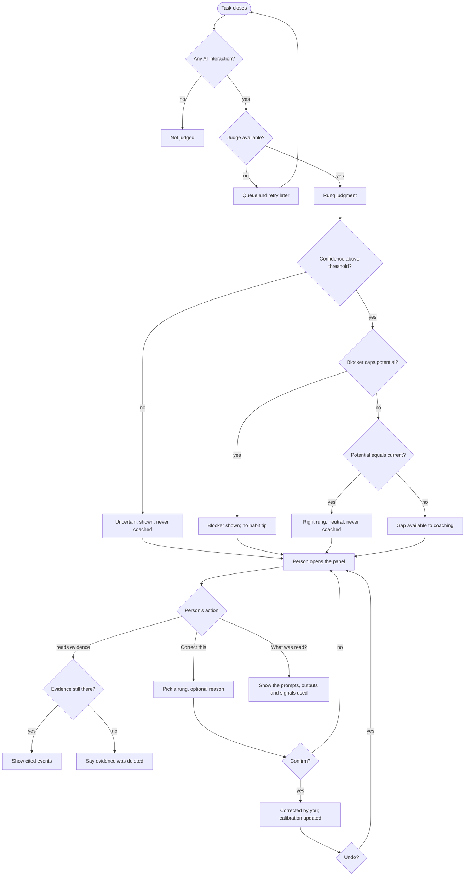

# Spec: Rung model (per-task maturity judgment)

Produced with AI-Forward `/specify` (v2026.10.19.4), run interactively with Imran.
Source of truth: AIQ brief and Design > Rung model tab (https://claude.ai/artifact/6PhqpuQvWMcU6xBD7rBbRw).
Sibling spec: `docs/specs/coaching-loop.md` (consumes this model's output for Opportunity 4).

## Decisions so far

| # | Decision | Source |
|---|---|---|
| R1 | A model-based judge first; rules or peer comparison may be added later for calibration | Imran, 2026-10-31 (recorded owner ruling) |
| R2 | Ladder: 1 Assisted, 2 Directed, 3 Delegated, 4 Orchestrated, 5 Factory. One ladder for everyone | Imran, 2026-10-31 (recorded owner ruling) |
| R3 | The unit of analysis is the **task**: one unit of intent, spanning prompts and surfaces | Design > Rung model tab |
| R4 | Potential is reported as the **next reachable rung**; the theoretical ceiling is a secondary field | Design > Rung model tab |
| R5 | The rubric is tuned **per job, not per role**. The ladder is shared; each job pack supplies its own rung examples and signal weights. This replaces the tab's "adjusted for each role" and "role-specific rubric emphasis" | Follows from coaching-loop D7 (Imran, 2026-10-31: "aligning to the jobs-to-be-done framework") |
| R6 | Only the person sees their judgments; model calls are on device or zero-retention | Imran, 2026-10-31 (privacy rule) |
| R7 | Evaluation uses a golden set of synthetic and volunteer-donated tasks labeled by experts, never users' private data | Design > Rung model tab |
| Q1 | Scope: the judge, its explanation and the person's correction. The rung distribution and opportunity views get their own spec | Imran, 2026-10-31 (decision card) |
| Q2 | The judge runs **on device only** and reads the task's prompts and outputs there, while the device keeps them. Nothing leaves the device. A cloud judge is not in this spec; it is added later, as its own decision, only if the on-device judge misses the US-7 bar | Proposed to Imran 2026-10-31 after he asked whether the judge needs the prompts and why two judges; **awaiting his confirmation** |
| Q3 | What a correction does | **Pending** (recommended: replaces the shown rung for that task, tunes the person's own calibration) |
| Q4 | Accuracy bar before the judge drives coaching | **Pending** (recommended: current rung ≥ 70% exact, ≥ 95% within one; potential ≥ 60% exact, ≥ 90% within one) |
| Q5 | Does weak context management cap a task at Directed? | **Pending** (recommended: a rubric signal, not a hard cap, until it can be detected reliably) |

## Part A — Functional specification

### Problem
AIQ's progress views and its "this task could be delegated" coaching both rest on one judgment: at
what rung was this task done, and what rung could it reach next? People don't know this about their
own work, and a usage count (prompts, agent runs) doesn't tell them. If the judgment is wrong,
unexplained or unfair, every view and tip built on it loses trust. So the judgment has to be
consistent, explained with the person's own evidence, fair to the job being done and the tools
available, and easy to correct.

### Target users & jobs-to-be-done
The same people as the coaching loop: anyone doing the alpha jobs **Code a change** or **Write a spec
or doc** on VS Code, Claude Code or Copilot CLI (coaching-loop D2, D6, D7).

Their job here: *"When I look back at my work, tell me honestly how I used AI on each task and the one
next step that would let an agent do more, without grading me or showing anyone else."*

Indirect consumers inside AIQ: the coaching loop (Opportunity 4, slow path) and the future views
(rung distribution, opportunity view).

### Core scenario
Priya fixes a flaky upload test. She asks Copilot Chat in VS Code what the test does, then gives
Claude Code three prompts and edits most of its diff by hand before running the tests herself. When
the task closes, AIQ judges it **Directed** (structured prompt with the failing output; output checked
before use) and its next reachable rung **Delegated**. The evidence says: "You gave the agent the
failing output, then made most of the edits yourself." The gap says: "Give the agent the acceptance
criteria and let it run the tests itself." The coaching loop can now offer that as a tip at the next
pause.

Priya thinks the task was really Delegated because the agent wrote the fix and she only renamed
variables. She corrects it. AIQ shows "Delegated (corrected by you)", records her reason, and the
next similar task is judged with her own calibration. Nobody else can see either judgment.

### In scope / Out of scope (explicit non-goals)
In scope (Q1):
- Judging each closed task: current rung, next reachable rung, ceiling, confidence, evidence, gap,
  blockers.
- The per-job rubric as pack data, and the placement rule.
- The person's correction of a judgment and their private calibration.
- The task judgment panel that shows one judgment and its correction controls.
- The evaluation regime: golden set, accuracy bar, consistency and gaming checks.

Out of scope:
- **Grouping events into tasks and classifying their job.** Defined in the coaching-loop domain model
  and being tested by the Phase 0 feasibility spike; this spec consumes "a closed task with a job or
  Unclassified".
- The rung distribution view and the opportunity view in AIQ home (own spec).
- The fast in-the-moment detectors (coaching-loop spec); they never wait for this model.
- Choosing the model, runtime or where it runs (`/define-architecture`).
- Any sharing, team or org view, or comparison with other people.
- Judging work on surfaces other than the three alpha ones.
- Rules-based or peer-based calibration (R1: later).

### Conceptual domain model (bounded context: Rung assessment)
Shares **Task**, **Job**, **Job pack** and **Environment blocker** with the Coaching context
(coaching-loop spec); the meaning is identical.

Ubiquitous language:
- **Rung**: one of the five ladder levels (R2). A value, compared by order.
- **Rubric**: per job pack, the observable signals that place a task on each rung, and the signals
  that rule a rung out. Versioned pack data.
- **Signal profile**: the structured facts extracted from one task on device (interaction shape,
  delegation, verification, reuse, task context, environment). Contains no raw prompt text.
- **Task content**: the task's prompts and AI outputs as kept on the device. The judge reads it on
  device while it is retained; it never leaves the device (Q2).
- **Rung judgment**: the judge's verdict on one task: current rung, potential rung, ceiling, a
  confidence for each, evidence, gap and blockers, stamped with the rubric and judge versions.
- **Current rung**: the highest rung whose rubric signals are clearly met. Mixed signals place the
  task on the lower rung.
- **Potential rung**: the next reachable rung, weighed on fit, readiness, availability and
  repetition. Equals the current rung when the task is already at its right rung or is capped.
- **Ceiling**: the highest rung the task type could reach in principle. Secondary, for the
  opportunity view.
- **Evidence item**: one plain-language statement tied to one or more of the person's own events.
- **Gap**: the one change that would move the task to its potential rung. What coaching uses.
- **Blocker**: an Environment blocker that caps potential (e.g. "no agent with repo access"). Reported
  as a cause, never as a low score.
- **Right rung**: potential equals current with no blocker. Shown neutrally and never coached.
- **Uncertain**: a judgment whose confidence is below the pack's threshold. Kept out of coaching.
- **Correction**: the person's statement that a judgment is wrong, with the rung they believe and an
  optional reason.
- **Calibration profile**: the person's private adjustments for one job, learned from their own
  corrections and feedback.
- **Golden task**: a synthetic or donated task trace with independent expert labels, used only for
  evaluation.

Entities: Rung judgment, Correction, Calibration profile, Golden task, Rubric (versioned).
Value objects: Rung, Signal profile, Task content, Evidence item, Gap, Blocker, Confidence.

Aggregates and the invariant each protects:
- **Rung judgment** (root: the judgment of one Task): potential is never below current and never more
  than one rung above it; every rung claim cites at least one evidence item. A re-judgment creates a
  new version and never edits an old one.
- **Task rating** (root: Task): once the person corrects a task, their correction is the rung shown
  for it, and no later re-judgment overrides it (pending Q3).
- **Calibration profile** (root: person × Job): changes only from that person's own corrections and
  feedback, and never leaves their device.
- **Golden set** (root: golden set version): every golden task has at least two independent expert
  labels, and a donated task is included only with its donor's explicit consent.

### User stories & acceptance criteria

**US-1 — As anyone working with AI, I want each task I finish judged against a clear rubric, so that I see how I actually worked rather than how much I used AI.**
- **Given** a closed task with at least one AI interaction **When** it closes **Then** a Rung judgment is produced within 60 s (p95) on the reference laptop, with current rung, potential rung, ceiling and a confidence for each.
- **Given** a closed task with no AI interaction **When** it closes **Then** no judgment is produced (there is no rung 0).
- **Given** a task meets every Delegated signal except "the person reviews the result rather than doing the steps" **When** judged **Then** it is placed on Directed, and the evidence names the unmet signal.
- **Given** a task classified *Code a change* **When** judged **Then** the Code a change rubric is used; **Given** an *Unclassified* task **Then** only the shared ladder definitions are used and the judgment's confidence is capped below the coaching threshold.
- **Given** the same task under the Developer and the PM preset **When** judged **Then** both judgments are identical (R5: the role never enters).

**US-2 — As anyone working with AI, I want the potential rung to be one realistic next step, so that I'm not pushed toward something I can't do yet.**
- **Given** a Directed task where fit, readiness and availability hold for Delegated and the ceiling is Factory **When** judged **Then** potential is Delegated and the ceiling is Factory.
- **Given** a task whose next rung needs a tool the person doesn't have (e.g. no agent with repo access) **When** judged **Then** potential equals current, a Blocker is recorded, the task is **not** marked Right rung, and no habit tip is generated from it.
- **Given** potential equals current and no Blocker **When** judged **Then** the task is Right rung and is never the subject of a tip.
- **Given** a task type the person did fewer than 3 times in the last 30 days **When** judged **Then** potential is never Factory (repetition rule; threshold is pack data).

**US-3 — As anyone working with AI, I want every judgment explained with my own activity, so that I can trust it or see where it's wrong.**
- **Given** any judgment **When** shown **Then** it has at least one evidence item per rung claim, each linked to the events it cites, and exactly one gap sentence when potential is above current.
- **Given** the person deleted the events an evidence item cites **When** the judgment is opened **Then** the item says the evidence was deleted; the rung stays and is marked "evidence removed".
- **Given** any judgment **When** rendered **Then** it never names the person's role or compares them with anyone.

**US-4 — As anyone working with AI, I want to correct a judgment I think is wrong, so that AIQ gets better for me.** (pending Q3)
- **Given** a judgment **When** the person picks a different rung and confirms **Then** that rung is shown for the task, labeled "corrected by you", and the model's judgment stays visible in the task's history.
- **Given** a corrected task **When** the rubric or judge version changes and the task is re-judged **Then** the correction still wins.
- **Given** 3 corrections in the same direction on one job's tasks within 30 days **When** the next task of that job is judged **Then** the calibration profile shifts that job's placement threshold one step in that direction, and the person can see and reset that adjustment.
- **Given** a correction **When** saved **Then** nothing about it leaves the device.

**US-5 — As anyone working with AI, I want the judge to understand what I asked for without my work ever leaving my machine.** (Q2)
- **Given** a closed task **When** it is judged **Then** the judge reads the Signal profile and the task content on device, and a network capture over a week shows no task content, signal or judgment leaving the device.
- **Given** a judgment **When** the person opens "What was read?" **Then** the panel lists exactly the prompts, outputs and signals the judge used.
- **Given** the task's content is past the device's raw-retention window **When** it is re-judged **Then** the judge uses signals only and the judgment says so.
- **Given** the person paused capture during part of a task **When** it is judged **Then** content from the paused period is never read, because it was never captured.

**US-6 — As anyone relying on AIQ's views and tips, I want low-confidence judgments kept out of coaching, so that a guess never drives a tip.**
- **Given** a judgment below the pack's confidence threshold **When** stored **Then** it is marked Uncertain, shown as "uncertain" wherever it appears, and never used by the coaching loop.
- **Given** the judge is unavailable (model missing, crash, timeout) **When** a task closes **Then** the task is queued and judged later, and the coaching loop treats it as "no rung estimate available" (coaching-loop scope note).

**US-7 — As the AIQ team, we want the judge held to a measured accuracy bar before it drives coaching, so that people get fair judgments from day one.** (pending Q4)
- **Given** the golden set for a job **When** the judge is evaluated **Then** current rung matches the adjudicated expert label on ≥ 70% of tasks and is within one rung on ≥ 95%; potential rung ≥ 60% exact and ≥ 90% within one.
- **Given** any golden task presented twice **When** judged **Then** the current rung is the same on ≥ 95% of tasks; **given** the task's prompts reworded with the same meaning **Then** ≥ 90%.
- **Given** the golden set's gaming cases (padded prompts, agent runs with no verification and no accepted output) **When** judged **Then** ≥ 90% are placed at the rung they would get without the padding.
- **Given** a job pack whose judge fails any bar above **When** a release is cut **Then** that job's judgments ship as Uncertain only and drive no coaching.

### Rubric and placement rule
The rubric is pack data per job (R5). The shared ladder below is the default; each job pack adds
examples and weights for its own work.

| Rung | Signals that a task was done here | Signals it was *not* |
|---|---|---|
| 1 Assisted | Short, ad hoc prompts or autocomplete; the person does the work and AI fills in pieces | Any structured context or delegation |
| 2 Directed | Structured prompt with goal, context and constraints; output checked before use | Re-prompting without adding context; output used unchecked |
| 3 Delegated | A whole task handed to an agent; the person reviews the result rather than doing the steps | The person makes most of the edits, or drives the agent step by step |
| 4 Orchestrated | Several agents or steps coordinated with a written spec, guardrails and automated checks or evals | Manual handoffs between steps; no automated verification |
| 5 Factory | A reusable, versioned workflow that runs again with little change, and others can trigger it | One-off setups that only this person runs |

Placement: the highest rung whose signals are clearly met; mixed signals place the lower rung, and the
evidence says why. Judge outcomes and verification, not activity (anti-gaming).

Context management (model and reasoning choice, lean context, durable facts in instructions files,
handling compaction) is a rubric signal at every rung above Assisted. Whether it is a hard cap at
Directed is pending Q5.

Alpha job examples (pack data, illustrative):
- **Code a change, Delegated:** "Fix the failing upload test" handed to Claude Code with the failing
  output and acceptance criteria; the agent edits and runs the tests; the person reviews the diff.
- **Write a spec or doc, Delegated:** an agent drafts the spec from a brief (audience, goal,
  constraints, sources); the person reviews and edits lightly rather than rewriting.

### Non-functional requirements (ISO/IEC 25010)
| Attribute | Requirement (measurable) |
|---|---|
| Functional suitability | US-7 accuracy, consistency and gaming bars per job, measured on each release |
| Performance efficiency | Judgment ≤ 60 s p95 after task close on the reference laptop; judging runs at low priority and keeps the core within the coaching-loop CPU and memory budgets when idle (to confirm in the Phase 0 spike) |
| Reliability | A judge failure never blocks a collector or the coaching fast path; unjudged tasks are queued and retried |
| Security | The judge has no network access; pack rubrics are data and cannot run code |
| Privacy | R6; the judge reads content on device only and nothing leaves it (Q2); corrections and calibration stay on device; full export and delete cover judgments |
| Usability | In a 5-person hallway test, ≥ 4 can say why a task got its rung from the panel alone |
| Accessibility | Panel keyboard-operable and screen-reader readable; rung never conveyed by colour alone |
| Compatibility | Same as coaching-loop spec |
| Maintainability | Rubric, thresholds, repetition rule and calibration step are pack data; every judgment records the rubric and judge versions |
| Portability | Judgment schema is the same on all surfaces and in AIQ home |

### Boundary set
A task with one prompt; a task with 10,000+ events; a task spanning two surfaces and a day boundary;
a task the person deletes after it was judged; a judge or rubric version upgrade mid-week (old
judgments keep their versions); a task with an agent run that produced nothing; a person with no
agent access at all; an Unclassified task; a correction on an Uncertain judgment; a task re-judged
after its content passed the retention window; a golden task whose two experts disagree by two or more rungs (adjudicate or drop).

### Evaluation regime
- **Golden set:** for alpha, at least 100 tasks per alpha job, mixing synthetic traces and tasks
  donated by volunteers with explicit consent. Each is labeled independently by two experienced
  practitioners against the rubric, with disagreements adjudicated. Inter-rater agreement is
  reported alongside the judge's score; the judge is not expected to beat the experts' own agreement.
- **Bars:** US-7 (pending Q4).
- **Local signal:** each person's correction rate is visible only to them and can trigger their own
  recalibration (US-4).
- **Dependency:** the golden set's first traces and the task-grouping and job-classification inputs
  come from the Phase 0 feasibility spike. This spec does not repeat that work.

### Comparables & user evidence
| Claim | Source | Confidence |
|---|---|---|
| LLM-as-judge with an explicit rubric agrees with human raters reasonably well on structured tasks, with known biases (position, verbosity) | Zheng et al. 2023, "Judging LLM-as-a-Judge" (MT-Bench) | Inferred (from memory, not re-checked) |
| Maturity models are usually assessed per organisation or team, not per task | CMMI; DORA capabilities | Flagged (from memory) |
| Labeled golden sets with inter-rater agreement are the standard for judging a classifier against experts | Common annotation practice (Cohen's kappa) | Inferred |
| People accept automated assessments more when they can see the evidence and correct it | HAX guidelines G11, G15 (Amershi et al. 2019) | Inferred |
| People want a per-task rung judgment | None yet | Flagged: validate in Phase 1 alpha |

### Applicable governance lenses
- [x] Quality attributes / NFRs: above
- [x] Threat model (STRIDE): applies (judge reads prompts and code on device). **Gap:** run in `/define-architecture`
- [x] Privacy & data governance: R6, US-5, golden-set donation consent
- [x] Accessibility: NFR row; Part C
- [x] Performance budget: NFR row; to confirm in the spike
- [x] Release / rollback: rubric and judge versions on every judgment; a failing job pack ships Uncertain-only (US-7)
- [x] Observability: local-only judge health, latency and correction rate; no remote telemetry

### AI-integrated allocation
- **Archetype:** advisory assessor. AIQ judges and explains; the person can always override.
- **Tier allocation:** stage 1 deterministic feature extraction on device; stage 2 model judge with the
  rubric (on device by default); stage 3 personal calibration from the person's own corrections.

## Part B — UX specification

### Personas & jobs-to-be-done
- **Priya, rung 1–2, doing Code a change:** "Show me why you think this task was Directed and what
  would make it Delegated." Success: she agrees with most judgments, and corrects the rest in seconds.
- **Dana, rung 2, doing Write a spec or doc:** "Don't judge my spec work by coding norms." Success:
  her doc tasks are judged against doc examples, never against "did the agent run the tests".
- **Marcus, rung 3, no agent with repo access at work:** "Don't tell me I'm low when the tool isn't
  allowed." Success: he sees a blocker, not a low potential.

### Information architecture
- **Task judgment panel:** Task title · Current rung (with confidence) · Next step (potential + gap) ·
  Why (evidence items) · Blockers · Correct this · History (model judgments and corrections).
- **Entry points:** a coaching card's Evidence link; a task row in AIQ home (views spec).
- **Settings > Rung model:** my calibration (view, reset per job).
- Labels for the glossary: *Rung, Current rung, Next step, Ceiling, Evidence, Blocker, Right rung,
  Uncertain, Correct this, Corrected by you, Calibration.*

### User flows

Recovery paths: a correction can be undone from History; calibration can be reset per job in
Settings.

### Wireframe-level structure
- **Panel (AIQ home, and a VS Code side panel when opened from a card):** header with task title and
  surfaces used; a two-column rung line "Done at: Directed → Next step: Delegated"; one gap sentence;
  an evidence list; a blocker note if any; footer with [Correct this] and "What was read?".
- **CLI:** `aiq task <id>` prints the same fields as plain text; `aiq correct <id> <rung>` corrects.

### UX acceptance criteria
- From a coaching card, the panel opens in 1 step.
- A correction takes ≤ 3 steps (open, pick rung, confirm) and can be undone in 1.
- Every branch of the flow ends in a shown state or a queued retry; none is a dead end.
- Uncertain, Right rung and Blocker states are each distinguishable in words, not only by colour.

## Part C — UI specification

### UI Archetype Signature
- **Archetype:** B1 · Keyboard-Velocity GUI (nearest row; the panel is a detail pane in a keyboard-first tool)
- **Signature deviations:** `Layout: DetailPane` (no master list in this spec), `Persistence: LocalOnly`, `Sync: LocalOnly`, `Color: HostTheme` (VS Code) / light and dark (AIQ home), `Feedback: Calm`.
- **Selection:** auto-selected from the JTBD. The job is "look at one task's judgment, understand it and correct it fast", which maps to B-series keyboard-first record detail (Linear issue view), not to A4 gamified progress: the tone is honest feedback, not grading.

### Medium(s) & platform guidelines
VS Code webview view guidelines; AIQ home desktop app (framework decided in `/define-architecture`);
terminal conventions for the CLI (plain text, respects `NO_COLOR`).

### Visual intent & tokens
Qualities: honest, specific, calm, correctable. Not: grading, celebratory, comparative, preachy.
Rungs use names first, numbers second ("Directed (2)"). Host theme tokens in VS Code; AIQ home tokens
come from `DESIGN.md`, to be produced in `/design-slice`.

### Key screens & component states
Task judgment panel: loading (judging), judged, uncertain, right rung, capped by blocker, corrected
by you, evidence removed, judge unavailable (queued), error. Correct-this control: closed, picking,
confirming, saved, undone.

### Motion, copy, accessibility & performance
- No motion beyond host defaults; nothing animates under reduced motion.
- Copy: second person, plain words, no scores beyond the rung name. Example gap: "Give the agent the
  acceptance criteria and let it run the tests itself." Example blocker: "Delegated needs an agent
  with repo access, which isn't available to you here."
- WCAG 2.2 AA; all controls keyboard-operable; the rung line is read as one sentence by screen
  readers.
- Panel renders ≤ 200 ms after open for a judged task.

### AI-UX
HAX G2 (make clear how well AIQ can judge: confidence and Uncertain), G11 (why: evidence), G9 (efficient
correction), G15 (granular feedback), G16 (convey consequences: what a correction changes).

### UI acceptance criteria
- No panel text compares the person with anyone or names their role.
- Uncertain, Right rung, capped and corrected states each carry a text label.
- All panel controls work by keyboard alone; CLI output is readable with `NO_COLOR=1`.

## Flagged risks & residual unknowns
- Grouping events into tasks and classifying jobs are unproven. Depends on the Phase 0 feasibility spike.
- Whether a small on-device model can meet the US-7 bar is unknown. Probe: run the judge on the first golden set in Phase 0 or early Phase 1.
- A small on-device model may miss the US-7 bar even with the prompts. Probe: run it on the first golden set; if it misses, decide then whether to add a cloud judge (Q2).
- Golden-set labels may disagree too much to be a benchmark. Probe: measure inter-rater agreement on the first 50 tasks.
- Task close detection (idle timeout vs artifact boundary) is not defined here; inherited from task grouping.
- Comparables are from memory (Flagged / Inferred). Probe: `/collectknowledge` on LLM-as-judge reliability.

## Gate record
Pending: the gate runs after the open questions are answered.

---
**Handoff:** → `/define-architecture` (judge runtime and placement), then `/design-slice`.
